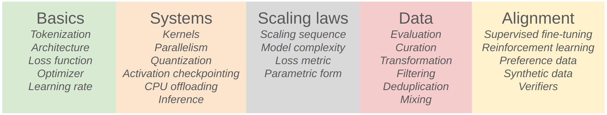

> [Stanford CS336, Spring 2025](https://stanford-cs336.github.io/spring2025/): Outline & Key points

## 01_Intro, Assignments, Tokenizer

### Intro

1. 即使所提供的计算资源不足以让我们在手搓的“大模型”上观察到真正的大模型的某些能力（涌现、顿悟……），我们依然开设这门课程，并尝试通过这门课程传授Mechanics（原理）、Mindset（思考方式）及Intuitions（直觉）.

2. 在生成式大语言模型被提出以前，构建和训练大模型的关键组件已被广泛研究，同时BERT等小型的Foundation model被提出.

3. Course logistics.

4. 课程结构
   

### Assignments

1. Basics
    - 实现BPE分词器.
    - 实现Transformer模型、交叉熵损失函数、AdamW优化器，以及训练循环.
    - 在TinyStories和OpenWebText数据集上进行训练.
    - 排行榜目标：在H100上限定90分钟内，最小化OpenWebText的困惑度（Perplexity）.

2. Systems
    - 通过Triton实现Fused RMSNorm kernel.
    - 实现数据并行的分布式训练.
    - 实现Optimizer state sharding.
    - 对这些实现进行基准测试和性能分析.

3. Scaling laws
    - 基于以往的运行结果，定义一个训练API（从超参数到Loss的映射）.
    - 在给定的FLOPs预算下提交Training jobs，并收集数据点.
    - 对这些数据点拟合Scaling law.
    - 提交放大后超参数的预测结果.
    - 排行榜目标：在固定FLOPs预算下最小化Loss.

4. Data
    - 将Common Crawl HTML转换为Text.
    - 训练分类器来过滤高质量内容和有害内容.
    - 使用MinHash进行Deduplication.
    - 排行榜目标：在给定Token预算下最小化Perplexity.

5. Alignment
    - 实现SFT.
    - 实现DPO.
    - 实现GRPO.

### Tokenizer

1. 分词本质是将一段文本转换为整数序列，一个整数即一个Token，整数范围即词典大小.

2. Character-based tokenization
    - 对于Unicode字符，对应码点即为分词结果.
    - 问题1：在字符级别进行分词，不可避免地都会导致非常大的词典规模（你必须至少为每个字符单独编码）.
    - 问题2：很多字符非常罕见，而这是一种对词典的低效利用.

3. Byte-based tokenization
    - 通过Unicode编码将字符序列表示为字节序列.
    - 问题：压缩比（每个Token平均表示的字节数）为1，带来长序列问题.

4. Word-based tokenization
    - 在训练数据上通过正则、统计方法或概率模型Fit出一个分词器.
    - 问题：这个分词器大概率不完备，需要引入\<UNK> token.

5. Byte Pair Encoding (BPE)
    - 通过Unicode编码将字符序列表示为字节序列，然后进行字节对合并.
    - > Talk is Cheap. Show me the code.
      ``` python
      from collections import defaultdict


      class BPETokenizer:
          def __init__(self, vocab: dict[int, bytes], merges: dict[tuple[int, int], int]):
              self.vocab = vocab
              self.merges = merges

          def encode(self, string: str) -> list[int]:
              """根据 merges 进行编码"""
              tokens = list(map(int, string.encode("utf-8")))

              while True:
                  temp_tokens = []
                  do_merge = False
                  i = 0
                  while i < len(tokens):
                      if i < len(tokens) - 1 and (tokens[i], tokens[i + 1]) in self.merges:
                          do_merge = True
                          temp_tokens.append(self.merges[(tokens[i], tokens[i + 1])])
                          i += 1
                      else:
                          temp_tokens.append(tokens[i])
                      i += 1
                  if not do_merge:
                      break
                  tokens = temp_tokens

              return tokens

          def decode(self, tokens: list[int]) -> str:
              """根据 vocab 进行解码"""
              bytes_seq = b"".join([self.vocab[token] for token in tokens])
              return bytes_seq.decode("utf-8")


      def train_bpe(string: str, num_merges: int) -> BPETokenizer:
          vocab: dict[int, bytes] = {x: bytes([x]) for x in range(256)}
          merges: dict[tuple[int, int], int] = {}

          tokens = list(map(int, string.encode("utf-8")))

          for _ in range(num_merges):
              counts = defaultdict(int)  # 创建一个默认值为 0 的整数字典
              for token_1, token_2 in zip(tokens, tokens[1:]):
                  counts[(token_1, token_2)] += 1
              if not counts:
                  break

              pair = max(counts, key=counts.get)
              token_1, token_2 = pair
              new_token = len(vocab)
              vocab[new_token] = vocab[token_1] + vocab[token_2]
              merges[pair] = new_token

              temp_tokens = []
              i = 0
              while i < len(tokens):
                  if i < len(tokens) - 1 and (tokens[i], tokens[i + 1]) == pair:
                      temp_tokens.append(new_token)
                      i += 1
                  else:
                      temp_tokens.append(tokens[i])
                  i += 1
              tokens = temp_tokens

          return BPETokenizer(vocab=vocab, merges=merges)


      tokenizer = train_bpe(string="the cat in the hat", num_merges=3)

      string = "the quick brown fox"
      tokens = tokenizer.encode(string)
      reconstructed_string = tokenizer.decode(tokens)
      assert string == reconstructed_string

      print(len(tokenizer.vocab), "tokens in vocab")
      print("String:", string)
      print("Tokens:", tokens)
      ```