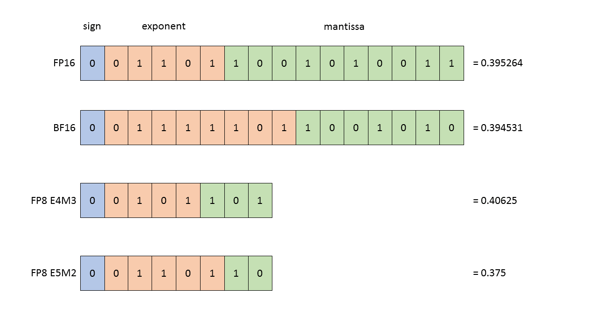
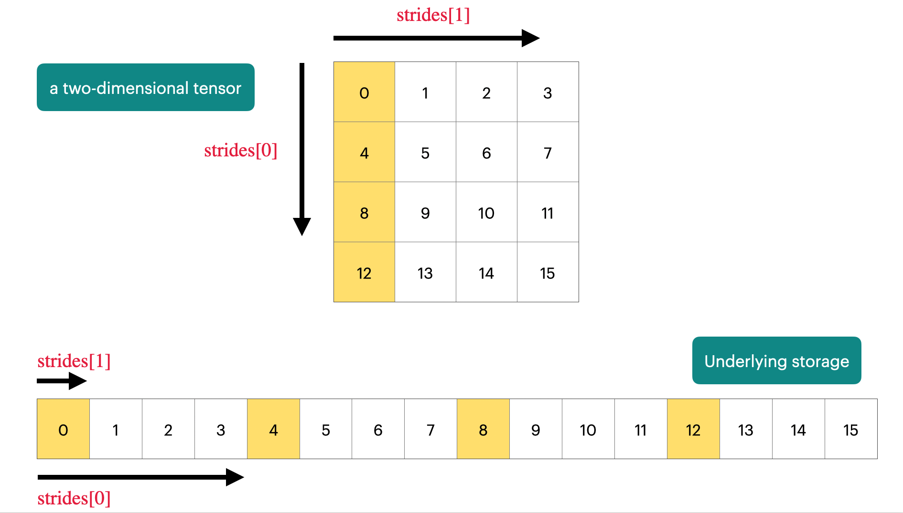
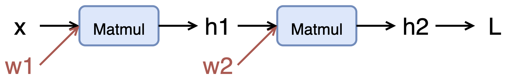

> [Stanford CS336, Spring 2025](https://stanford-cs336.github.io/spring2025/): Outline & Key points

## 02_Tensor theory, Resource accounting, Practical advice

### Napkin math

1. 1024 H100集群，15T tokens，训练一个70B模型，需要多少天？
   > $\mathrm{FLOPs} = 6 * 70\mathrm{e}9 * 15\mathrm{e}12$
   > 
   > $\mathrm{We\ know\ that:\ H100\ FLOPS\ can\ be\ }1979\mathrm{e}12 / 2$
   > 
   > $\mathrm{We\ assume\ that:\ }\mathrm{MFU} = 0.5$
   > 
   > $\mathrm{FLOPs\ per\ day} = \mathrm{FLOPS} * \mathrm{MFU} * 1024 * 60 * 60 * 24$
   > 
   > $\mathrm{days} = \mathrm{FLOPs} / \mathrm{FLOPs\ per\ day}$

2. 8 H100集群，使用Adam优化器，能训练多大模型？（Naively）
   > $\mathrm{bytes\ per\ parameter} = 4 + 4 + (4 + 4)$
   > 
   > $\mathrm{We\ know\ that:\ H100\ memory\ can\ be\ }80\mathrm{e}9$
   > 
   > $\mathrm{num\ of\ parameters} = (8 * \mathrm{memory}) / \mathrm{bytes\ per\ parameter}$
    - 对每个参数，需要缓存参数值、梯度值、优化器状态，这里不考虑激活值（激活值显存占用依赖batch_size和seq_len）.
    - 以上计算考虑使用FP32进行训练，如果采用混合精度训练，则动态的参数值和梯度值分别占2字节，同时维护4字节的参数值，显存占用不变，速度变快.

### Memory accounting

> More: [Transformer Memory Arithmetic: Understanding all the Bytes in nanoGPT](https://erees.dev/transformer-memory)

1. 数据精度
    - FP32 (4 bytes)
      
    - FP16 (2 bytes)
      
    - BF16 (2 bytes)
      
        - 指数位更多，尾数位更少.
        - 表示范围变大，分辨率变差.
        - 更适合深度学习计算.
    - FP8 (1 bytes)
      

2. 使用Adam优化器进行模型训练，显存占用情况：
   | 阶段 | 参数值 θ | 梯度值 g | 一阶矩 m | 二阶矩 v | 激活值 | 激活值梯度 |
   |----|----|----|----|----|----|----|
   | Forward | ✅ | ❌ | ✅ | ✅ | ✅ | ❌ |
   | Backward | ✅ | ✅ | ✅ | ✅ | ✅ | ✅ |
   | Adam 更新 | ✅ | ✅ | ✅ | ✅ | ❌ | ❌ |
   | 清空梯度后 | ✅ | ❌ | ✅ | ✅ | ❌ | ❌ |

### Tensor theory

1. 我们所定义的Tensor包含指向连续空间的指针和规定读取方式的Metadata.
   

2. 注意区分Tensor深复制和浅复制.
   ``` python
   x = torch.tensor([[1., 2, 3], [4, 5, 6]])

   # Get row 0
   y = x[0]
   assert torch.equal(y, torch.tensor([1., 2, 3]))
   assert same_storage(x, y)

   # Get column 1
   y = x[:, 1]
   assert torch.equal(y, torch.tensor([2, 5]))
   assert same_storage(x, y)

   # View 2x3 matrix as 3x2 matrix
   y = x.view(3, 2)
   assert torch.equal(y, torch.tensor([[1, 2], [3, 4], [5, 6]]))
   assert same_storage(x, y)

   # Transpose the matrix
   y = x.transpose(1, 0)
   assert torch.equal(y, torch.tensor([[1, 4], [2, 5], [3, 6]]))
   assert same_storage(x, y)

   # Check that mutating x also mutates y
   x[0][0] = 100
   assert y[0][0] == 100

   # 注意非连续 Tensor 无法执行 view 操作
   x = torch.tensor([[1., 2, 3], [4, 5, 6]])
   y = x.transpose(1, 0)
   assert not y.is_contiguous()
   try:
       y.view(2, 3)
       assert False
   except RuntimeError as e:
       assert "view size is not compatible with input tensor's size and stride" in str(e)

   # 先进行深复制，再执行 view 操作
   y = x.transpose(1, 0).contiguous().view(2, 3)
   assert not same_storage(x, y)
   ```

3. 积累常用的Tensor创建、GPU相关、Matmul、Elementwise、Reduce、元素重排操作.
    - 广播规则
      > 假设两个张量 A 和 B，它们的形状分别是：`A.shape = (a1, a2, ..., an)` 和 `B.shape = (b1, b2, ..., bm)`
      > 
      > 1. 对齐维度
      >     - 从最后一维开始对齐（右对齐）
      >     - 不足的维度用 1 补齐
      > 2. 逐维比较，对齐后的每一维 d：
      >     - 如果 `A.shape[d] == B.shape[d]` → 保持
      >     - 如果 `A.shape[d] == 1` → A 在该维度广播
      >     - 如果 `B.shape[d] == 1` → B 在该维度广播
      >     - 如果都不等且都不为 1 → ❌ 报错
      > 3. 输出形状
      >     - 每一维的长度 = max(A.shape[d], B.shape[d])
    - 张量矩乘规则
      > 1. 最后两维总是做标准矩阵乘法：`m×k @ k×n → m×n`
      > 2. 前面所有维度做广播：
      >     - 如果 A 和 B 的前面维度不一样，但可以通过广播规则对齐，则广播后再做矩阵乘
      >     - 输出 shape = broadcasted_prefix + (m, n)

4. 维度操作语言Einops
   ``` python
   import torch
   import torch.nn as nn
   import einops
   from jaxtyping import Float


   # jaxtyping
   x = torch.ones(2, 2, 1, 3)
   x: Float[torch.Tensor, "batch seq head hidden"] = torch.ones(2, 2, 1, 3)

   # einsum
   x: Float[torch.Tensor, "batch seq1 hidden"] = torch.ones(2, 3, 4)
   y: Float[torch.Tensor, "batch seq2 hidden"] = torch.ones(2, 3, 4)
   # old way
   z = x @ y.transpose(-1, -2)
   # new way
   z = einops.einsum(x, y, "batch seq1 hidden, batch seq2 hidden -> batch seq1 seq2")
   # or
   z = einops.einsum(x, y, "... seq1 hidden, ... seq2 hidden -> ... seq1 seq2")

   # reduce
   x: Float[torch.Tensor, "batch seq hidden"] = torch.ones(2, 3, 4)
   # old way
   y = x.mean(dim=-1)
   # new way
   y = einops.reduce(x, "... hidden -> ...", "mean")

   # rearrange
   x: Float[torch.Tensor, "batch seq total_hidden"] = torch.ones(2, 3, 8)
   w: Float[torch.Tensor, "hidden1 hidden2"] = torch.ones(4, 4)
   x = einops.rearrange(x, "... (heads hidden1) -> ... heads hidden1", heads=2)
   x = einops.einsum(x, w, "... hidden1, hidden1 hidden2 -> ... hidden2")
   x = einops.rearrange(x, "... heads hidden2 -> ... (heads hidden2)")
   ```

### Compute accounting

> More: [Transformer FLOPs](https://www.adamcasson.com/posts/transformer-flops)

1. 一次浮点数加法或乘法即一个浮点数操作（FLOP），模型计算量单位为FLOPs，硬件计算性能单位为FLOPS（每秒可以执行浮点数操作的次数）.

2. 基本Tensor操作的FLOPs：
    - 一次线性变换（假设一个`B x D`矩阵x和一个`D x K`矩阵w进行矩阵乘法）FLOPs为`2 * B * D * K`，可以解释为对每个`(i, j, k)`都需要一次`x[i][j] * w[j][k]`的浮点数乘法和一次浮点数加法.
    - 一个`m x n`矩阵一次Elementwise操作FLOPs为`O(mn)`.
    - 矩阵乘法占计算量的主要部分，因此，模型前向传播的FLOPs近似为矩阵乘法的FLOPs.

3. `2 * B * D * K`的结论可以推广到Transformer和LLM，因此，一次前向传播FLOPs为`2 * (#tokens) * (#parameters)`.

4. 引入MFU（Model FLOPs utilization）的概念：
    - $\mathrm{MFU} = \mathrm{actual\ FLOPS} / \mathrm{promised\ FLOPS}$.
    - FLOPS取决于硬件和数据类型（精度）.

5. 理解反向传播和计算图.
    - 在反向传播中，每个张量的梯度的形状总是与该张量本身的形状完全一致.

6. 在反向传播中，矩阵乘法同样占计算量的主要部分，以这个简单模型为例：
   
    - 假设x形状为`B x D`，w1形状为`D x D`，w2形状为`D x K`.
    - `w2.grad[j, k] = sum_i h1[i, j] * h2.grad[i, k]`，计算w2的梯度FLOPs为`2 * B * D * K`.
    - `h1.grad[i, j] = sum_k w2[j, k] * h2.grad[i, k]`，计算h1的梯度FLOPs为`2 * B * D * K`.
    - 因此，对第2个矩乘做反向传播需要的FLOPs为`4 * B * D * K`，对第1个矩乘做反向传播同理为`4 * B * D * D`（尽管不需要输入的梯度）.
    - 推广到LLM，一次反向传播FLOPs为`4 * (#tokens) * (#parameters)`，因此，训练所需FLOPs为`6 * (#tokens) * (#parameters)`（预训练一般只进行1轮）.

### Practical advice

1. Parameter initialization
    - Xavier初始化：为了保证训练稳定性（避免梯度爆炸和梯度消失），我们希望模型各层激活值的方差和模型输入保持一致，经过推导，可以得到模型线性变换参数标准差应为输入维度的倒数开方.
      ``` python
      w = nn.Parameter(torch.randn(input_dim, output_dim) / np.sqrt(input_dim))
      ```
    - Attention操作中除以$\sqrt{d_{k}}$一定程度上和这里的原理相同.

2. Note about randomness
    - 参数初始化、数据集处理、Dropout等过程都会引入随机性，在调试代码时，建议设置随机种子.
      ``` python
      # Torch
      import torch
      seed = 0
      torch.manual_seed(seed)

      # NumPy
      import numpy as np
      np.random.seed(seed)

      # Python
      import random
      random.seed(seed)
      ```

3. Data loading
    - `memmap` + `pin_memory` + `non_blocking=True`
    - This allows us to do two things in parallel:
        - Fetch the next batch of data into CPU.
        - Process x on the GPU.

4. Checkpointing
    - 训练过程中，定期保存（且只需保存）模型参数和优化器状态.

5. Mixed precision training
    - 前向传播过程使用BF16或FP8（For activations），其他过程使用FP32（For parameters, gradients, optimizer states）.