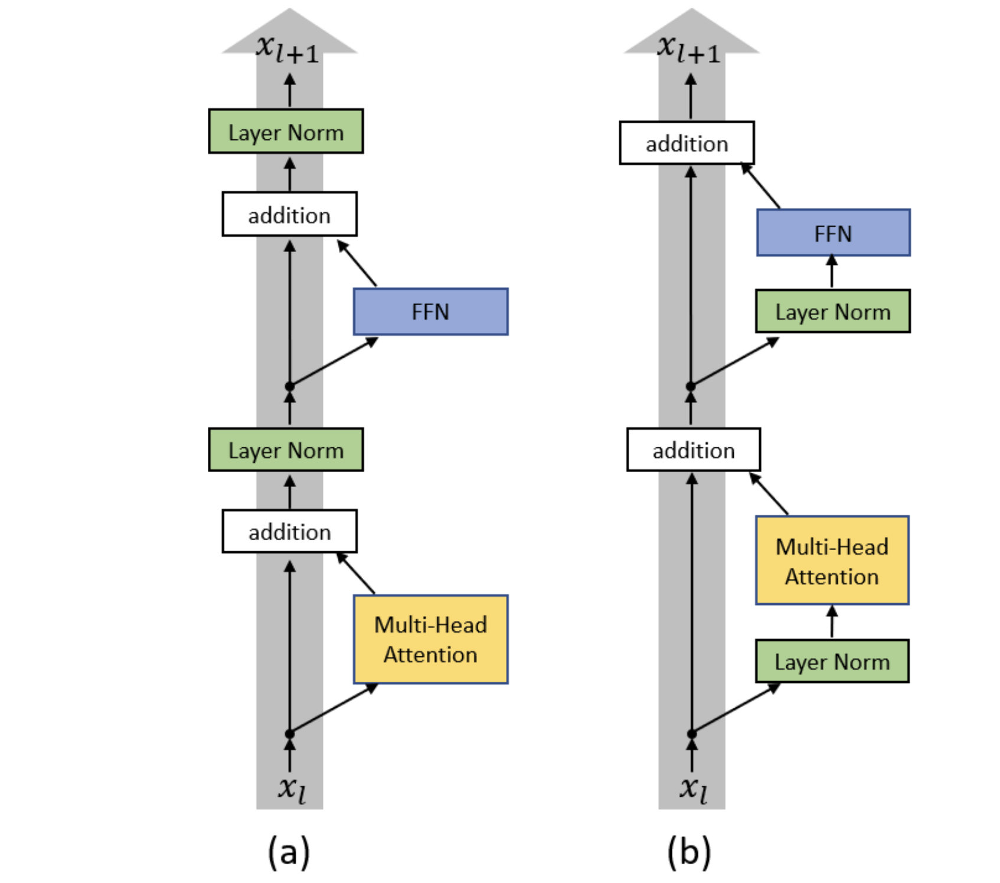
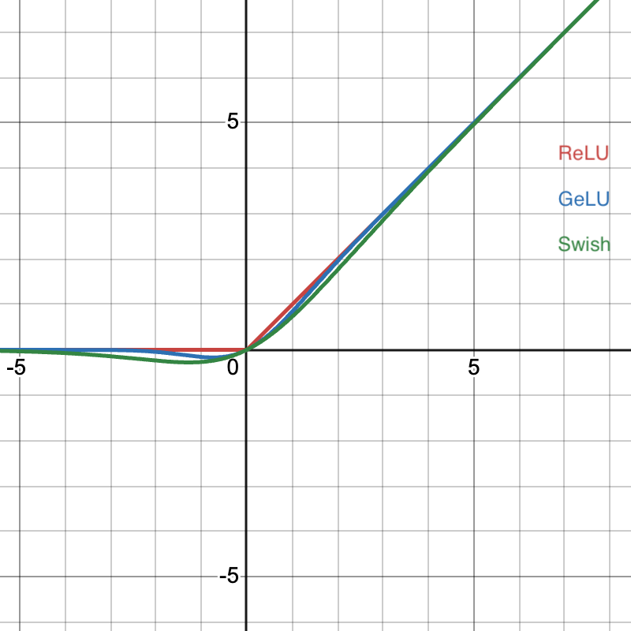
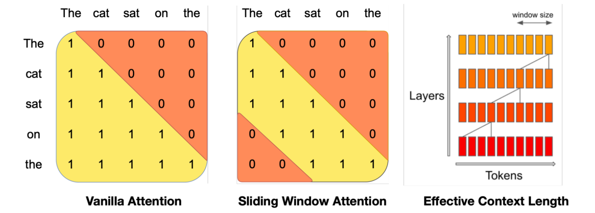
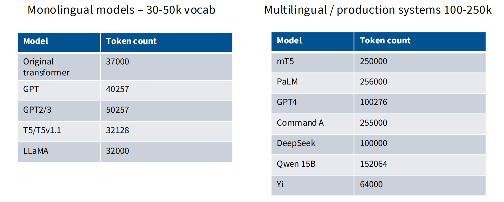
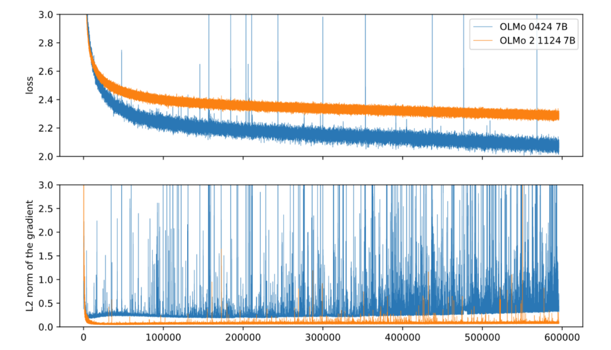
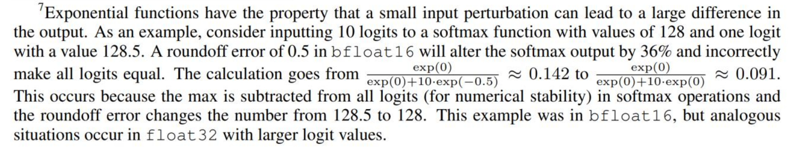

> [Stanford CS336, Spring 2025](https://stanford-cs336.github.io/spring2025/): Outline & Key points

## 03_Architecture, Training

### Vanilla transformer


1. 使用Post-norm & LayerNorm.

2. 使用ReLU.

3. 使用正余弦位置编码.

### Architecture

1. Normalization位置
   
    - 绝大部分LLM采用Pre-norm（以及最后输出头之前的Normalization），维护通畅的残差信号路径.
    - Pre-norm保留了恒等梯度路径，使得梯度流动更稳定，因此能支撑大规模网络的稳定训练，并允许使用更大的学习率.
    - 所以有人提出Double-norm、Non-residual post-norm.

2. LayerNorm还是RMSNorm
    - LayerNorm
      $$y = \frac{x - \mathrm{E}[x]}{\sqrt{\mathrm{Var}[x] + \epsilon}} * \gamma + \beta$$
    - RMSNorm
      $$y = \frac{x}{\sqrt{\|x\|^{2}_{2} + \epsilon}} * \gamma$$
    - 性能接近，但绝大部分LLM采用RMSNorm.
    - 尽管RMSNorm相较LayerNorm带来更小的显存占以及更少的FLOPs，但是这些提升基本可以忽略（Matmul matters），更重要的是，RMSNorm通过减少显存和计算单元之间的数据传输，有效减少Runtime.

3. 偏置可弃
    - For FLOPs, memory (though negligible) and optimization stability.

4. LU和GLU
   
    - ReLU
      $$FF(x) = \max(0, xW_{1})W_{2}$$
    - ReGLU
      $$FF(x) = (\max(0, xW_{1})\otimes xV)W_{2}$$
    - GeLU
      $$FF(x) = \mathrm{GeLU}(xW_{1})W_{2}$$
      $$\mathrm{GeLU} := x\Phi(x)$$
      $$\Phi(x):\mathrm{\ CDF\ of\ N}(0, 1)$$
    - GeGLU
      $$FF(x) = (\mathrm{GeLU}(xW_{1})\otimes xV)W_{2}$$
    - Swish
      $$FF(x) = \mathrm{Swish}(xW_{1})W_{2}$$
      $$\mathrm{Swish} := x\sigma(x)$$
    - SwiGLU
      $$FF(x) = (\mathrm{Swish}(xW_{1})\otimes xV)W_{2}$$
    - 门控线性单元（GLU）被实验证明能够提升模型性能，通过一个线性变换分支提供门控信号，增强模型表达能力.
    - 为了保持总参数量不变，使用GLU的Feedforward层其Feedforward-dim为原来的2/3.

5. Parallel layers
    - Serial layers
      $$y = x + \mathrm{MLP}(\mathrm{Norm}(x + \mathrm{Attention}(\mathrm{Norm}(x))))$$
    - Parallen layers
      $$y = x + \mathrm{MLP}(\mathrm{Norm}(x)) + \mathrm{Attention}(\mathrm{Norm}(x))$$
    - 并行化越好，GPU效率越高，如果采用Parallel layers架构，Attention层和FF层的Normalization和Matmul可以融合.

6. RoPE
    - 正余弦位置编码：在Embedding的不同维度对上使用不同频率的正弦和余弦函数，使得序列位置在这些函数所张成的二维平面上形成沿圆周变化的相位表示.
      $$\mathrm{PE}(pos, 2i) = \sin{\frac{pos}{10000^{\frac{2i}{d_{model}}}}}$$
      $$\mathrm{PE}(pos, 2i + 1) = \cos{\frac{pos}{10000^{\frac{2i}{d_{model}}}}}$$
      $$\mathrm{Embed}(x, i) = \mathrm{TokenEmbed}(x) + \mathrm{PE}_{i}$$
    - 绝对位置编码：可学习.
      $$\mathrm{Embed}(x, i) = \mathrm{TokenEmbed}(x) + \mathrm{PosEmbed}(i)$$
    - 相对位置编码：可学习，作用在Attention层.
      $$e_{ij} = \frac{x_{i}W^{Q}W^{K\top}x_{j}^{\top} + r_{i - j}}{\sqrt{d_{k}}}$$
    - RoPE
        - Preliminary
          $$
          R(\theta) =
          \begin{bmatrix}
          \cos\theta & -\sin\theta \\
          \sin\theta & \cos\theta
          \end{bmatrix}
          $$
          这个变换表示在二维平面上将向量(x, y)绕原点(0, 0)按逆时针方向旋转角度θ，长度保持不变.
        - 公式
          $$
          R(i; \theta_{1}, \theta_{2}, ..., \theta_{d / 2}) =
          \begin{bmatrix}
          \cos i\theta_{1} & -\sin i\theta_{1} & 0 & 0 & ... & 0 & 0 \\
          \sin i\theta_{1} & \cos i\theta_{1} & 0 & 0 & ... & 0 & 0 \\
          0 & 0 & \cos i\theta_{2} & -\sin i\theta_{2} & ... & 0 & 0 \\
          0 & 0 & \sin i\theta_{2} & \cos i\theta_{2} & ... & 0 & 0 \\
          ... & ... & ... & ... & ... & ... & ... \\
          0 & 0 & 0 & 0 & ... & \cos i\theta_{d / 2} & -\sin i\theta_{d / 2} \\
          0 & 0 & 0 & 0 & ... & \sin i\theta_{d / 2} & \cos i\theta_{d / 2}
          \end{bmatrix}
          $$
          $$e_{ij} = \frac{x_{i}W^{Q}R(i)(x_{j}W^{K}R(j))^{\top}}{\sqrt{d_{k}}} = \frac{x_{i}W^{Q}\overbrace{R(i)R(j)^{\top}}^{R_{i - j}}W^{K\top}x_{j}^{\top}}{\sqrt{d_{k}}}$$
          满足$f(x, i)\odot f(y, j) = g(x, y, i - j)$.
        - 模型训练和推理时，仍然是计算点积（而不将上式展开），推理时KV cache中的K带位置信息.

7. MQA / GQA
    - 动机：减少推理时的KV cache存储和内存带宽压力，权衡推理效率和模型性能.
    - Preliminary：Attention维度变化分析.
        - 假设：B(batch-size), N(seq-len), D(model-dim), h(num-heads), d(head-dim)
        - Input $x$: (B, N, D)
        - Parameters $W^{Q}, W^{K}, W^{V}, W^{O}$: (D, h * d)
        - $Q, K, V$: (B, N, h * d) -> (B, N, h, d) -> (B, h, N, d)
        - $Q \cdot K^{\top}$: (B, h, N, N)
        - $\mathrm{softmax}\left(\frac{Q \cdot K^{\top}}{\sqrt{d}}\right) \cdot V$: (B, h, N, d) -> (B, N, h * d)
        - output: (B, N, D)
    - 训练时MACs（Multiply-ACcumulate次数）：
      $$3BND^{2} + BN^{2}D + BN^{2}D + BND^{2} = 4BND^{2} + 2BN^{2}D$$
    - 推理时MACs：
      $$4BND^{2} + 2B(1 * \sum\limits_{n=1}^{N}n)D \approx 4BND^{2} + BN^{2}D$$
    - 训练时访存：
      $$O(\overbrace{BND}^{activations} + \overbrace{D^{2}}^{parameters}+ \overbrace{BhN^{2}}^{softmax})$$
    - 推理时访存：
      $$O(\overbrace{BN^{2}D}^{activations} + \overbrace{ND^{2}}^{parameters})$$
    - 引入MQA，推理时访存：
      $$O(\overbrace{BN^{2}d}^{activations} + \overbrace{ND^{2}}^{parameters})$$
    - 计算强度（Arithmetic intensity）等于总计算量除以总访存量，其临界值为峰值算力除以显存带宽（反映硬件能力），高于临界值说明算力为瓶颈（假设计算量打满，带宽还有余），低于临界值说明带宽为瓶颈（假设访存量打满，算力还有余）.
    - MQA一定程度上减少了推理时的内存带宽压力（但不多）.
      ``` python
      # LLAMA 13B
      B = 8
      N = 2048
      D = 5120
      h = 40
      d = D // h

      train_flops = B * N * D * D + B * N * N * D
      infer_flops = B * N * D * D + B * N * N * D
      train_bytes = B * N * D + D * D + B * h * N * N
      infer_bytes = B * N * N * D + N * D * D

      train_AI = train_flops / train_bytes
      infer_AI = infer_flops / infer_bytes
      print(f"Train AI: {train_AI:.2f} FLOPs/Byte")  # 414.04
      print(f"Infer AI: {infer_AI:.2f} FLOPs/Byte")  # 2.67

      # 引入MQA
      infer_bytes = B * N * N * d + N * D * D
      infer_AI = infer_flops / infer_bytes
      print(f"Infer AI with MQA: {infer_AI:.2f} FLOPs/Byte")  # 10.37

      # Large batch size when inferencing
      B = 128
      infer_flops = B * N * D * D + B * N * N * D
      infer_bytes = B * N * N * d + N * D * D
      infer_AI = infer_flops / infer_bytes
      print(f"Infer AI with MQA: {infer_AI:.2f} FLOPs/Byte")  # 78.60
      ```

8. Sparse attention (Especially, sliding window attention)
   
    - 动机：Attention平方复杂度的背景下，对长序列权衡计算代价和模型性能.
    - SWA：让模型深度来扩展有效上下文.
    - 更新的做法：在模型各层交叉使用Full attention和Sparse attention.
      > Cohere Command A
      > 
      > - Interleave 3 SWA blocks and 1 FA block.
      > - SWA with RoPE, FA without PE.

### Training: hyperparameters (Very empirical and isn't written in stone)

1. Feedforward-dim to model-dim ratio
   $$d_{ff} = 4d_{model}$$
   $$\mathrm{Especially\ with\ GLU:\ }d_{ff} = \frac{8}{3}d_{model} = 2.66d_{model}$$

2. Head-dim * num-heads to model-dim ratio
   $$d_{head} * n_{head} = d_{model}$$

3. Model-dim to num-layers ratio (Aspect ratio)
    - 约为100.
    - 从并行化的角度考虑，更宽的模型比更深的模型对流水线并行更友好.
    - Residual解决了梯度问题，但大模型时代硬件和并行约束变得更关键，因此宽比深更优.
    - 深度依然存在（100–200比例已经算深了），但不会无限追求堆层.

4. 词典大小
   

5. 需不需要正则
    - 预训练一般只进行1个Epoch，基本不存在过拟合问题.
    - 但是一些模型仍然保留Weight decay策略，有研究说明Weight decay和LR衰减相互作用可以带来更好的Training loss下降.

### Training: stability

1. 什么是“训练稳定性”
   
   Don’t train models that look like the blue curve!
    - 指标1：Loss.
    - 指标2：梯度范数.
    - 训练稳定性的核心是激活值尺度和参数尺度，问题常常出在Softmax：CE损失没有约束Logits尺度导致Softmax中的指数操作出现上溢或下溢，进而影响训练稳定性.
      

2. For output softmax: Z-loss
   $$L_{total} = L_{CE} + L_{Z} = -\log\frac{e^{z_{y}}}{\sum_{j}e^{z_{j}}} + \alpha\left(\log\sum_{j}e^{z_{j}}\right)^{2}$$
    - 当$\sum_{j}e^{z_{j}} = 1$时最优.

3. For attention softmaxes: Normalization always works
    - 经典的$\sqrt{d_{k}}$.
    - 更新的做法：线性变换得到Q和K之后先进行Normalization.
    - 其他做法：通过Tanh对Logits进行软上限处理，使其不超过某个最大值.
      $$\mathrm{logits} ← \mathrm{softcap} * \tanh(\mathrm{logits} / \mathrm{softcap})$$