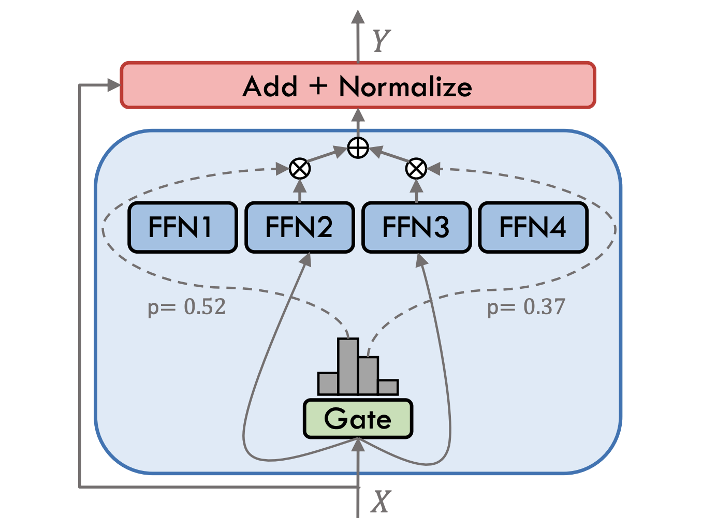
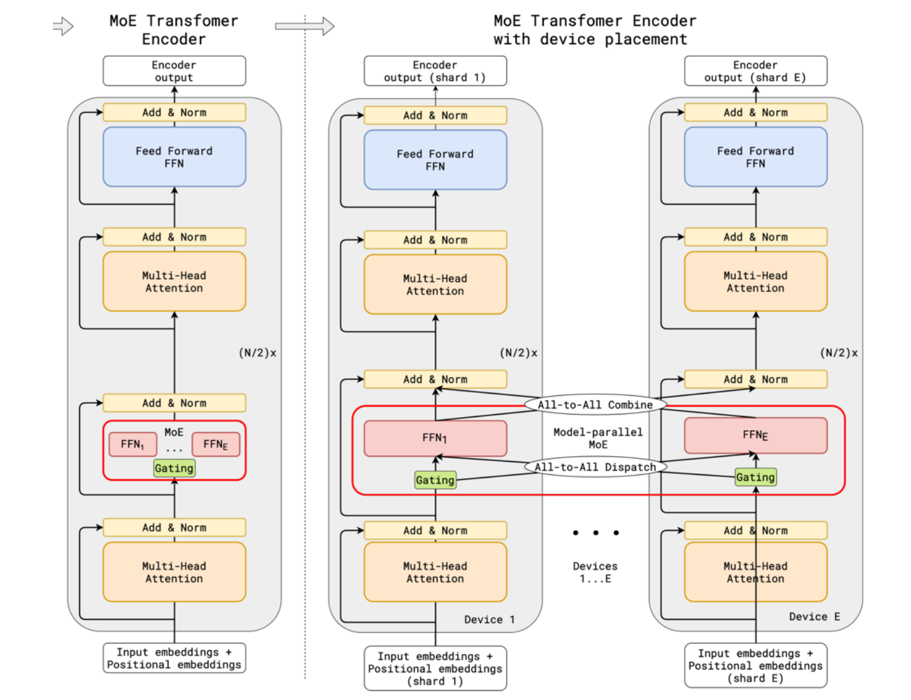
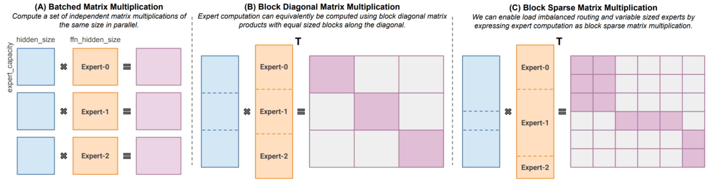
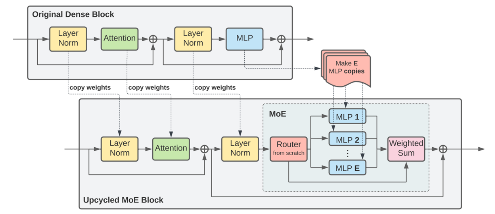
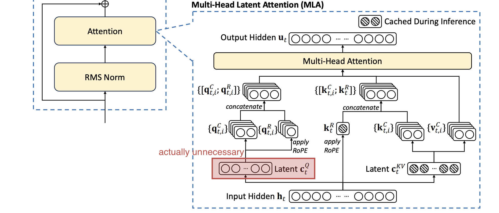
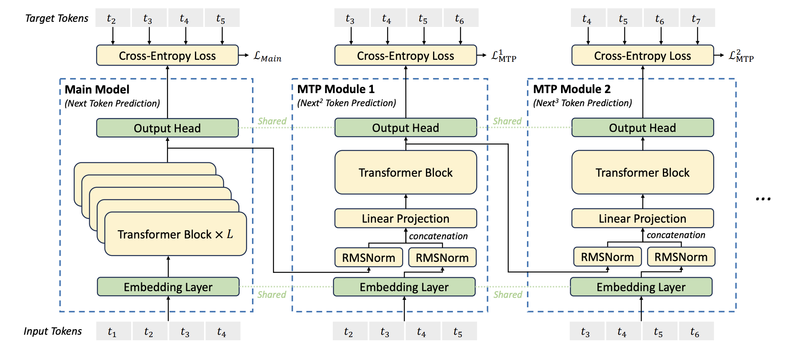
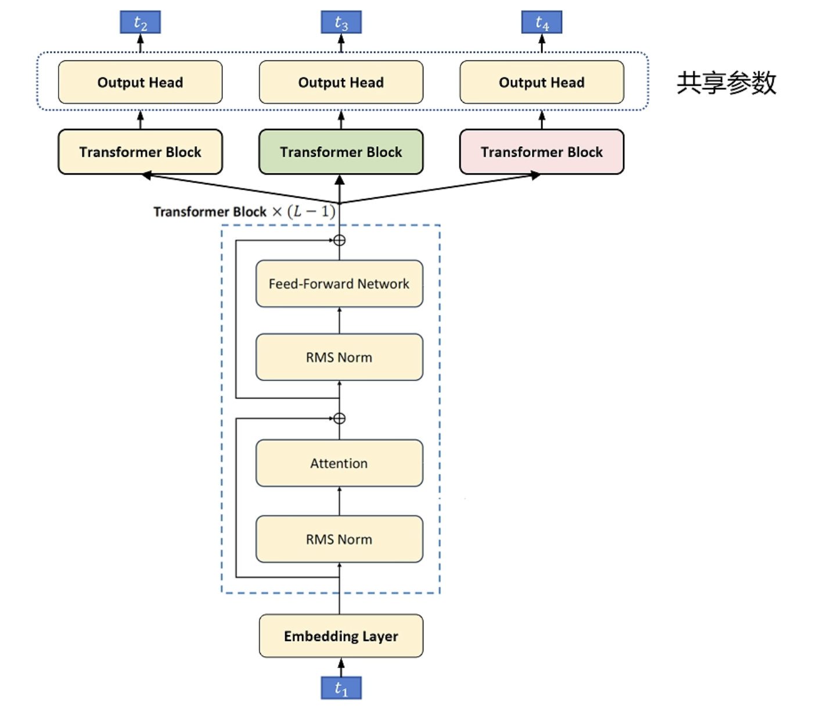

> [Stanford CS336, Spring 2025](https://stanford-cs336.github.io/spring2025/): Outline & Key points

## 04_MoE, Deepseek stuff

### MoE

1. 概括MoE：将大型FFN层替换为多个大型FFN层，并加入一个路由层，实现在不增加FLOPs的情况下增加模型参数提高模型性能.
    - Advantages:
        - Same FLOPs, more parameters does better.
        - Faster to train.
        - Easy to parallelize to many devices.
    - Challenges:
        - Infrastructure is complex.
        - Training objectives are somewhat heuristic.

2. 研究主题1：路由层设计.
    - 路由算法收敛到Choose top-k.
        - 可能的选择有Top-k, Hashing(usually treated as baseline), RL, Linear assignment.
    - 从另一个角度看收敛到Token choose top-k expert.
        - 可能的选择有Token choose expert, Expert choose token, Global routing.
    - 公式
      
      $$x = x + \sum\limits_{i = 1}^{N}(\overbrace{\mathrm{Score}_{i}}^{gating}\mathrm{FFN}_{i}(x))$$
      $$\mathrm{Scores} = \begin{cases} \mathrm{score}_{i}, & \mathrm{score}_{i}\mathrm{\ in\ Topk} \\ 0, & \mathrm{otherwise} \end{cases}$$
      $$\mathrm{scores} = \mathrm{softmax}(xG)$$

3. 研究主题2：专家粒度及专家数量.
    - DeepSeekMoE：在保持总参数量及激活参数量不变的前提下，通过减小专家粒度（Feedforward-dim），增加专家数量及激活专家数量，可以进一步提高MoE模型性能.
    - DeepSeekMoE：设置共享专家，可以进一步提高MoE模型性能（OLMoE认为帮助不大）.

4. 研究主题3：训练目标（不可微性及负载均衡）.
    - Challenge：我们希望在训练阶段就引入稀疏性以提升训练效率，但是MoE中的专家选择过程（Gating）不可微，导致部分FFN无法获得梯度更新.
    - Solution：除了强化学习和在反向传播时的某些梯度近似方法，我们几乎无法根除不可微性，当前主流做法是在Batch中鼓励Exploit&Explore，从而尽量让所有FFN都能获得梯度.
    - RL：把Gating看作Policy network，把Expert看作Action，把Hidden vector看作State，把Loss看作Reward.
        - RL via REINFORCE可行，但由于高方差、低效率、难以稳定训练，这条路线几乎被放弃.
    - 随机噪声：在输入和路由网络矩乘的基础上，添加随机噪声，然后再进行Softmax.
        - 在训练阶段通过引入随机噪声，鼓励探索，使更多专家被激活.
    - 负载均衡：除了Exploit&Explore，从系统效率角度考虑，我们也希望每个专家能够处理数量相当的Token，引入负载均衡损失可以一举两得.

      （Switch transformer）假设有$N$个专家（激活$K$个专家），在一个Batch $\mathcal{B}$中，包含$T$个Token，每个MoE层的辅助损失：
      $$\mathcal{L}_{aux} = \alpha N\sum\limits_{i = 1}^{N}f_{i}\cdot P_{i}$$
      $$f_{i} = \frac{1}{KT}\sum\limits_{x\in\mathcal{B}}\mathbb{1}[\mathrm{Token\ }x\mathrm{\ 路由到专家\ }i]$$
      $$P_{i} = \frac{1}{T}\sum\limits_{x\in\mathcal{B}}p_{i}(x)$$
      > Take-away：
      > - 注意：没被路由到专家$i$的Token，它们的分数$p_{i}(x)$仍然会加入$P_{i}$的计算.
      > - 当
      >   $$f_{i} = P_{i} = \frac{1}{N},\ \ \forall x$$
      >   即完全负载均衡时，辅助损失最小.
      > - 另一个角度，可以得到
      >   $$\frac{\partial\mathcal{L}_{aux}}{\partial p_i(x)} = C\sum\mathbb{1}[\mathrm{Token\ }x\mathrm{\ 路由到专家\ }i]$$
      >   即专家被使用得越频繁，Token路由到该专家的概率被惩罚越强.

      （DeepSeekV1/DeepSeekV2）Expert-level balancing + Device-level balancing，提高并行化系统效率，前者同上，后者其实就是对设备上部署的专家的频率和概率进行累积，作为设备级的频率和概率.
      $$\mathcal{L}_{dev-bal} = \alpha_{2}\sum\limits_{i = 1}^{D}f_{i}^{\prime}\cdot P_{i}^{\prime}$$
      $$f_{i}^{\prime} = \frac{1}{|\mathcal{E}_{i}|}\sum\limits_{j\in\mathcal{E}_{i}}f_{j}$$
      $$P_{i}^{\prime} = \sum\limits_{j\in\mathcal{E}_{i}}P_{j}$$

      （DeepSeekV2）先选择Top-M设备，再在这些设备上所部署专家的范围内选择Top-K专家. 除了Expert-level balancing和Device-level balancing，引入Communication balancing，Device-level balancing loss平衡设备的计算压力，而Communication balancing loss平衡设备间的通信压力.
      $$\mathcal{L}_{comm-bal} = \alpha_{3}\sum\limits_{i = 1}^{D}f_{i}^{\prime\prime}\cdot P_{i}^{\prime\prime}$$
      $$f_{i}^{\prime\prime} = \frac{D}{MT}\sum\limits_{t = 1}^{T}\mathbb{1}[\mathrm{Token\ }t\mathrm{\ is\ sent\ to\ Device\ }i]$$
      $$P_{i}^{\prime\prime} = \sum\limits_{j\in\mathcal{E}_{i}}P_{j}$$
      
      （DeepSeekV3）保留Device-level balancing，对于Expert-level balancing，通过在Topk排序时在每个专家的分数上增加负载惩罚（在线更新），实现“Auxiliary loss free balancing”（在前向传播时进行负载均衡）.
      $$\mathrm{Scores} = \begin{cases} \mathrm{score}_{i}, & \mathrm{score}_{i} + b_{i}\mathrm{\ in\ }Topk(\{\mathrm{score}_{j} + b_{j} | 1 \le j \le N\}, k) \\ 0, & \mathrm{otherwise} \end{cases}$$
      但其实还是加了Sequence-wise的辅助损失.

5. 系统相关.
    - 专家并行是很自然的想法，涉及All-to-all dispatch和All-to-all combine.
      
      ⬆️ Data parallel + Expert parallel
    - 针对MoE的稀疏矩阵乘法.
      
      ⬆️ Megablocks

6. 专家容量带来额外的随机性.
    - 在GPT4中，即使温度设置为0，偶尔输出也不确定，很可能因为你的Query（Latest token）被某层某专家丢弃.

7. 上一讲提到Softmax带来的Instability，对于Output softmax可以引入Z-loss，对于Attention softmaxes可以通过Normalization缩小Logits尺度，对于Router softmax常见做法可以是Z-loss或者转换回FP32精度.

8. 对MoE模型在较小样本上进行SFT时，实验发现MoE模型的过拟合比Dense模型严重（可能由于MoE总参数量比Dense model多得多），可能的做法有：
    - 在模型架构上交替MoE FFN层和Dense FFN层，后训练冻结MoE FFN.
    - 增加数据量.

9. 预训练MoE模型，一个较好的实践是从Dense模型Upcycling到MoE模型.
   

### Deepseek stuff

1. DeepSeekV2 MLA (Multi-head latent attention)
   
    - 动机：KV cache可以避免推理时自回归生成带来的大量冗余FLOPs，同时也导致存储和带宽压力，一种优化方向是通过压缩减少每个Token所需的缓存，之前的优化方法如MQA/GQA有效减少了缓存但牺牲了性能（共享），DeepSeek沿着这个方向探索提出了缓存减少而性能甚至可以有所提升的方法MLA（共享+重构）.
    - 只缓存KV的Latent向量$c_{t}^{KV}$，通过线性变换还原K和V.
    - 但是看似引入Latent向量之后又带来冗余FLOPs（从$c_{t}^{KV}$到K和V），而事实是可以通过矩阵融合保持计算量不变.

      $W^{UK}$和$W^{Q}$融合：
      $$e_{i} = \frac{x_{i}W^{Q}(C^{KV}W^{UK})^{\top}}{\sqrt{d_{k}}} = \frac{x_{i}\overbrace{W^{Q}W^{UK\top}}^{W^{QUK}}C^{KV\top}}{\sqrt{d_{k}}}$$
      $W^{UV}$和$W^{O}$融合：
      $$o_{i} = \mathrm{softmax}(e_{i})(C^{KV}W^{UV})W^{O} = \mathrm{softmax}(e_{i})C^{KV}W^{UVO}$$

    - $W^{UK}$和$W^{Q}$融合与RoPE不适配，因此对于Q和K，额外拼接一部分用于位置表示的特征（仅在这部分特征上计算RoPE），这部分特征采用MQA，需要缓存K的这部分特征.
      $$e_{i} = \frac{x_{i}W^{QUK}C^{KV\top}\oplus x_{i}W^{(r)Q}R(i)K^{(r)\top}}{\sqrt{d_{k}}}$$

2. DeepSeekV3 MTP (Multi-token prediction)
   
    - MTP is not fresh.
      
        - 在训练时，MTP目标可以增加训练信号，使模型有往前多看几步的能力.
        - 在推理时，一般还是Next-token prediction.
        - 但是，MTP天然地提供了推测解码所需的“小模型”，可以通过MTP进行推测解码，提高生成效率.
    - 动机：第2个及其以后的Token prediction头看不到MTP范围内其之前Token的内容，限制了MTP的训练效果.
    - Embedding获得了更强的梯度信号.