> [Stanford CS336, Spring 2026](https://cs336.stanford.edu/): Outline & Key points

## 05_GPU, Flash Attention

> 如果你需要设计高效的算法，需要扩展模型规模，那么首先需要理解系统.
> 
> More: [@GPUMODE](https://www.youtube.com/@GPUMODE), [How to Scale Your Model](https://jax-ml.github.io/scaling-book/) ([熟肉](https://skindhu.github.io/How-To-Scale-Your-Model-CN/article-trans/scaling-book.html)), [土法炼钢](https://quant67.com/categories/gpu.html)

### GPU

> Scaling law告诉我们：更快的硬件、更好的利用率、更优的并行化等等这些都能在算力维度推动模型边界.
> 
> CPU路线是通过提高时钟频率，加快指令执行效率，而摩尔定律早已接近极限，且降低串行延迟并不适配深度学习负载的特性（大规模数据的批量计算）；因此GPU路线是提高并行吞吐，如今GPU面向深度学习在不同层面推动并行计算的边界（V100：Tensor core - specialized for matmul，A100：Structure sparsity，H100：FP8 transformer engine）.
> 
> 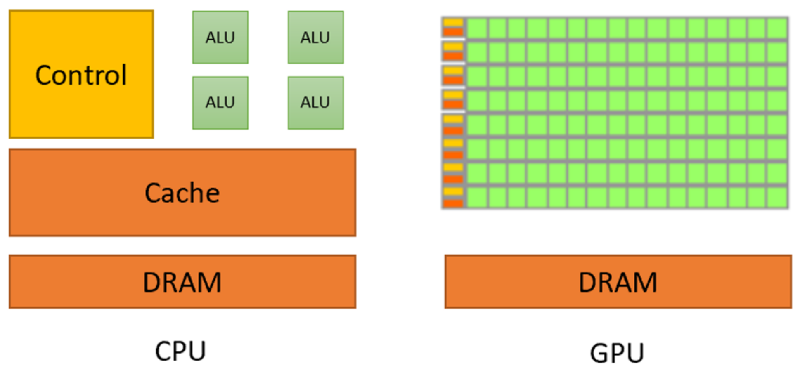
> 
> 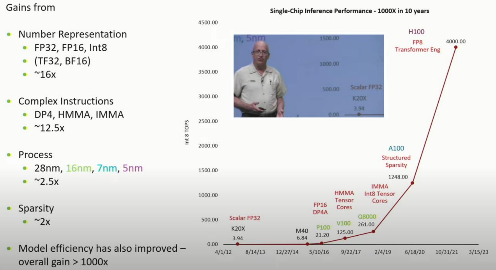

#### GPU硬件模型

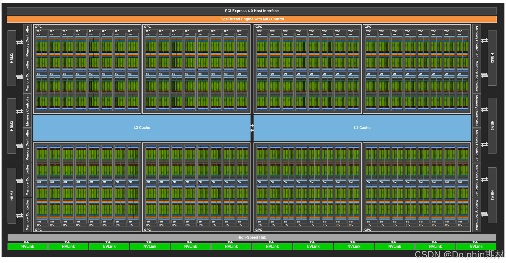

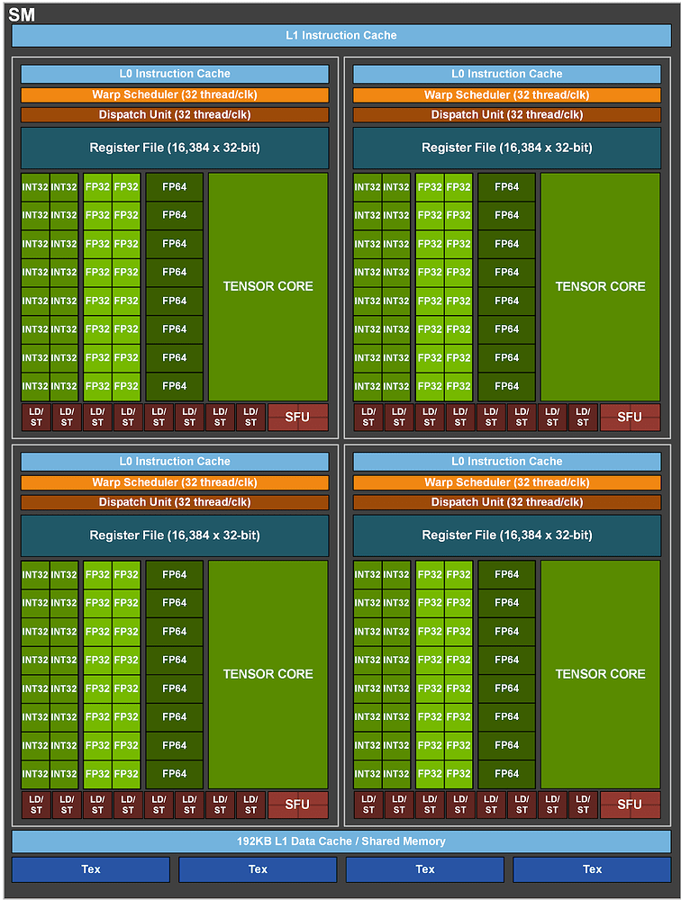

1. GPU的计算核心由大量SM（Streaming Multiprocessor，流式多处理器）组成，例如GA100包含128个SM，每个SM包含若干Cuda core（int32/fp32/fp64）和Tensor core.
2. GPU的内存层级包括：
   | 名称 | 介质 | 位置 | 带宽 |
   | --- | --- | --- | --- |
   | Register | SRAM | SM内部 | ~100TB/s |
   | L1 cache/Shared memory | SRAM | SM内部 | ~10-100TB/s |
   | L2 cache | SRAM | GPU芯片内部（SM共享） | ~5-10TB/s |
   | Global memory（显存） | HBM/GDDR DRAM | GPU芯片外 | ~1-2TB/s |
   | CPU memory | DDR DRAM | CPU | ~100-200GB/s |
   越近、越快、越贵、越耗能、容量越小.

#### GPU编程模型

1. Grid & Block & Thread
   - 将GPU计算自上而下拆开，分别是：框架层（torch.matmul）、算子库层（cuBLAS/cuDNN/cuTLASS）、kernel层（CUDA C++/Triton）、编译层（NVCC/NVRTC -> PTX）、硬件指令层（ptxas -> SASS -> SM执行）.
   - 一次kernel launch创建一个Grid，每个Grid由若干Block组成，每个Block由若干Thread组成（具体多少由开发者或编译器决定，例如Triton中只需声明Block数）.
   - 一个Grid内所有Block使用相同Block配置，一个Block内所有Thread执行相同kernel（SIMT），它们通过threadIdx/blockIdx/blockDim/gridDim获得不同编号，从而处理不同数据.
2. Block to SM & Thread to Warp
   - 每个Block会被分配到其中一个SM执行，获得其中的寄存器和共享内存资源，Block中的所有线程都可以访问其所拥有的共享内存，Block之间无法同步而同一Block内的线程可以同步.
   - 每个SM可以同时驻留多个Block，只要寄存器和共享内存够分.
   - SM中以Warp为执行调度单位，Warp是32个连续线程（threadIdx相邻）的固定分组，当一个正在计算的Warp需要等待显存时，调度器就会切换到另一个就绪Warp以隐藏延迟.
3. 内存访问模型
   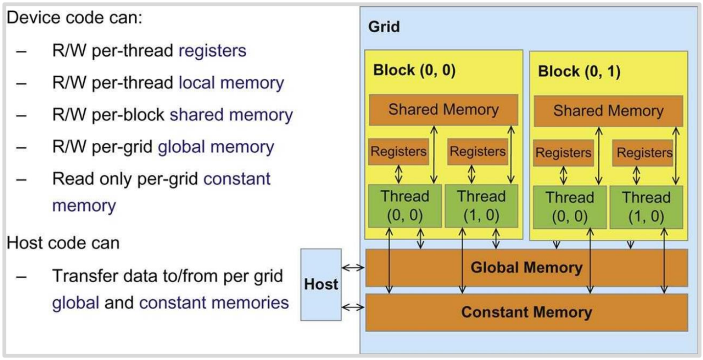
   - GPU的内存层级中，L1 cache和L2 cache无法编程控制，而其他都可以被主机进程或kernel线程控制.
   - 训练、推理任务通常由运行在CPU上的主机进程负责调度，主机进程负责管理CPU内存与GPU显存之间的数据传输，并通过kernel launch命令启动GPU上的kernel执行.
   - kernel线程中的变量有三类：
     - 全局内存指针：存放在寄存器中，指向全局内存，例如输入输出数据的指针.
     - 线程局部变量：存放在寄存器中，例如计算的中间结果，但当线程局部变量过多导致超过每线程寄存器数量上限时，会溢出到全局内存中的per-thread local memory.
     - 共享内存变量：在kernel代码中通过`__shared__`声明，存放在共享内存中，由同一个Block内的所有线程共同访问和协作维护，例如tiling矩阵乘法中两个输入矩阵的tile.
4. Block调度与Occupancy
   - Block被调度到某个SM时，会根据kernel中声明的共享内存变量大小，从该SM的共享内存中划分出一块给该Block，编译器提前分析每个线程需要多少寄存器，调度时SM会为该Block中的所有线程分配对应数量寄存器，而后Block始终占用被分配的资源直至计算完成退出SM.
   - 每线程寄存器数量上限默认为255 32-bit registers，若超限，编译时会将部分变量放在Local memory；每Block共享内存大小上限与具体GPU有关，编译时会检查kernel中的静态共享内存是否超限，超限则编译报错，运行时可能会额外申请动态共享内存，若总的共享内存超限则kernel launch失败.
   - Occupancy是“SM上活跃Warp数”与“SM支持的最大Warp数”的比值，Occupancy高意味着SM有更多就绪Warp可供调度，更容易隐藏延迟（但是高Occupancy不等于高性能）.
   - 
   - 影响Occupancy的因素有三类：
     - **每线程寄存器数量**越多，SM所能容纳的线程越少，Occupancy越低.
     - **每Block共享内存大小**越多，SM所能容纳的Block越少，Occupancy越低.
     - 每个Block最多1024个线程，每个SM最多可容纳的Block数量也有上限，因此如果Block中线程太少，即使打满SM，也难以获得较高的Occupancy.

#### TPU vs GPU

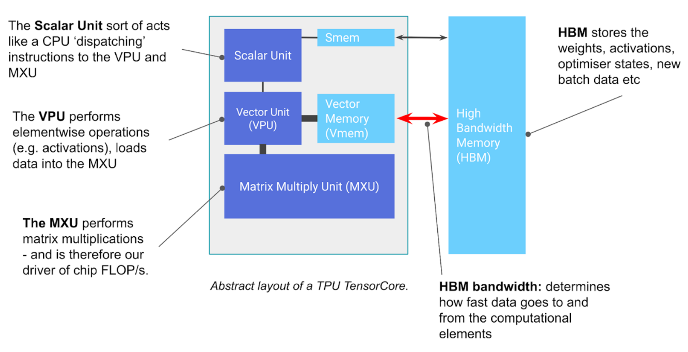

| GPU concepts | TPU counterparts | H100 # | TPU v5p # |
| --- | --- | --- | --- |
| SM | **Tensor core**（It is!） | 132 | 2 |
| Warp scheduler | VPU slots | 528 | 8(?) |
| **Tensor core** | MXU | 528 | 8 |
| Cuda core | VPU ALU | 132*128 | 2 |
| Registers | Vector registers（VRegs） | 32MB | 256KB(?) |
| L1 cache | VMEM | 32MB | 128MB |
| HBM | HBM | 80GB | 95GB |

TPU和GPU设计理念相似，都有矩阵乘法运算单元以及层次化的内存结构，区别在于：
- GPU有更多的SM，而TPU只有很少的TC（但性能相当）.
- TPU针对深度学习任务例如矩阵乘法有更极致的优化，例如轻量的控制单元、高性能的矩阵乘法单元；TPU的矩阵乘法单元规模更大、数量更少，大规模矩阵乘法更高效，而GPU的矩阵乘法单元规模更小、数量更多，更灵活.
- TPU是一个高度静态调度的专用处理器，把大量调度复杂性放到XLA编译阶段；运行时Tensor core按预定Instruction schedule执行，因此没有GPU那种Warp调度和Occupancy管理问题.
- TPU的网络连接和GPU有较大区别.

#### 回到GPU：Roofline model

Roofline model：

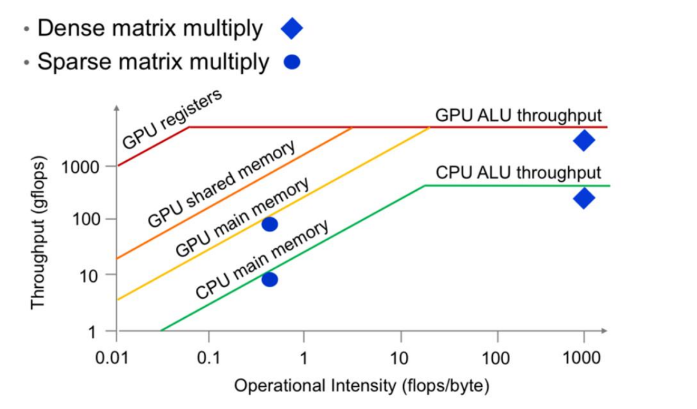

1. Roofline model说明了计算任务的吞吐量随Arithmetic intensity（or Operational intensity，计算强度，“总计算量”与“总访存量”的比值）增大的变化过程：
   - 转折点（Ridge point）处对应的计算强度等于“峰值算力”与“显存带宽”的比值，即当前任务如果打满带宽，所匹配的计算量恰好等于峰值算力.
   - 若计算强度低于Ridge point，则当前任务如果打满带宽，所匹配的计算量低于峰值算力，即**访存受限**（Memory bound），增大计算强度可以提高吞吐量.
   - 若计算强度高于Ridge point，则当前任务如果打满带宽，所匹配的计算量高于峰值算力，即**计算受限**（Compute bound），增大计算强度吞吐量不变（Plateau）.
   - 吞吐量Plateau等于硬件的峰值算力，硬件的峰值算力越高，最大吞吐量越大.
   - 相同的硬件中，带宽越大的内存介质，越快达到计算受限.
2. 我们想要计算受限，这意味着达到最大吞吐，意味着只要任务Scale up就没有资源被浪费.
3. GPU的进化过程中，峰值算力比显存带宽增长更快，即Ridge point向右上方移动，意味着摆脱访存受限越困难：
   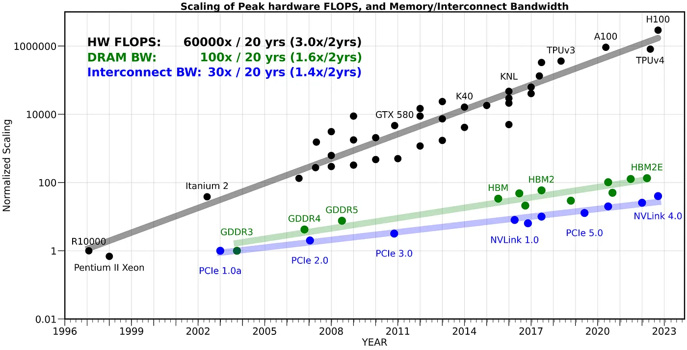
4. 想要达到计算受限，可以：
   - 给定硬件，针对计算负载进行优化，通过优化kernel和数据访问模式，使得从显存传输到SM的数据能够被充分复用（例如Flash Attention、低精度......）.
   - 给定负载，根据负载特性选择合适的硬件，使得计算强度高于“峰值算力”与“显存带宽”的比值（例如推理阶段PD分离，Prefill阶段计算强度高，选择Ridge point更大的GPU，Decode阶段计算强度低，选择Ridge point更小的GPU）.

#### 根据GPU的特性优化计算

<u>**分支发散**</u>：

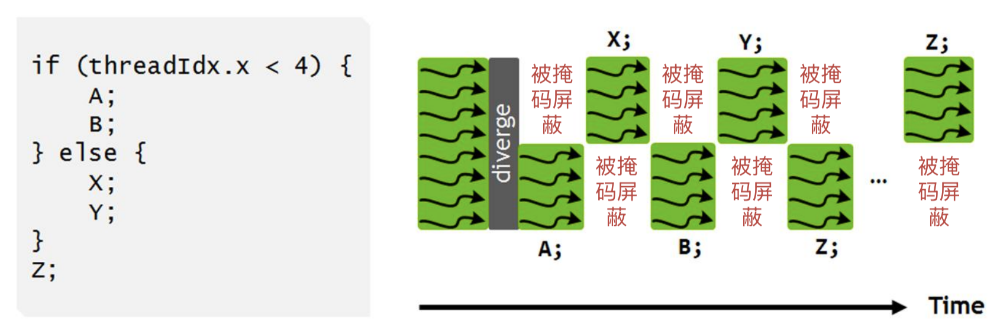

- GPU指令执行遵循SIMT，即一个Warp中的所有线程执行相同指令，若线程包含分支语句且Warp内的线程走向不同分支，那么就会导致分支发散，串行执行多个分支路径，并通过掩码屏蔽无效线程，造成计算资源浪费.
- Solution：用乘以掩码矩阵代替分支，或尽可能使同一Warp内的所有线程走相同分支.

<u>**低精度及量化**</u>：

> 需要注意很多低精度的Recipe其实都是根据具体硬件以及计算需求权衡的结果，因此并不是死的，主要体会设计思想.

1. 当前LLM训练和推理常见精度有：FP32（E8M23）、BF16（E8M7）、FP16（E5M10）、FP8（E4M3/E5M2）、INT8（推理优化更常用），指数位越多表示范围越大，底数位越多表示精度越高.
2. 当前BF16是大部分模型的默认精度，模型公司还可能同时发布更低精度版本的模型用于推理加速，FP32/BF16混合精度训练已经是模型训练的Baseline：
   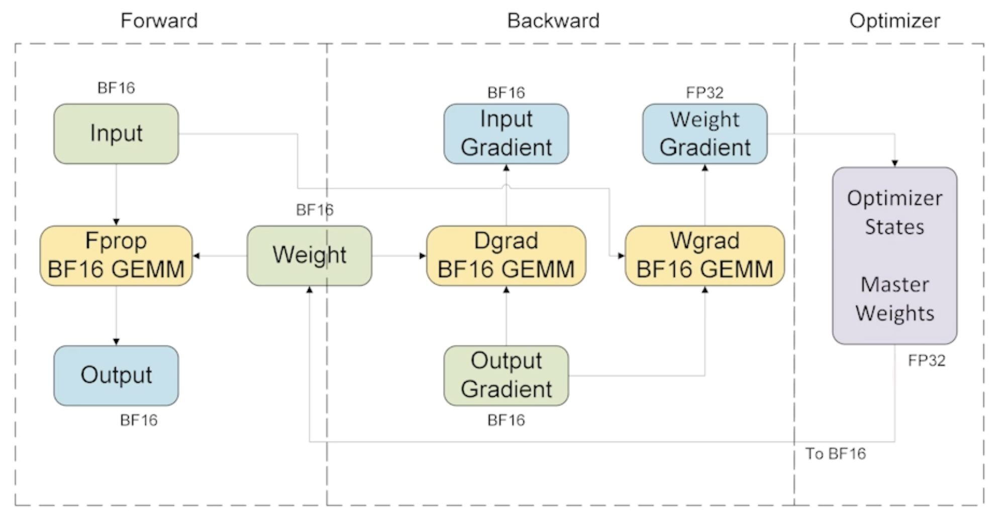
   - 权重精度：对所有参数，分别维护低精度权重（BF16）、梯度（BF16，对数值范围敏感，若使用FP16需进行Loss scale）、主权重（FP32）、一阶矩（FP32）、二阶矩（FP32），其中主权重、一阶矩、二阶矩是Adam优化器状态，为避免长期累积导致的舍入误差，优化器状态使用高精度；初始化主权重后，转换得到低精度权重，使用低精度权重进行前向传播和反向传播，然后使用反向传播得到的梯度更新一阶矩、二阶矩、主权重，主权重再转换得到低精度权重继续下一次迭代.
   - 计算过程精度：权重、梯度、激活值通常都是低精度，但具体算子可以根据计算对数值精度或范围的需求灵活调整数据精度，例如：框架层AMP（Automatic Mixed Precision，自动混合精度，Pytorch中可通过`with torch.autocast("cuda")`开启）为每个算子维护了一套经验性的精度策略，自动决定输入是否cast、调用哪个dtype的kernel、输出dtype，此外硬件也会根据计算特性支持某种精度策略，例如Tensor core对AB+C的计算进行了精度优化以避免累加过程的误差，如下图：
     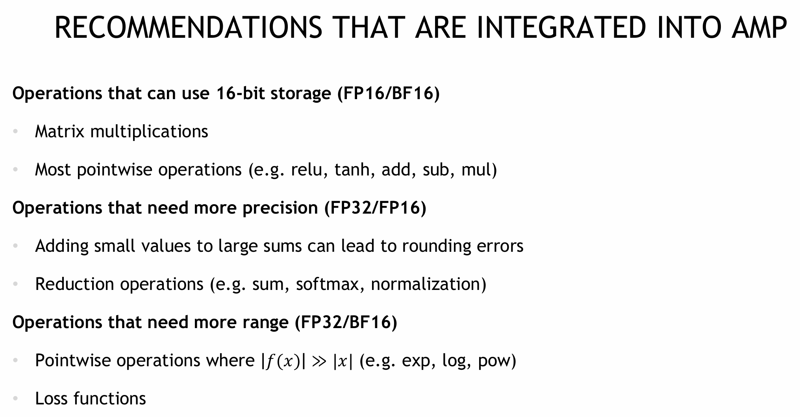
     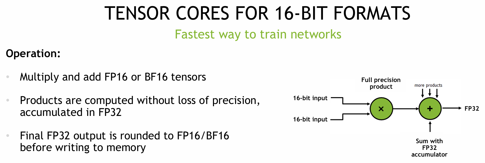
3. 低精度的收益：显存占用减少、通信开销降低、计算速度提升.
4. H100开始在Tensor core中支持FP8（优化矩乘），DeepSeek-V3/R1、Llama 4等模型使用FP8进行训练，但在实际使用FP8时存在更多的权衡：
   - 使用哪种FP8格式？
     - E4M3
     - E4M3 for inputs and weights, E5M2 for grads
   - 使用什么Scaling策略？
     - per-tensor
     - per-group with size of ...
     > 补充：Scaling的过程
     > 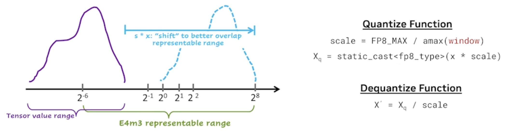
     > Scaling根据tensor或group的绝对最大值选择缩放因子，将其映射到FP8最大有限值附近，使其他数值同比例缩放，从而避免最大值上溢，并尽量减少较小数值的下溢和舍入误差.
     > 
     > 由此引出了另一维度的Scaling策略权衡：
     > - current: calculate the amax from the current tensor
     > - delayed: use the amax from a history buffer
   - 什么位置使用FP8？可以确定的是，除了Embedding和LM-head的所有线性层都可以使用FP8，但“Attention中的矩阵乘法是否使用FP8”、“模型的第一层和最后一层是否使用FP8”等等仍然是可以设计的点.

> 补充：MXFP8（Blackwell支持该Recipe）
> 
> 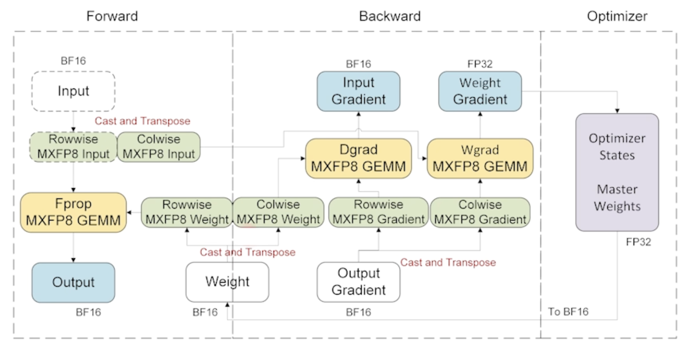
> 
> - 使用E4M3的FP8格式和1-per-32的Scaling策略（Scaling factor使用E8M0格式）.
> - 由于硬件限制，需要同时保存Row-wise和Col-wise的数据，矩阵转置直接使用Col-wise的数据.
> 
> More: [FP8 混合精度训练方案与性能分析](https://www.bilibili.com/video/BV1mpMwz9Ey5)

<u>**访存优化的几个技巧**</u>：

1. 算子融合
   - 将多个连续算子的计算合并到一个kernel中，减少中间结果的数据搬运.
   - 例如：$\sin^2x+\cos^2x$是一个Element-wise的操作，但朴素实现需要launch5个kernel，Cache miss的情况下需要来回搬运5次数据，合并为一个kernel后只需搬运1次数据.
   - 简单的算子融合通过编译就能实现，Pytorch通过`torch.compile`实现（某种意义上的静态图）.
   - 特别地，反向传播中的算子融合可以理解为把多个相邻的VJP（Vector-Jacobian Product，向量-雅可比乘积）计算融合进一个kernel.
2. 激活值重计算
   - 对于模型中一个层的若干函数，一般的实现会在前向传播时保存每个函数的输出（激活值），在反向传播时读取这些激活值计算输入和权重的梯度.
   - 如果在前向传播时不保存中间激活值，而是在反向传播时读取输入并重新计算出中间激活值，就能实现用计算换访存/显存.
   - 例如：
     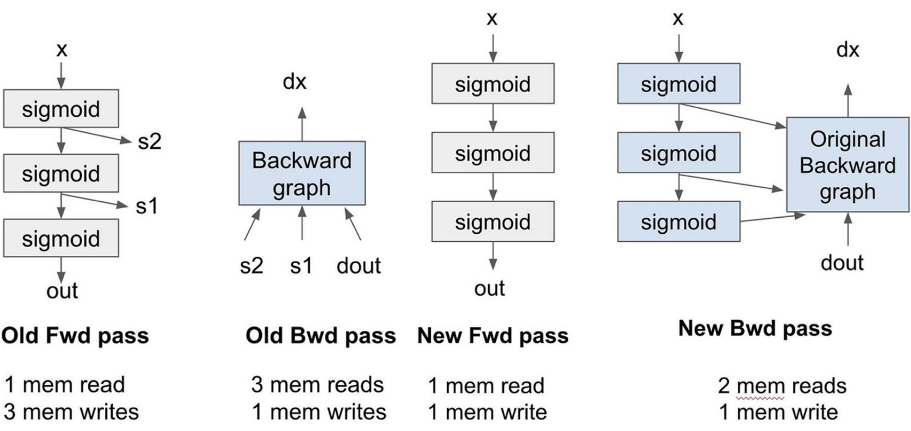
3. 访存合并
   - 显存读取采用“突发传输模式”，即当访问某个地址时，硬件不会只读取该地址对应的数据，而是读取该地址所在的、按传输粒度对齐的固定大小数据块.
   - 一个Warp的线程共同形成一个内存访问请求，当一个Warp内的所有线程访问的数据都位于同一传输数据块时，GPU可以将这些访问合并为一次内存访问.
   - 突发传输数据块的常见规格有32/64/128bytes，是由于Warp包含32个线程，有利于实现访存合并.
   - 对于行主序存储的矩阵，如果线程内的数据访问沿矩阵的行索引方向移动，则访存**不是**合并的：
     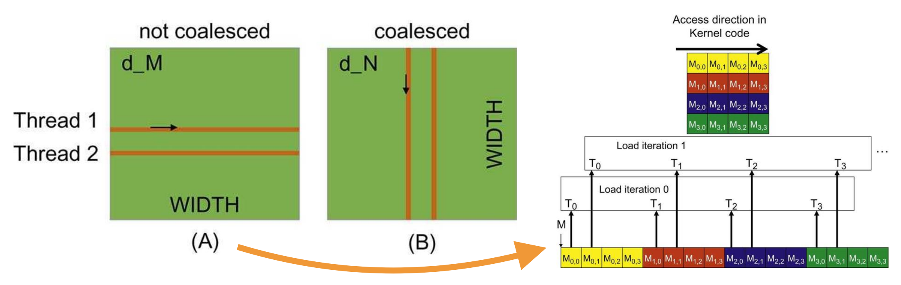
4. Tiling
   - 将大规模计算对应的数据划分为很多能够放进共享内存的小的tiles，并组织线程维护和消费对应的tile，使得数据从显存加载到片上后被多次复用，从而减少频繁显存访问.
   - 以$C_{m\times n}=A_{m\times k}B_{k\times n}$矩阵乘法为例：
     - 如果将得到C中每个元素的计算过程封装为一个线程（Block在这里透明），不考虑硬件层面的访存特性，计算次数为2mnk（对C中每个元素，都有k次乘和k次加），访存数据量为2mnk + mn（读n次A，读m次B，写C，多次重复读取），计算强度低（$O(1)$）.
     - 在C上划分tiles，将计算每个tile的过程封装为一个Block，而将得到tile中每个元素的计算过程封装为Block内的一个线程，这样Block内线程就能协作将所需数据加载到共享内存并复用这些数据，计算次数仍为2mnk，访（显）存数据量变为$mk\lceil\frac{n}{w}\rceil+nk\lceil\frac{m}{h}\rceil+mn$（假设tile尺寸为h*w，读ceil(n/w)次A，读ceil(m/h)次B，写C），在合理范围内tile越大，访存数据量减少越多，对共享内存需求越多，计算强度从$O(1)$提升为$O(T)$.
       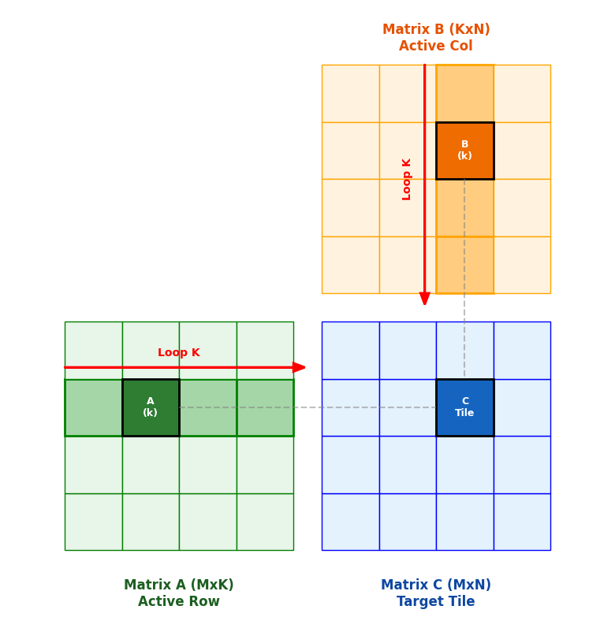
     - Talk is Cheap. Show me the code.
       ```cpp
       #include <cuda_runtime.h>

       constexpr int TILE = 16;

       __global__ void matmul_tiled(
           const float* A,
           const float* B,
           float* C,
           int M,
           int N,
           int K
       ) {
           // 一个 Block 计算 C 中一个 TILE x TILE 的 tile
           __shared__ float As[TILE][TILE];
           __shared__ float Bs[TILE][TILE];

           const int tx = threadIdx.x;
           const int ty = threadIdx.y;

           const int row = blockIdx.y * TILE + ty;
           const int col = blockIdx.x * TILE + tx;

           float acc = 0.0f;

           // 沿 K 维依次处理 A 和 B 的 tiles
           const int num_k_tiles = (K + TILE - 1) / TILE;

           for (int t = 0; t < num_k_tiles; ++t) {
               const int a_col = t * TILE + tx;
               const int b_row = t * TILE + ty;

               // Block 内线程协作加载 A、B tile；越界位置补 0
               // 访存合并
               As[ty][tx] = (row < M && a_col < K)
                   ? A[row * K + a_col]
                   : 0.0f;

               Bs[ty][tx] = (b_row < K && col < N)
                   ? B[b_row * N + col]
                   : 0.0f;

               // 确保整个 tile 已加载完成
               __syncthreads();

               // 共享内存中的每个元素被多个线程复用
               #pragma unroll
               for (int p = 0; p < TILE; ++p) {
                   acc += As[ty][p] * Bs[p][tx];
               }

               // 确保所有线程使用完当前 tile 后再覆盖共享内存
               __syncthreads();
           }

           if (row < M && col < N) {
               C[row * N + col] = acc;
           }
       }

       void launch_matmul(
           const float* A,
           const float* B,
           float* C,
           int M,
           int N,
           int K
       ) {
           dim3 block(TILE, TILE);

           dim3 grid(
               (N + TILE - 1) / TILE,
               (M + TILE - 1) / TILE
           );

           matmul_tiled<<<grid, block>>>(A, B, C, M, N, K);
       }
       ```
       二维Block中线程的排列顺序是在x方向连续变化，对于行主序存储的矩阵，threadIdx.x对应矩阵列方向能够让Warp内线程产生连续、可合并的内存访问.
5. 在矩阵乘法背景下讨论Tiling带来的一些问题
   - 如果tile尺寸无法整除矩阵对应维度的长度，在计算时需要用0进行Padding，将导致计算资源的浪费.
   - 对于行主序存储的矩阵，**每行**的起始地址应该与突发传输数据块的边界对齐（否则最好进行Padding），以获得最少的访存数据量.
     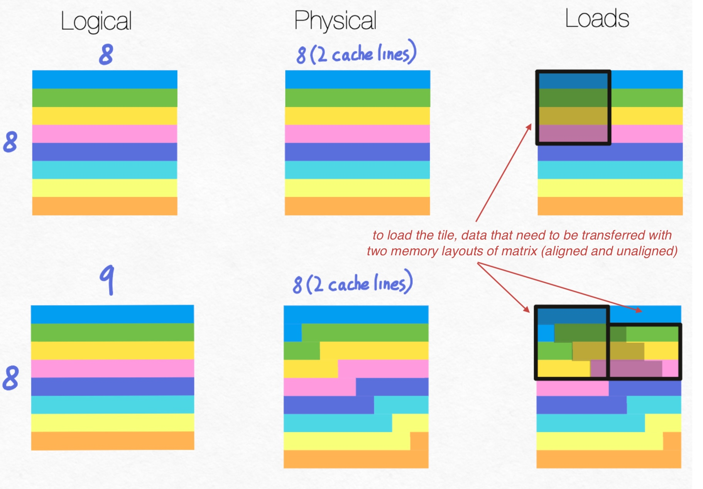
     然后你就会明白Karpathy的这条推文：
     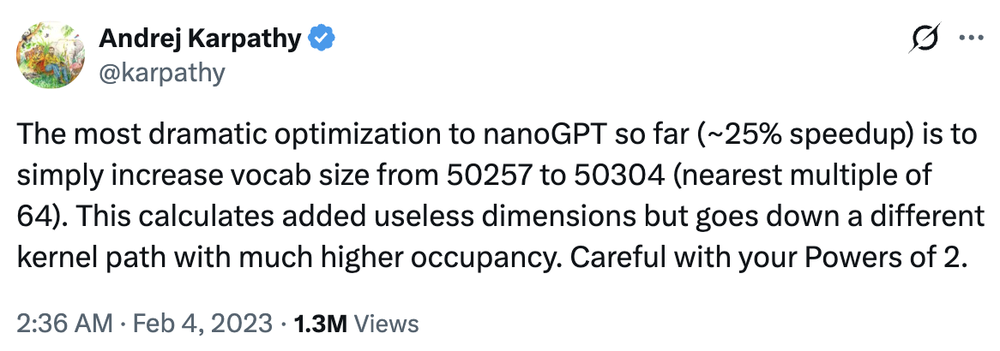
     以及为什么下图中“大小可被32或16整除的矩阵的矩乘，计算吞吐高于大小仅可被8整除的矩阵，高于大小仅可被2整除的矩阵，高于大小仅可被1整除的矩阵”：
     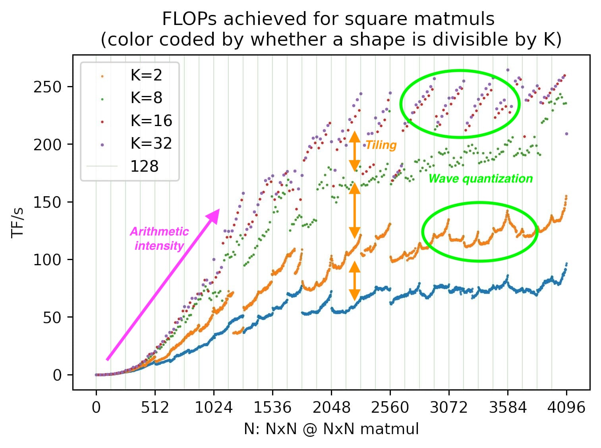
   - Wave quantization效应：如上图所示，除去矩阵大小的影响，计算吞吐会出现类似波浪的形状；以1791到1793计算吞吐下跌为例，这里使用的是256\*128的tile，对于1791的矩阵共有ceil(1791/256)\*ceil(1791/128) = 98个tiles/Blocks，对于1793的矩阵共有ceil(1793/256)\*ceil(1793/128) = 120个tiles/Blocks，而测试所用的A100有108个SM，因此1791的矩阵乘法能够在一轮调度中被执行而1793的矩阵乘法需要两轮调度，因为1791/1792到1793是从一轮到两轮的分界点，所以在这里出现了计算吞吐的大幅下跌.

> 补充：torch.compile
> 
> 确定一个较优的tile尺寸需要考虑多种因素，比如：共享内存大小（tile太大会降低Occupancy）、矩阵形状对tile的可整除性、tile能否最大化访存合并的收益等等，人工进行决策非常困难.
> 
> ```python
> model = torch.compile(
>     model,
>     backend="inductor",
>     mode="max-autotune"
> )
> ```
> 
> `torch.compile`提供了max-autotune的模式，基于inductor后端，在编译时通过测量确定tile尺寸.
> 
> `torch.compile`提供的编译模式包括：
> - default：默认模式，平衡编译时间和运行性能.
> - reduce-overhead：使用CUDA Graph，减少kernel launch调度开销.
> - max-autotune：最大化运行性能，会进行kernel配置搜索.
> - max-autotune-no-cudagraphs：和max-autotune类似，但不使用CUDA Graph.

### Flash Attention

> Fusion & Tiling & Recomputation.
> 
> Paper: [Flash Attention 1](https://arxiv.org/pdf/2205.14135), [Flash Attention 2](https://arxiv.org/pdf/2307.08691), [Flash Attention 3](https://arxiv.org/pdf/2407.08608)

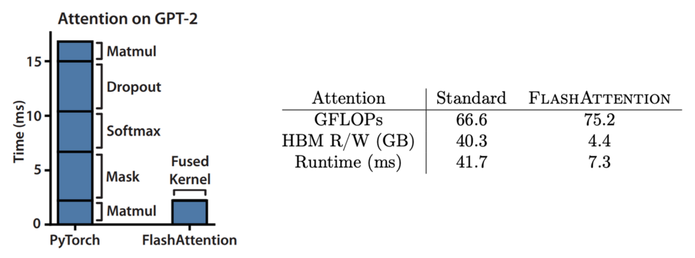

1. Preliminary
   - Flash Attention针对训练阶段及推理时的Prefill过程，优化的是Attention层中激活值投影到Q、K、V之后，输出投影之前的计算过程，具体过程可表示为：
     $$(Q,K,V) \rightarrow \frac{QK^T}{\sqrt{d}} \rightarrow \mathrm{Mask} \rightarrow \mathrm{Softmax} \rightarrow \mathrm{Dropout} \rightarrow \times V \rightarrow O$$
     其中Mask、Dropout是逐元素操作，而Softmax除了涉及逐元素操作，还涉及max和sum的规约操作；RoPE、QK-Norm、MLA等并不改变上述过程，因为它们优化的都是得到Q、K、V的过程.
2. Naive Attention
   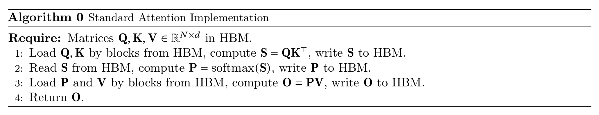
   - 问题：中间激活值需要占用大量显存，同时需要大量通信开销（$O(N^2)$）；Softmax等逐元素和规约操作本身就有计算强度较低的问题，还需要对大矩阵进行操作.
3. Flash Attention
   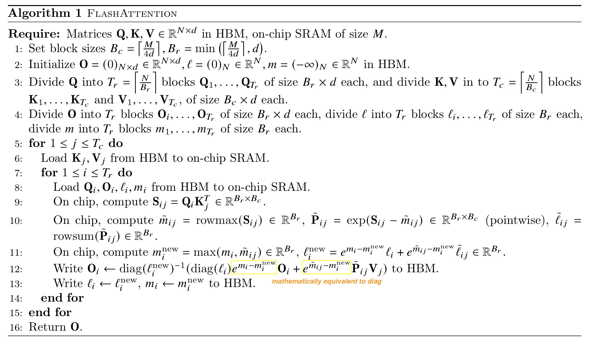
   - Flash Attention提出了一个不进行中间激活值显存读写的Fused kernel.
   - 在序列方向将K和V切成若干块，同样在序列方向将Q和O切成若干块，K和V共享指针同步前进；对每一对(K, V)子块，遍历Q的所有子块，计算$\mathrm{some\_operations}(QK^T)V$，得到O中与Q位置对应的子块的部分和（不一定正确，因为Softmax没走完），(K, V)遍历结束后，O中所有子块即已有完整和.
     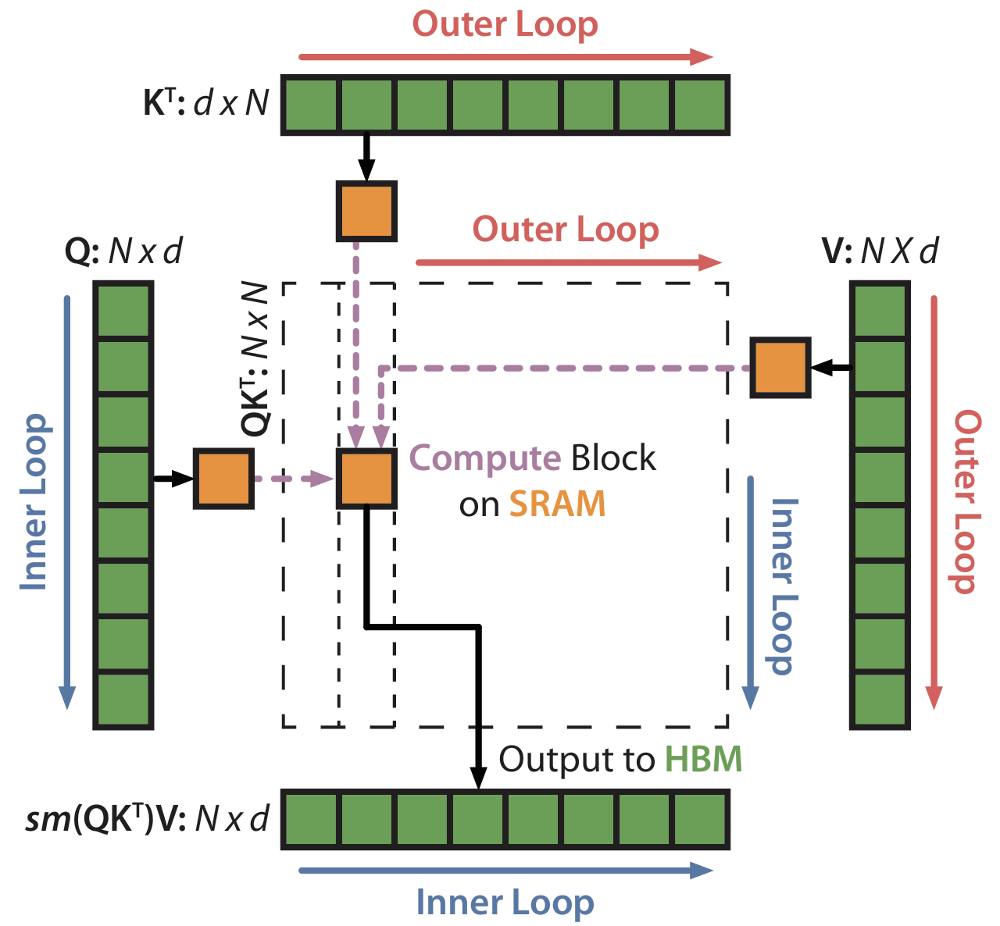
   - 上述过程中的some operations包含Preliminary所述的各类操作，其中比较棘手的是Softmax：
     $$\mathrm{Softmax}\left(\left\{x_1,...,x_N\right\}\right)=\left\{\frac{e^{x_i-\mathrm{maxv}}}{\sum_{j=1}^{N}e^{x_j-\mathrm{maxv}}}\right\}_{i=1}^{N}$$
     其过程可表示为：
     $$\mathrm{input} \rightarrow \mathrm{rowmax(reduction)} \rightarrow \mathrm{exp(elementwise)} \rightarrow \mathrm{rowsum(reduction)} \rightarrow \mathrm{div(elementwise)} \rightarrow \mathrm{output}$$
     Softmax需要进行max和sum的按行规约操作，其朴素实现需要$QK^T$在行方向上完整，但由于SRAM上无法容纳完整的$QK^T$（随序列长度扩展），因此朴素实现肯定无法避免显存读写.
     > 补充：Online Softmax
     > 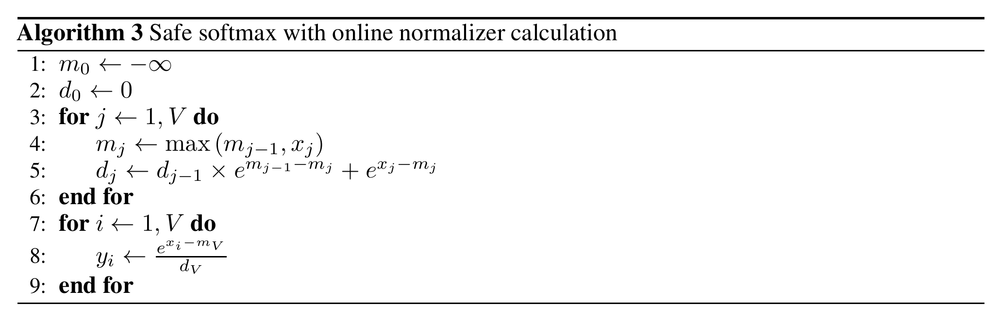
     
     借鉴Online Softmax的思想，但与其不同的是，每一行只维护一个最大值和累加值状态，在Flash Attention中实现了逐块调整规约、最终正确规约的过程.
   - 由于没有保存中间激活值，反向传播时需要重计算，但是因为前向传播保存了Softmax的规约结果，所以重计算时不需要重新进行Online Softmax的规约过程.
   - Naive Attention显存访问次数为$O(Nd+N^2)$，Flash Attention显存访问次数为$O(\frac{N^2d^2}{M})$（外循环$O(\frac{Nd}{M})$，内循环$O(\frac{Nd}{M})$，每次访存$O(M)$），$d^2$远小于$M$，因此Flash Attention的显存访问开销远小于Naive实现；此外由于不保存激活值，避免了随序列长度平方增长的显存占用.