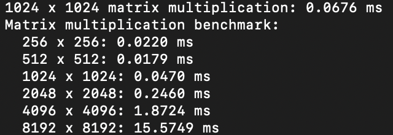
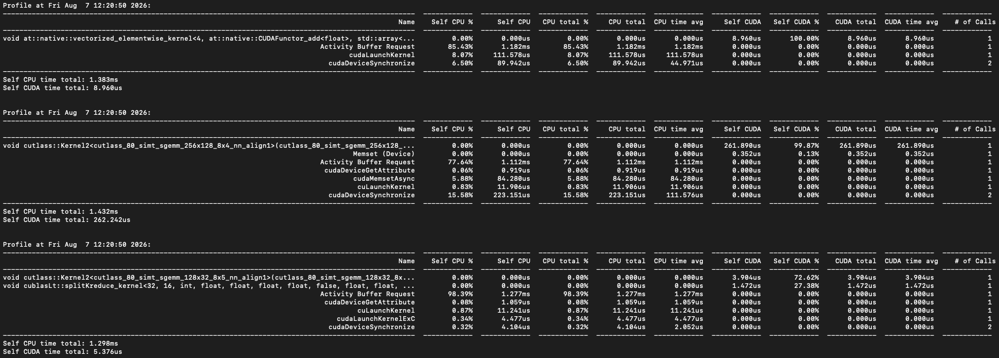
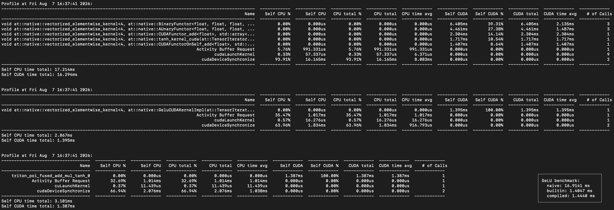
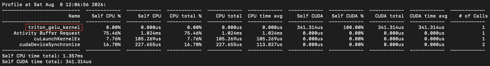
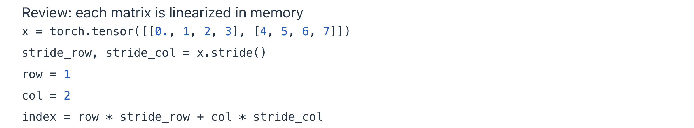

> [Stanford CS336, Spring 2026](https://cs336.stanford.edu/): Outline & Key points

## 06_Writing triton kernels

### 回顾一下GPU

1. 硬件
   | Accelerator | A100 | H100 | B200 |
   |---|---|---|---|
   | # SMs | 108 | 132 | 148 |
   | Register size (per SM) | 256 KB | 256 KB | 256 KB |
   | L1 cache + shared memory size (per SM) | 192 KB | 256 KB | 256 KB |
   | L2 cache size | 40 MB | 50 MB | 96-126 MB |
   | HBM size | 80 GB | 80 GB | 192 GB |
   | Register bandwidth | ~116 TB/s | ~401 TB/s | ~447 TB/s |
   | L1 cache + shared memory bandwidth | ~19 TB/s | ~33 TB/s | ~19 TB/s |
   | L2 cache bandwidth | ~5-8 TB/s | ~12 TB/s | ~9 TB/s |
   | HBM bandwidth | 2 TB/s | 3.35 TB/s | 8 TB/s |

   *What's more*：B200也拥有用于Tensor core的张量内存（Tensor memory，TMEM），它位于寄存器和共享内存之间，并且对程序员是不可见的.
2. 编程模型
   - **Thread**：在数据的一小部分上执行代码的执行单元.
   - **Thread block（或Concurrent thread array，CTA）**：一组Thread的集合，被调度到一个SM上，可以访问同一块共享内存.
   - **Grid**：Thread block的集合，当你launch一个kernel时，其实启动了一个Grid.
   - *What's more*：H100和B200还支持Thread block cluster，可以实现分布式共享内存.
   - *Dig deeper*：为什么在编程模型中设计Block这一层？对于逐元素操作，将任务分解为线程、每个线程处理一个元素非常自然，不需要Block这层；但是对于Softmax、Matmul等操作，线程之间需要进行通信，而从显存中读写数据速度很慢，因此会想利用共享内存（由一组被调度到一个SM中执行的线程共享），也就自然引入了Block.
3. 一些影响编程实践的硬件特性
   > 编程模型提供了对硬件的简化和抽象，理解编程模型足以写出正确的程序，但是为了获得高性能，需要理解更多的硬件特性.
   - Warp及分支发散：
     - Block被调度到SM，其每32个连续线程组成Warp.
     - Warp是SM中的执行调度单位，可以实现以零开销进行Warp切换（以隐藏显存读写延迟）.
     - Warp遵循SIMT，由此引入了分支发散的问题.
   - Occupancy：高Occupancy仅意味着Warp更多，有利于隐藏延迟（毕竟Warp切换几乎零成本），但是高Occupancy不一定性能更好，低Occupancy也不一定性能更差.
   - 🌟 **共享内存**中的Bank conflict：
     - 为了支持一个Warp的32个线程并行访问，共享内存被组织成32个可独立访问的Bank，每个Bank宽4字节，地址通过取模映射到Bank.
     - 每个Bank每周期处理一个4字节word；如果线程访问分散到不同Bank，可以并行完成；如果多个线程访问同一Bank的**不同地址**（如果是读同一地址，硬件会将数据广播到对应的线程），就会发生Bank conflict，冲突的访问将被串行化.
     - 最坏情况是32-way bank conflict，例如一个矩阵的每一行跨越所有Bank，32个线程同时访问第一列.
     - 读矩阵列是不可避免的，我们总要对共享内存中的tile执行矩阵乘法，可以通过重新排列共享内存以避免Bank conflict（Swizzling机制：row xor col列映射）.
   - **显存**中的Memory coalescing：当Warp中的32个线程访问显存时，这些内存访问会被合并成若干大小为128字节的内存事务（Cache line），最佳情况是所有线程访问同一个Cache line（即Full coalescing，32threads × 4bytes = 128bytes）.
   - Wave quantization：Grid中的Blocks一波一波地被调度到SMs，如果最后一波中的Block数少于SM数，将导致部分SM空闲，应尽量使Block数能被SM数整除.

### Benchmarking & Profiling

> 通过Benchmarking和Profiling，可以对计算过程进行测量和分析，进而指导进一步优化或验证优化后性能.
> 
> Benchmarking测量的是Wall-clock time，通过Benchmarking可以**直观比较不同实现的性能**、**直观理解性能随规模扩展的变化**；Profiling可以监控和测量计算涉及的底层过程，然后展示这些环节及其多类指标的测量结果.

<u>**How to do benchmarking?**</u>

- Pytorch提供的Benchmarking工具：[torch.utils.benchmark](https://docs.pytorch.org/tutorials/recipes/recipes/benchmark.html)
- Case：
  ```python
  from typing import Callable

  import torch

  from gpu_util import cuda_if_available


  def benchmark(run: Callable, num_warmups: int = 1, num_trials: int = 3) -> float:
      # Warm up because the first few runs may be slower due to compilation and other overhead.
      # Measure steady-state performance because the kernel will run multiple times.
      for _ in range(num_warmups):
          run()
      torch.cuda.synchronize()  # Wait for all CUDA work to finish.

      # Measure the execution time.
      times: list[float] = []

      for trial in range(num_trials):  # Run multiple trials to capture variance.
          # Use CUDA events for accurate GPU timing without including CPU overhead.
          start_event = torch.cuda.Event(enable_timing=True)
          end_event = torch.cuda.Event(enable_timing=True)

          start_event.record()  # Record the start time.
          run()  # Execute the operation.
          end_event.record()  # Record the end time.
          torch.cuda.synchronize()  # Wait for all CUDA work to finish.

          times.append((start_event.elapsed_time(end_event)))

      mean_time = mean(times)

      return mean_time


  def run_operation2(dim: int, operation: Callable) -> Callable:
      # Create two random dim-by-dim matrices.
      x = torch.randn(dim, dim, device=cuda_if_available())
      y = torch.randn(dim, dim, device=cuda_if_available())

      # Return a function that performs the operation.
      return lambda: operation(x, y)


  def mean(xs: list[float]) -> float:
      return sum(xs) / len(xs)


  # Benchmark matrix multiplication.
  matmul = run_operation2(dim=1024, operation=lambda a, b: a @ b)
  result = benchmark(matmul)

  # Measure how execution time scales with matrix dimension.
  results = {}
  for dim in [256, 512, 1024, 2048, 4096, 8192]:
      results[dim] = benchmark(run_operation2(dim=dim, operation=lambda a, b: a @ b))
  ```
  Result on RTX 5090：

  
  
  较小维度的矩阵乘法运行时间差别不大，到达某一维度后运行时间开始随维度大小大约三次方增长.

<u>**How to do profiling?**</u>

- Pytorch提供的Profiling工具：[torch.profiler](https://docs.pytorch.org/tutorials/recipes/recipes/profiler_recipe.html)
- Nvidia推出的Profiling工具：[NVIDIA Nsight Systems](https://developer.nvidia.cn/nsight-systems)
- Case：
  ```python
  import time
  from typing import Callable

  import torch
  from torch.profiler import ProfilerActivity

  from gpu_util import cuda_if_available


  def profile(run: Callable, num_warmups: int = 1):
      # Warm up the operation.
      for _ in range(num_warmups):
          run()
      torch.cuda.synchronize()

      # Profile one execution of the operation.
      with torch.profiler.profile(
          activities=[ProfilerActivity.CUDA],
          experimental_config=torch._C._profiler._ExperimentalConfig(verbose=True),
      ) as prof:
          run()
          torch.cuda.synchronize()

      # Format the profiler results as a table.
      table = prof.key_averages().table(
          sort_by="cuda_time_total", max_name_column_width=100, row_limit=10
      )

      # Append the results to `profiles.txt`.
      with open("var/profiles.txt", "a") as f:
          f.write(f"Profile at {time.ctime()}:\n")
          f.write(table)
          f.write("\n\n")
      return table


  def run_operation2(dim: int, operation: Callable) -> Callable:
      ...


  # Profile elementwise addition (dim = 2048).
  add_profile = profile(run_operation2(dim=2048, operation=lambda a, b: a + b))

  # Profile matrix multiplication (dim = 2048).
  matmul_profile = profile(run_operation2(dim=2048, operation=lambda a, b: a @ b))

  # Profile matrix multiplication (dim = 128).
  matmul_profile = profile(run_operation2(dim=128, operation=lambda a, b: a @ b))
  ```
  Result on RTX 5090：

  

  可以从Profiling结果中看到调用了哪些kernel，例如`cutlass_80_simt_sgemm_256x128_8x4_nn_align1`：
  - `cutlass`：Nvidia GEMM高性能库.
  - `80`：该kernel是针对Ampere架构优化的.
  - `simt`：该kernel适用于Cuda core.
  - `sgemm`：Single-precision GEMM，即FP32.
  - `256x128`：tile大小.
  - `8x4`：每轮沿K维处理8个元素，并在共享内存中使用4个槽位，让多个K tile同时处于加载中、等待计算或正在计算的状态，从而将数据加载延迟隐藏在计算过程中.
  - `nn`：两个输入矩阵都不转置.
  - `align1`：每次访存的起始地址只需按一个元素的字节大小对齐.

<u>**Apply it to the GeLU example**</u>

```python
import time
from typing import Callable

import torch
from torch.profiler import ProfilerActivity

from gpu_util import cuda_if_available


def benchmark(run: Callable, num_warmups: int = 1, num_trials: int = 3) -> float:
    ...


def profile(run: Callable, num_warmups: int = 1):
    ...


def run_operation1(dim: int, operation: Callable) -> Callable:
    # Create one random dim-by-dim matrix.
    x = torch.randn(dim, dim, device=cuda_if_available())

    # Return a function that performs the operation.
    return lambda: operation(x)


def mean(xs: list[float]) -> float:
    return sum(xs) / len(xs)


def naive_gelu(x: torch.Tensor):
    # tanh approximation of the GeLU activation function.
    # https://docs.pytorch.org/docs/stable/generated/torch.nn.GELU.html
    return 0.5 * x * (1 + torch.tanh(0.79788456 * (x + 0.044715 * x * x * x)))


def builtin_gelu(x: torch.Tensor):
    # PyTorch's built-in GeLU with the tanh approximation.
    return torch.nn.functional.gelu(x, approximate="tanh")


def check_equal_1d(f1, f2):
    x = torch.randn(2048, device=cuda_if_available())
    y1 = f1(x)
    y2 = f2(x)
    assert torch.allclose(y1, y2, atol=1e-6)


x = torch.tensor([1.])

# 1. Naive PyTorch implementation (not fused).
y1 = naive_gelu(x)

# 2. Built-in PyTorch implementation (fused).
y2 = builtin_gelu(x)
check_equal_1d(naive_gelu, builtin_gelu)

# 3. Compile the naive implementation with PyTorch.
compiled_gelu = torch.compile(naive_gelu)
y3 = compiled_gelu(x)
check_equal_1d(naive_gelu, compiled_gelu)

# Benchmark the implementations.
naive_time = benchmark(run_operation1(dim=16384, operation=naive_gelu))
builtin_time = benchmark(run_operation1(dim=16384, operation=builtin_gelu))
compiled_time = benchmark(run_operation1(dim=16384, operation=compiled_gelu))

# Profile the naive GeLU implementation.
naive_gelu_profile = profile(run_operation1(dim=16384, operation=naive_gelu))

# Profile the built-in GeLU implementation.
builtin_gelu_profile = profile(run_operation1(dim=16384, operation=builtin_gelu))

# Profile the compiled GeLU implementation.
compiled_gelu_profile = profile(run_operation1(dim=16384, operation=compiled_gelu))
```

Result on RTX 5090：



Built-in和Compiled实现的性能显著优于没有算子融合的Naive实现，`torch.compile`将多个计算节点合并成一个Triton kernel.

### Writing triton kernels

- CUDA C++（Nvidia）和Triton（OpenAI）是主流的GPU编程语言（DSL），它们的宿主语言分别是C++和Python，通过它们可以实现运行在GPU上的具体算子.
- CUDA C++和Triton代码都需要编译为GPU机器码，由主机launch到GPU上运行，因此CUDA C++和Triton是不同的前端，需要经过如下编译流程：
  
- 使用CUDA C++和Triton编写算子各有优缺点：
  | 前端 | 心智模型 | 优点 | 缺点 |
  |---|---|---|---|
  | CUDA C++ | 编程对象是线程，通过`blockIdx`和`threadIdx`标识线程，需要理解线程级别的数据搬运、同步、计算的过程 | 可以进行精细控制，实现硬件级别的优化 | 复杂，需要手动管理共享内存等 |
  | Triton | 编程对象是Block，通过`program_id`标识Block，将数据加载到SM、对数据进行操作、将数据写回显存 | 简单，且对于实现算法级别的优化（如Flash Attention）已经够了 | 不够精细，很多东西交给编译器 |
- Triton documentation: [here](https://triton-lang.org/main/index.html)

#### Writing GeLU kernel (Elementwise operation)

```python
import torch
import triton
import triton.language as tl

from gpu_util import cuda_if_available


def triton_gelu(x: torch.Tensor):
    # Validate the input tensor.
    assert x.is_cuda
    assert x.is_contiguous()

    # Allocate the output tensor.
    y = torch.empty_like(x)

    # Define the grid by partitioning elements across Triton programs.
    # | T T T T T T T T | T T T T T T T T | T T T T T T T T | T T T T T T T T |
    # |    Program 0    |    Program 1    |    Program 2    |    Program 3    |
    num_elements = x.numel()
    BLOCK_SIZE = 1024
    num_blocks = triton.cdiv(num_elements, BLOCK_SIZE)  # Any ceiling-division expression works here.

    # Launch the Triton kernel.
    kernel = triton_gelu_kernel[(num_blocks,)](
        x, y, num_elements, BLOCK_SIZE=BLOCK_SIZE
    )

    # Write the generated PTX for later inspection.
    output_ptx("triton_gelu", kernel)
    return y


@triton.jit
def triton_gelu_kernel(x_ptr, y_ptr, num_elements, BLOCK_SIZE: tl.constexpr):
    # Annotate kernel parameters that must be known at compile time with `tl.constexpr`.
    # The input starts at `x_ptr`.
    # The output starts at `y_ptr`.
    
    # Identify the current program instance.
    pid = tl.program_id(axis=0)
    # Compute the starting index of this program instance.
    start = pid * BLOCK_SIZE
    # Compute the indices processed by this program instance.
    offsets = start + tl.arange(0, BLOCK_SIZE)
    # Prevent reads and writes beyond the end of the tensor.
    mask = offsets < num_elements
    # Load the input values.
    x = tl.load(x_ptr + offsets, mask=mask)
    # Compute the GeLU approximation.
    # Approximate GeLU is 0.5 * x * (1 + tanh(sqrt(2/pi) * (x + 0.044715 * x^3))).
    # `tl.tanh` is unavailable; use tanh(a) = (exp(2a) - 1) / (exp(2a) + 1).
    a = 0.79788456 * (x + 0.044715 * x * x * x)
    exp = tl.exp(2 * a)
    tanh = (exp - 1) / (exp + 1)
    y = 0.5 * x * (1 + tanh)
    # Store the output values.
    tl.store(y_ptr + offsets, y, mask=mask)


def builtin_gelu(x: torch.Tensor):
    ...


def output_ptx(name: str, kernel):
    """Print out the PTX code generated by Triton for the given `kernel`."""
    ptx_path = f"var/{name}-ptx.txt"
    with open(ptx_path, "w") as f:
        ptx = kernel.asm["ptx"]
        f.write(ptx)


x = torch.randn(8192, device=cuda_if_available())

y1 = triton_gelu(x)
y2 = builtin_gelu(x)
assert torch.allclose(y1, y2, atol=1e-6)
```

Profiling result of `triton_gelu` on RTX 5090：



向量中的每1024个元素组成一个Program instance（对应上述编程模型中的Thread block）.

`triton_gelu_kernel`被编译为线程的[PTX](https://louisxxr.github.io/triton_gelu_ptx.txt)代码，从中可以观察到：
- `%ctaid.x`是Block编号，`%tid.x`是线程编号.
- `ld.global.*`和`st.global.*`分别表示显存读写.
- `%r*`是32-bit寄存器，`%rd*`是64-bit寄存器，具体被解释为哪种数据类型，需要看`.reg`声明和指令的类型后缀.
- 每个线程处理8个数据（Thread coarsening，是由编译器做出的决策）.

#### Writing Softmax kernel (Reduction; row fits in a block)

```python
import torch
import triton
import triton.language as tl

from gpu_util import cuda_if_available


def triton_softmax(x: torch.Tensor):
    # Allocate the output tensor.
    y = torch.empty_like(x)

    # Define the grid with one Triton program per row.
    M, N = x.shape  # Number of rows and columns.
    BLOCK_SIZE = triton.next_power_of_2(N)  # Each program covers all columns; (IMPORTANT) `tl.arange` boundaries must be powers of two.
    num_blocks = M  # Launch one program per row.

    # Launch the Triton kernel.
    triton_softmax_kernel[(num_blocks,)](
        x_ptr=x,
        y_ptr=y,
        x_row_stride=x.stride(0),
        y_row_stride=y.stride(0),
        num_cols=N,
        BLOCK_SIZE=BLOCK_SIZE,
    )

    return y


@triton.jit
def triton_softmax_kernel(
    x_ptr,
    y_ptr,
    x_row_stride,  # Physical row stride; includes padding when present.
    y_row_stride,  # Same physical row-stride semantics as above.
    num_cols,  # Logical number of columns; excludes padding.
    BLOCK_SIZE: tl.constexpr,
):
    assert num_cols <= BLOCK_SIZE

    # Process each row independently.
    row_idx = tl.program_id(0)
    col_offsets = tl.arange(0, BLOCK_SIZE)

    # Load the input row from global memory.
    x_start_ptr = x_ptr + row_idx * x_row_stride
    x_ptrs = x_start_ptr + col_offsets
    x_row = tl.load(x_ptrs, mask=col_offsets < num_cols, other=float("-inf"))

    # Compute softmax.
    x_row = x_row - tl.max(x_row, axis=0)
    numerator = tl.exp(x_row)
    denominator = tl.sum(numerator, axis=0)
    y_row = numerator / denominator

    # Store the output row in global memory.
    y_start_ptr = y_ptr + row_idx * y_row_stride
    y_ptrs = y_start_ptr + col_offsets
    tl.store(y_ptrs, y_row, mask=col_offsets < num_cols)


def naive_softmax(x: torch.Tensor):
    # M is the number of rows; N is the number of columns.
    M, N = x.shape
    # Compute the maximum of each row (MN reads, M writes).
    x_max = x.max(dim=1)[0]
    # Subtract the maximum (MN + M reads, MN writes).
    x = x - x_max[:, None]
    # Exponentiate each element (MN reads, MN writes).
    numerator = torch.exp(x)
    # Compute the normalization constant (MN reads, M writes).
    denominator = numerator.sum(dim=1)
    # Normalize each row (MN + M reads, MN writes).
    y = numerator / denominator[:, None]
    # Total: 5MN + 2M reads and 3MN + 2M writes.
    # Ideally, use MN reads and MN writes for a potential 4x speedup.
    return y


def builtin_softmax(x: torch.Tensor):
    return torch.nn.functional.softmax(x, dim=-1)


x = torch.randn(2, 1000, device=cuda_if_available())

y1 = triton_softmax(x)
y2 = naive_softmax(x)
y3 = builtin_softmax(x)
assert torch.allclose(y1, y3, atol=1e-6)
assert torch.allclose(y2, y3, atol=1e-6)
```

矩阵每行作为一个Program instance.

#### Writing RowSum kernel (Reduction; row doesn't fit in block)

```python
import torch
import triton
import triton.language as tl

from gpu_util import cuda_if_available


def triton_row_sum(x: torch.Tensor) -> torch.Tensor:
    M, N = x.shape
    y = torch.empty(M, device=x.device, dtype=x.dtype)
    BLOCK_SIZE = 1024

    row_sum_kernel[(M,)](
        x, y, N, BLOCK_SIZE=BLOCK_SIZE
    )

    return y


@triton.jit
def row_sum_kernel(x_ptr, out_ptr, N, BLOCK_SIZE: tl.constexpr):
    # Identify the row processed by the current program instance.
    row = tl.program_id(0)

    # Initialize one accumulator per block element.
    acc = tl.zeros([BLOCK_SIZE], dtype=tl.float32)

    # Iterate over the row tiles.
    for start in range(0, N, BLOCK_SIZE):
        cols = start + tl.arange(0, BLOCK_SIZE)
        mask = cols < N
        x = tl.load(x_ptr + row * N + cols, mask=mask, other=0.0)
        acc += x

    # Reduce the BLOCK_SIZE accumulators to a scalar.
    result = tl.sum(acc, axis=0)
    tl.store(out_ptr + row, result)


def builtin_row_sum(x: torch.Tensor):
    return x.sum(dim=1)


x = torch.randn(2, 8000, device=cuda_if_available())

y1 = triton_row_sum(x)
y2 = builtin_row_sum(x)
assert torch.allclose(y1, y2, atol=1e-6)
```

矩阵每行作为一个Program instance，但是由于假设无法一次性读取整行数据，因此需要Tiling；维护与tile等长的accumulator（其实是每个线程分别维护自己的accumulator，但Triton隐藏了这一层），在Program instance中循环读取每个tile并累加到accumulator，循环结束后对accumulator执行一次规约（通过共享内存或Warp shuffle）作为最终结果.

> 补充：共享内存树形规约（在Triton中透明）
> 
> 将线程accumulator从局部寄存器写到共享内存，然后执行如下过程：
> ```cpp
> for (int stride = blockDim.x / 2; stride > 0; stride >>= 1) {
>     if (tid < stride)
>         sdata[tid] += sdata[tid + stride];
> 
>     __syncthreads();
> ```

#### Writing MatMul kernel

下面这个kernel融合了矩乘和GeLU，这很常见，且这对于逐元素操作而言完全免费.

> 回顾最底层的矩阵索引：
> 

```python
import torch
import triton
import triton.language as tl

from gpu_util import cuda_if_available


def triton_matmul_relu(a: torch.Tensor, b: torch.Tensor):
    assert a.is_cuda and b.is_cuda
    assert a.is_contiguous() and b.is_contiguous()
    assert a.shape[1] == b.shape[0]

    M, K = a.shape
    K, N = b.shape
    c = torch.empty((M, N), device=a.device)
    BLOCK_M, BLOCK_N, BLOCK_K = 64, 64, 32
    grid = (triton.cdiv(M, BLOCK_M), triton.cdiv(N, BLOCK_N))

    matmul_relu_kernel[grid](
        a, b, c,
        M, N, K,
        a.stride(0), a.stride(1), b.stride(0), b.stride(1), c.stride(0), c.stride(1),
        BLOCK_M, BLOCK_N, BLOCK_K,
    )

    return c


@triton.jit
def matmul_relu_kernel(
    a_ptr,
    b_ptr,
    c_ptr,  # Output pointer for c = a @ b.
    M,
    N,
    K,  # Matrix shapes: a is M x K, b is K x N, and c is M x N.
    stride_am,
    stride_ak,  # Strides for navigating a.
    stride_bk,
    stride_bn,  # Strides for navigating b.
    stride_cm,
    stride_cn,  # Strides for navigating c.
    BLOCK_M: tl.constexpr,
    BLOCK_N: tl.constexpr,
    BLOCK_K: tl.constexpr,
):
    # Process the (m, n)-th output tile.
    pid_m = tl.program_id(0)
    pid_n = tl.program_id(1)

    # Compute the tile indices.
    indices_m = pid_m * BLOCK_M + tl.arange(0, BLOCK_M)  # Row indices of a; shape: [BLOCK_M].
    indices_n = pid_n * BLOCK_N + tl.arange(0, BLOCK_N)  # Column indices of b; shape: [BLOCK_N].
    indices_k = tl.arange(0, BLOCK_K)  # Shared K indices for a and b; shape: [BLOCK_K].

    # Construct the initial pointer matrices for a and b.
    a_ptrs = (
        a_ptr
        + indices_m[:, None] * stride_am
        + indices_k[None, :] * stride_ak
    )  # Shape: [BLOCK_M, BLOCK_K].
    b_ptrs = (
        b_ptr
        + indices_k[:, None] * stride_bk
        + indices_n[None, :] * stride_bn
    )  # Shape: [BLOCK_K, BLOCK_N].

    # Initialize the FP32 accumulator.
    acc = tl.zeros([BLOCK_M, BLOCK_N], dtype=tl.float32)

    # Iterate over tiles along the K dimension.
    for k in range(0, K, BLOCK_K):
        a = tl.load(
            a_ptrs,
            mask=(indices_m[:, None] < M) & (indices_k[None, :] + k < K),
            other=0.0,
        )
        b = tl.load(
            b_ptrs,
            mask=(indices_k[:, None] + k < K) & (indices_n[None, :] < N),
            other=0.0,
        )
        acc += tl.dot(a, b)
        a_ptrs += BLOCK_K * stride_ak  # Advance to the next column tile of a.
        b_ptrs += BLOCK_K * stride_bk  # Advance to the next row tile of b.

    # Apply the ReLU activation.
    acc = tl.maximum(acc, 0.0)

    # Store the output tile.
    c_ptrs = (
        c_ptr + indices_m[:, None] * stride_cm + indices_n[None, :] * stride_cn
    )
    tl.store(
        c_ptrs,
        acc,
        mask=(indices_m[:, None] < M) & (indices_n[None, :] < N),
    )


def naive_matmul_relu(x: torch.Tensor, y: torch.Tensor):
    return torch.nn.functional.relu(x @ y)


a = torch.randn(1024, 1024, device=cuda_if_available())
b = torch.randn(1024, 1024, device=cuda_if_available())

c1 = triton_matmul_relu(a, b)
c2 = naive_matmul_relu(a, b)
# assert torch.allclose(c1, c2, atol=1e-2)
# 注：triton_matmul_relu中使用了tl.dot，走的是Tensor core，暂不清楚naive_matmul_relu的实现，但两者应该不是一个路径，所要求的精度下不相等


# Verify masking with non-divisible dimensions; expect this case to be slower than 1024 x 1024.
a = torch.randn(1025, 1025, device=cuda_if_available())
b = torch.randn(1025, 1025, device=cuda_if_available())

c1 = triton_matmul_relu(a, b)
c2 = naive_matmul_relu(a, b)
# assert torch.allclose(c1, c2, atol=1e-2)
```

1024x1024矩阵乘法Benchmarking结果为：0.0329，1025x1025矩阵乘法Benchmarking结果为：0.0435，符合预期.

这里定义了二维Grid（一维其实也可以，区别只是实现中如何看待pid），每个输出矩阵上的tile对应一个Program instance.

---

到此为止，可以体会到Triton编程的心智模型：先确定Program instance的含义，然后以Thread block的视角进行编码，拿到pid、读取pid对应的数据、处理数据、结果存入pid对应的地址，不需要关心线程如何分配、共享内存如何管理等.