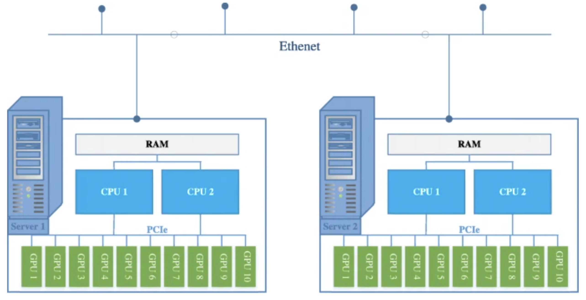
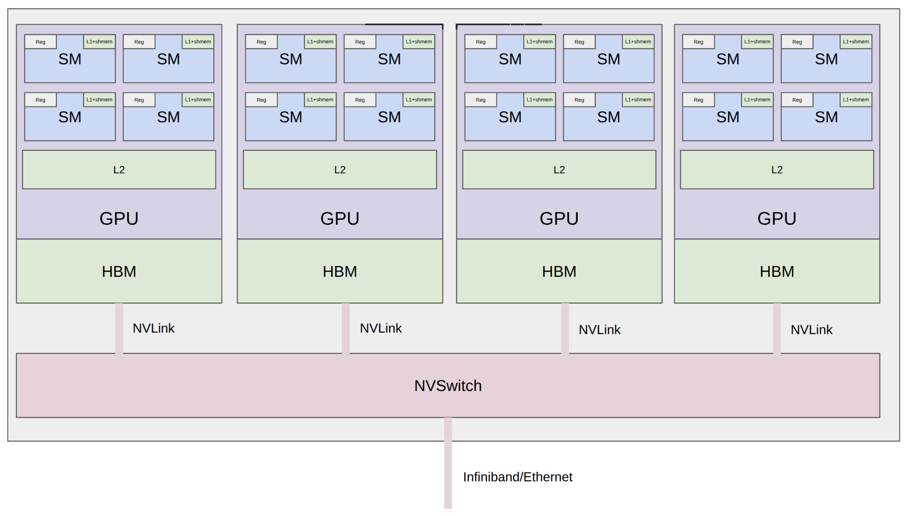
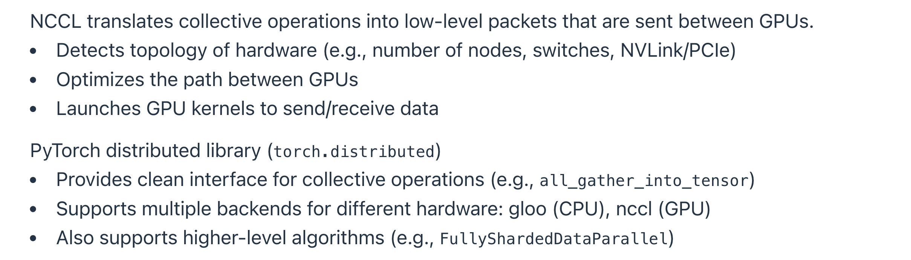

> [Stanford CS336, Spring 2026](https://cs336.stanford.edu/): Outline & Key points

## 07_Simple parallelism coding

> 比08更基础但更落地，可以作为08的补充.

### Keynotes

1. Multi-GPU
   - 古典拓扑：
     
     - 同节点的GPU通过PCIe通信（242 GB/s）.
     - 跨节点的GPU通过Ethernet通信（~200 MB/s）.
   - 现代拓扑：
     
     - 8 GPUs per node, connected by NVLink to an NVSwitch (B200s' NVLink 5.0 gets 1.8 TB/s, while HBM is 8 TB/s).
     - (typically) 256 nodes per pod, connected by InfiniBand (via PCIe -> HCA/InfiniBand NIC -> InfiniBand cable; ~0.05 TB/s).
     - N pods per cluster/datacenter, connected by Ethernet (via PCIe -> CPU -> Ethernet cable).
   - 关于数据传输是否需要经过CPU：
     - Ethernet requires passing through the CPU (copy data to kernel socket buffer, build TCP packets, copy to NIC ring buffer).
     - RDMA (Remote Direct Memory Access) allows one GPU to directly read/write another GPU's memory without involving the CPU.
     - InfiniBand supports RDMA, but standard Ethernet does not.
   - 硬件优化带来的一些例外：
     - GB200/GB300 NVL72: 8 GPUs per tray, 9 trays per rack (72 GPUs in one NVLink domain).
     - RoCE (RDMA over Converged Ethernet): Ethernet bypasses CPU, similar but cheaper/weaker than InfiniBand, used by Meta.
2. 讨论的主题：**在单GPU上，通过算子融合、激活值重计算、Tiling等方式减少访存**；随着模型增大，需要通过多卡并行扩展算力和显存，与此同时需要管理多GPU通信，即如何**在多GPU上，通过适量复制、等价算法、计算/通信重叠等方式减少或隐藏分片存储参数和数据带来的GPU间通信**.

### Collective operations in PyTorch Distributed



[PyTorch Distributed](https://docs.pytorch.org/docs/stable/distributed.html)封装了集合通信操作（支持NCCL在内的多种后端），本节记录课程中的示例代码.

```python
import os
import time
from typing import Callable

import torch
import torch.distributed as dist
import torch.multiprocessing as mp


def setup(rank: int, world_size: int):
    """
    Initializes the distributed environment (called at start of process).
    """
    # Specify where master lives (rank 0), used to coordinate (actual data goes through NCCL)
    os.environ["MASTER_ADDR"] = "localhost"
    os.environ["MASTER_PORT"] = "15623"

    if torch.cuda.is_available():
        torch.cuda.set_device(rank)
    
    if torch.cuda.is_available():
        dist.init_process_group("nccl", rank=rank, world_size=world_size)
    else:
        dist.init_process_group("gloo", rank=rank, world_size=world_size)


def cleanup():
    """
    Cleans up the distributed environment (called at end of process).
    """
    dist.destroy_process_group()


def cuda_if_available(index: int) -> torch.device:
    if torch.cuda.is_available():
        return torch.device(f"cuda:{index}")
    else:
        return torch.device("cpu")


def render_duration(duration: float) -> str:
    if duration < 1e-3:
        return f"{duration * 1e6:.2f}us"
    if duration < 1:
        return f"{duration * 1e3:.2f}ms"
    return f"{duration:.2f}s"


def collective_operations_main(rank: int, world_size: int):
    """
    This function is running asynchronously for each process (rank = 0, ..., world_size - 1).
    """
    setup(rank, world_size)
    
    # All-reduce
    dist.barrier()
    data = torch.tensor([0., 1, 2, 3], device=cuda_if_available(rank)) + rank
    print(f"Rank {rank} [before all-reduce]: {data}", flush=True)
    dist.all_reduce(tensor=data, op=dist.ReduceOp.SUM, async_op=False)
    print(f"Rank {rank} [after all-reduce]: {data}", flush=True)
    
    # Reduce-scatter
    dist.barrier()
    input = torch.arange(world_size, dtype=torch.float32, device=cuda_if_available(rank)) + rank
    output = torch.empty(1, device=cuda_if_available(rank))
    print(f"Rank {rank} [before reduce-scatter]: input = {input}, output = {output}", flush=True)
    dist.reduce_scatter_tensor(output=output, input=input, op=dist.ReduceOp.SUM, async_op=False)
    print(f"Rank {rank} [after reduce-scatter]: input = {input}, output = {output}", flush=True)
    
    # All-gather
    dist.barrier()
    input = output  # Input is the output of reduce-scatter
    output = torch.empty(world_size, device=cuda_if_available(rank))
    print(f"Rank {rank} [before all-gather]: input = {input}, output = {output}", flush=True)
    dist.all_gather_into_tensor(output_tensor=output, input_tensor=input, async_op=False)
    print(f"Rank {rank} [after all-gather]: input = {input}, output = {output}", flush=True)

    # Indeed, all-reduce = reduce-scatter + all-gather
    
    cleanup()


def all_reduce(rank: int, world_size: int, num_elements: int):
    """
    Benchmarking all-reduce.
    """
    setup(rank, world_size)
    
    # Create tensor
    data = torch.randn(num_elements, device=cuda_if_available(rank))
    
    # Warmup
    dist.all_reduce(tensor=data, op=dist.ReduceOp.SUM, async_op=False)
    if torch.cuda.is_available():
        torch.cuda.synchronize()  # Wait for CUDA kernels to finish
    dist.barrier()  # Wait for all the processes to get here
    
    # Perform all-reduce
    start_time = time.time()
    dist.all_reduce(tensor=data, op=dist.ReduceOp.SUM, async_op=False)
    if torch.cuda.is_available():
        torch.cuda.synchronize()  # Wait for CUDA kernels to finish
    dist.barrier()  # Wait for all the processes to get here
    end_time = time.time()
    duration = end_time - start_time
    print(f"[all_reduce] Rank {rank}: all_reduce(world_size={world_size}, num_elements={num_elements}) took {render_duration(duration)}", flush=True)
    
    # Measure the effective bandwidth
    dist.barrier()
    size_bytes = data.element_size() * data.numel()
    sent_bytes = size_bytes * 2 * (world_size - 1)  # 2x because send + receive, world_size-1 steps in all-reduce
    total_duration = world_size * duration
    bandwidth = sent_bytes / total_duration
    print(f"[all_reduce] Rank {rank}: all_reduce measured bandwidth = {round(bandwidth / 1024**3)} GB/s", flush=True)
    
    # Notes:
    # - Effective bandwidth ~ 2 * size_bytes / duration
    # - Independent of world_size
    # - Independent of algorithmic topology (ring or tree)
    
    cleanup()


def reduce_scatter(rank: int, world_size: int, num_elements: int):
    """
    Benchmarking reduce-scatter.
    """
    setup(rank, world_size)
    
    # Create input and output
    input = torch.randn(world_size, num_elements, device=cuda_if_available(rank))  # Each rank has a matrix
    output = torch.empty(num_elements, device=cuda_if_available(rank))
    
    # Warmup
    dist.reduce_scatter_tensor(output=output, input=input, op=dist.ReduceOp.SUM, async_op=False)
    if torch.cuda.is_available():
        torch.cuda.synchronize()  # Wait for CUDA kernels to finish
    dist.barrier()  # Wait for all the processes to get here
    
    # Perform reduce-scatter
    start_time = time.time()
    dist.reduce_scatter_tensor(output=output, input=input, op=dist.ReduceOp.SUM, async_op=False)
    if torch.cuda.is_available():
        torch.cuda.synchronize()  # Wait for CUDA kernels to finish
    dist.barrier()  # Wait for all the processes to get here
    end_time = time.time()
    duration = end_time - start_time
    print(f"[reduce_scatter] Rank {rank}: reduce_scatter(world_size={world_size}, num_elements={num_elements}) took {render_duration(duration)}", flush=True)
    
    # Measure the effective bandwidth
    dist.barrier()
    data_bytes = input.element_size() * input.numel()
    sent_bytes = data_bytes * (world_size - 1)
    total_duration = world_size * duration
    bandwidth = sent_bytes / total_duration
    print(f"[reduce_scatter] Rank {rank}: reduce_scatter measured bandwidth = {round(bandwidth / 1024**3)} GB/s", flush=True)
    
    # Notes:
    # - all-reduce = reduce-scatter + all-gather
    # - all-reduce moves 2x the data in 2x the time compared to reduce-scatter, so similar bandwidth
    
    cleanup()


def spawn(func: Callable, world_size: int, *args, **kwargs):
    """
    Launches `world_size` processes that each calls `func` on world_size, args, kwargs.
    """
    args = (world_size,) + args + tuple(kwargs.values())
    mp.spawn(func, args=args, nprocs=world_size, join=True)


if __name__ == "__main__":
    spawn(collective_operations_main, world_size=4)

    ########## Benchmarking ##########
    # All-reduce
    spawn(all_reduce, world_size=4, num_elements=100 * 1024**2)
    # Reduce-scatter
    spawn(reduce_scatter, world_size=4, num_elements=100 * 1024**2)
```

分布式训练常用“一进程一卡”的模式（此外还有“一进程多卡”“多进程一卡”），使用PyTorch实现这一模式的基本过程是：
1. 启动进程并分配编号：使用`mp.spawn`（代码）或torchrun（命令行）启动进程，PyTorch自动分配进程编号，前者通过函数参数（`rank`），后者通过环境变量（`LOCAL_RANK`），多机/节点情况下需要在每个机器上分别启动.
2. 由进程编号映射到GPU：接下来进入所启动的进程（所编写的进程函数或脚本的实例），可以先通过`torch.cuda.set_device`绑定GPU，也可以后续在每次声明设备时指定.
3. 通过`dist.init_process_group`建立通信组.
4. 执行计算与通信.
5. 通过`dist.destroy_process_group`释放通信组.

### Simple parallelism coding

> 以MLP为例，简单过一下Data/Tensor/Pipeline parallel.

#### Data parallel

```python
import os
import math
from typing import Callable

import torch
import torch.nn.functional as F
import torch.distributed as dist
import torch.multiprocessing as mp


def setup(rank: int, world_size: int):
    """
    Initializes the distributed environment (called at start of process).
    """
    # Specify where master lives (rank 0), used to coordinate (actual data goes through NCCL)
    os.environ["MASTER_ADDR"] = "localhost"
    os.environ["MASTER_PORT"] = "15623"

    if torch.cuda.is_available():
        torch.cuda.set_device(rank)
    
    if torch.cuda.is_available():
        dist.init_process_group("nccl", rank=rank, world_size=world_size)
    else:
        dist.init_process_group("gloo", rank=rank, world_size=world_size)


def cleanup():
    """
    Cleans up the distributed environment (called at end of process).
    """
    dist.destroy_process_group()


def cuda_if_available(index: int) -> torch.device:
    if torch.cuda.is_available():
        return torch.device(f"cuda:{index}")
    else:
        return torch.device("cpu")


def get_init_params(num_inputs: int, num_outputs: int, rank: int) -> torch.nn.Parameter:
    """
    Creates parameters and puts them on the `rank`-th GPU.
    """
    torch.random.manual_seed(0)
    return torch.nn.Parameter(torch.randn(num_inputs, num_outputs, device=cuda_if_available(rank)) / math.sqrt(num_outputs))


def int_divide(a: int, b: int) -> int:
    assert a % b == 0
    return a // b


def summarize_tensor(tensor: torch.tensor) -> str:
    return "x".join(map(str, tensor.shape)) + "[" + str(round(tensor.view(-1)[0].item(), 4)) + "...]"


def data_parallelism_main(rank: int, world_size: int, data: torch.tensor, num_layers: int, num_steps: int):
    setup(rank, world_size)
    
    # Get the slice of data for this rank (in practice, each rank should load only its own data)
    batch_size = data.size(0)
    num_dim = data.size(1)
    local_batch_size = int_divide(batch_size, world_size)
    start_index = rank * local_batch_size
    end_index = start_index + local_batch_size
    data = data[start_index:end_index].to(cuda_if_available(rank))
    
    # Create MLP parameters params[0], ..., params[num_layers - 1] (each rank has all parameters)
    params = [get_init_params(num_dim, num_dim, rank) for layer in range(num_layers)]
    optimizer = torch.optim.AdamW(params, lr=1e-3)  # Each rank has own optimizer state
    
    for step in range(num_steps):
        # Forward pass
        x = data
        for param in params:
            x = x @ param
            x = F.gelu(x)
        loss = x.square().mean()
        # Backward pass
        loss.backward()
        # Sync gradients across workers (ONLY difference between standard training and DDP)
        for param in params:
            dist.all_reduce(tensor=param.grad, op=dist.ReduceOp.AVG, async_op=False)
        # Update parameters
        optimizer.step()
        print(f"[data_parallelism] Rank {rank}: step = {step}, loss = {loss.item()}, params = {[summarize_tensor(params[layer]) for layer in range(num_layers)]}", flush=True)
    
    cleanup()


def generate_sample_data():
    batch_size = 128
    num_dim = 1024
    data = torch.randn(batch_size, num_dim)
    return data


def spawn(func: Callable, world_size: int, *args, **kwargs):
    """
    Launches `world_size` processes that each calls `func` on world_size, args, kwargs.
    """
    args = (world_size,) + args + tuple(kwargs.values())
    mp.spawn(func, args=args, nprocs=world_size, join=True)


if __name__ == "__main__":
    data = generate_sample_data()
    spawn(data_parallelism_main, world_size=4, data=data, num_layers=4, num_steps=1)
```

#### Tensor parallel

```python
# ...

def tensor_parallelism_main(rank: int, world_size: int, data: torch.tensor, num_layers: int):
    setup(rank, world_size)
    
    batch_size = data.size(0)
    num_dim = data.size(1)
    data = data.to(cuda_if_available(rank))  # Each rank gets the data
    
    # Create model (each rank gets 1/world_size of the parameters)
    #  |  |  |  |
    # W0 W1 W2 W3
    #  |  |  |  |
    local_num_dim = int_divide(num_dim, world_size)
    params = [get_init_params(num_dim, local_num_dim, rank) for layer in range(num_layers)]
    
    # Forward pass
    x = data
    for layer in range(num_layers):
        x = x @ params[layer]
        x = F.gelu(x)
        # Allocate memory for activations (world_size x batch_size x local_num_dim)
        activations = [torch.empty(batch_size, local_num_dim, device=cuda_if_available(rank)) for _ in range(world_size)]
        # Send activations via all-gather
        dist.all_gather(tensor_list=activations, tensor=x, async_op=False)
        # Concatenate them to get batch_size x num_dim
        x = torch.cat(activations, dim=1)
    print(f"[tensor_parallelism] Rank {rank}: forward pass produced activations {summarize_tensor(x)}", flush=True)
    
    cleanup()

# ...

if __name__ == "__main__":
    data = generate_sample_data()
    spawn(tensor_parallelism_main, world_size=4, data=data, num_layers=4)
```

#### Pipeline parallel

```python
# ...

def pipeline_parallelism_main(rank: int, world_size: int, data: torch.tensor, num_layers: int, num_micro_batches: int):
    setup(rank, world_size)
    
    batch_size = data.size(0)
    num_dim = data.size(1)
    data = data.to(cuda_if_available(rank))

    # Split up layers (each rank gets a subset of layers)
    local_num_layers = int_divide(num_layers, world_size)
    local_params = [get_init_params(num_dim, num_dim, rank) for layer in range(local_num_layers)]
    
    # Forward pass
    # Break up into micro batches to minimize the bubble
    micro_batch_size = int_divide(batch_size, num_micro_batches)
    if rank == 0:
        # The data
        micro_batches = data.chunk(chunks=num_micro_batches, dim=0)
    else:
        # Allocate memory for activations
        micro_batches = [torch.empty(micro_batch_size, num_dim, device=cuda_if_available(rank)) for _ in range(num_micro_batches)]
    
    for x in micro_batches:
        # Get activations from previous rank
        if rank - 1 >= 0:
            dist.recv(tensor=x, src=rank - 1)
        # Compute layers assigned to this rank
        for param in local_params:
            x = x @ param
            x = F.gelu(x)
        # Send to the next rank
        if rank + 1 < world_size:
            print(f"[pipeline_parallelism] Rank {rank}: sending {summarize_tensor(x)} to rank {rank + 1}", flush=True)
            dist.send(tensor=x, dst=rank + 1)
    
    # Not handled: overlapping communication/computation to eliminate pipeline bubbles
    
    cleanup()

# ...

if __name__ == "__main__":
    data = generate_sample_data()
    spawn(pipeline_parallelism_main, world_size=2, data=data, num_layers=4, num_micro_batches=4)
```

---

`dist.all_reduce`等通信操作没有定义反向传播方法，因此如果需要**在自动微分过程中进行通信操作**，需要将通信过程封装为`torch.autograd.Function`并分别定义`forward`和`backward`方法.

What's missing?
- Communication/computation overlap.
- More general models (with attention, etc.).
- Other forms of parallelism (e.g., sequence parallelism, expert parallelism, combinations).
- Jax/TPUs: just define the model, the sharding strategy, and the Jax compiler handles the rest (more: [Levanter — Legible, Scalable, Reproducible Foundation Models with JAX](https://crfm.stanford.edu/2023/06/16/levanter-1_0-release.html)).
- But we're doing PyTorch so you can see how one builds up from the primitives.