> [Stanford CS336, Spring 2026](https://cs336.stanford.edu/): Outline & Key points

## 08_Parallel paradigms, Parallel in the wild

> More: [The Ultra-Scale Playbook: Training LLMs on GPU Clusters](https://huggingface.co/spaces/nanotron/ultrascale-playbook) ([熟肉](https://huggingface.co/spaces/Ki-Seki/ultrascale-playbook-zh-cn)), [Megatron Core User Guide](https://docs.nvidia.com/megatron-core/developer-guide/0.15.0/index.html)

### Basics

1. *Why multi-GPU parallel*：单GPU已远远无法满足LLM对计算和显存的需求，通过多卡（GPU）并行，实现计算和显存的线性扩展.
2. *Why it is tough*：
   - 通信链路是异构的，单数据中心内的通信可以抽象为以下层次：
     | 范围 | 介质 | 带宽 |
     |---|---|---|
     | 本卡显存 | - | ~3 TB/s |
     | 本节点的GPU | NVLink（可接NVSwitch）或PCIe | ~500 GB/s |
     | 跨节点的GPU | InfiniBand或Ethernet | ~50 GB/s |
   - 多卡并行需要考虑如何合理分配计算任务和数据，以高效利用所有GPU的算力和显存；同时还需要协调GPU之间的通信（而通信链路是异构的），通过计算与通信的重叠来降低通信开销.
   > 补充：构成节点的具体硬件及其连接（从没有NVSwitch到有NVSwitch）
   > 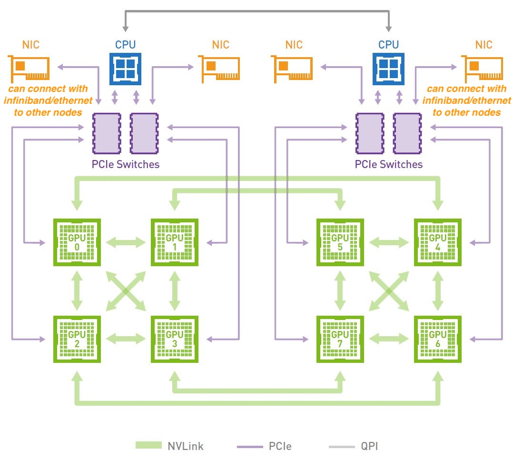
   > 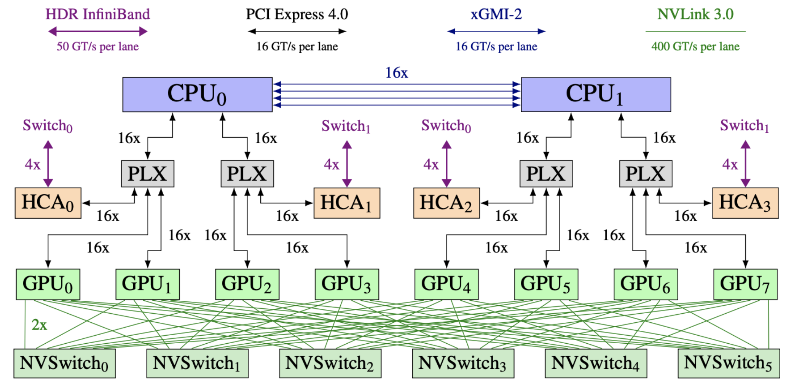
   > 上图和下图的本质区别其实就是GPU连接是否使用了NVSwitch；NVSwitch把点对点NVLink拓扑变成交换式全互联，避免经过其他GPU的多跳和链路带宽不均，并提高多GPU并发通信的总带宽.
3. 在实际编程时我们不用操作硬件，通过调用硬件之上通信原语层所抽象的通信原语（包括**集合通信**Broadcast、Scatter、Gather、Reduce、Reduce-scatter、All-gather、All-reduce、All-to-all和**点对点通信**Send、Recv），足以覆盖大部分需求，例如NCCL（Nvidia Collective Communication Library）是Nvidia提供的GPU通信原语库.
   | 通信原语 | 语义 | 反向传播对应的原语（Reduce具体为sum） |
   |---|---|---|
   | Broadcast | 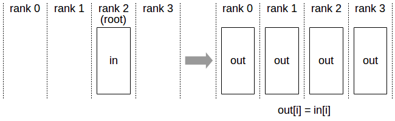 | Reduce（梯度累加） |
   | Scatter | 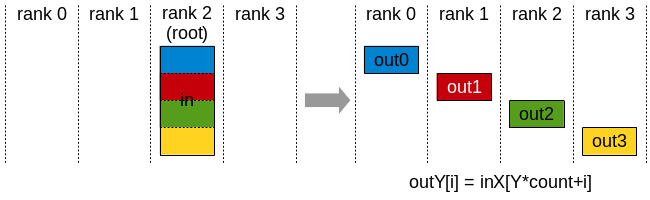 | Gather |
   | Gather |  | Scatter |
   | Reduce |  | Broadcast（加法对每个输入偏导都是1） |
   | Reduce-scatter | 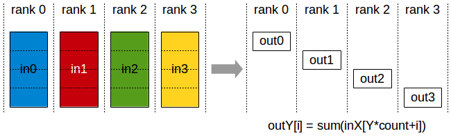 | All-gather（前向：等价于Reduce->Scatter；反向：Broadcast<-Gather） |
   | All-gather |  | Reduce-scatter（前向：等价于Gather->Broadcast；反向：Scatter<-Reduce） |
   | All-reduce | 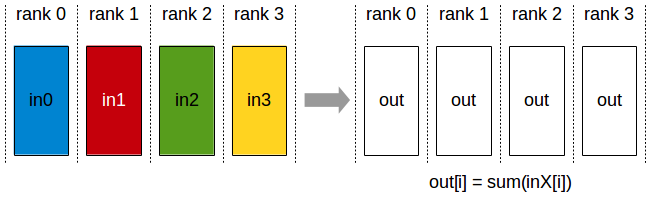 | All-reduce（前向：等价于Reduce->Broadcast；反向：Broadcast<-Reduce） |
   | All-to-all |  | All-to-all |
   
   All-reduce还等价于Reduce-scatter+All-gather，通过这种分解所实现的Ring All-reduce算法在带宽受限场景下实现了理论最优的通信数据量，这也是NCCL所采用的All-reduce算法：
   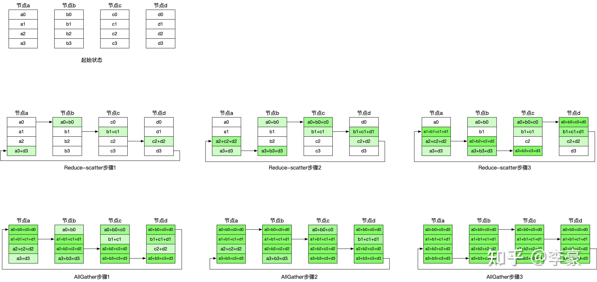
   假设单节点上数据总量为D，节点数量为M，两个阶段的通信次数都为M-1，每次通信每个节点发送数据量为D/M，故两个阶段的通信数据量都为(M-1)D/M；总共通信次数为2(M-1)，总共通信数据量为2(M-1)D/M.

> 补充：TPU vs GPU of networking
> 
> 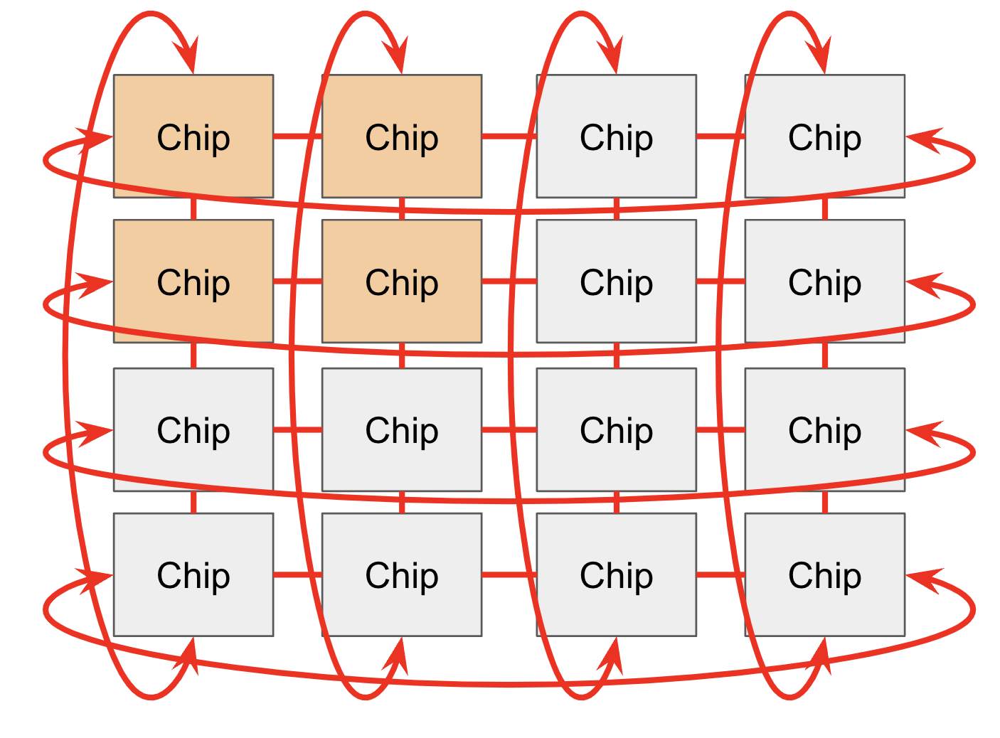
> 
> TPU和GPU的网络连接与芯片本身是共同设计的：
> - TPU的设计目标是规则大规模计算，因此使用环面网格的网络连接方式（如上图），规则、结构化的计算负载在TPU上可以获得非常好的性能，例如Tensor parallel.
> - GPU的设计目标是通用AI负载，因此在大规模集群中通常使用基于交换机的分层网络（即交换式全互联，例如Fat-tree），具有更大的灵活性，更适合非结构化的负载，例如Expert parallel.
> 
> 但在最新的第八代TPU“TPU 8t”和“TPU 8i”中，其网络连接方式更靠近了GPU：
> - TPU 8t：
>   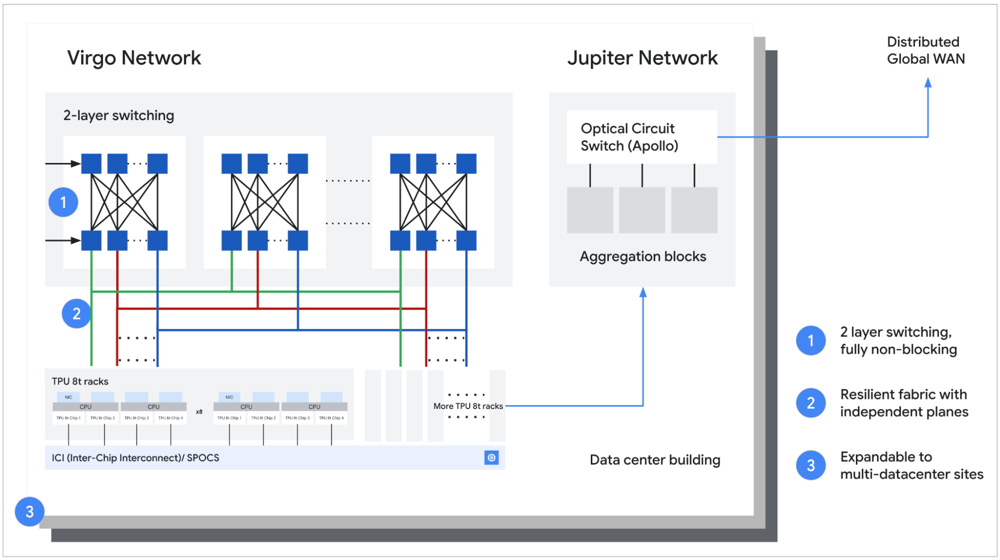
> - TPU 8i：
>   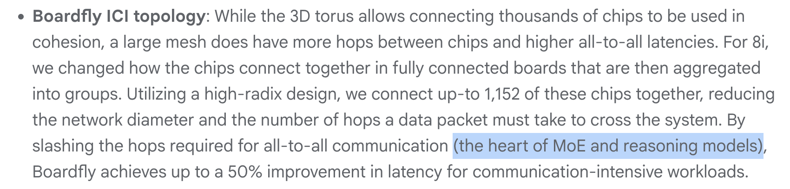
> - More: [Inside the eighth-generation TPU: An architecture deep dive](https://cloud.google.com/blog/products/compute/tpu-8t-and-tpu-8i-technical-deep-dive)

### Parallel paradigms

> 基于LLM训练过程的负载特性，利用上述通信原语，可以定义多种维度的多卡并行方式，以支持模型规模Scale up.
> 
> 组合不同并行方式需要考虑是否正交，且GPU的位置分布会对特定并行方式的效率有较显著的影响，因此需要对这些并行方式有较深的理解.

#### Data parallel

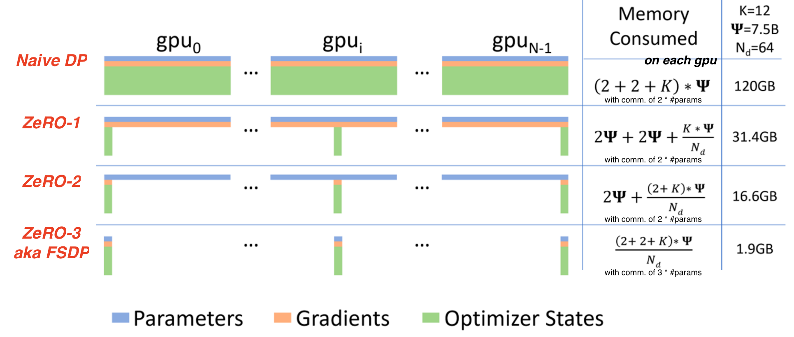

1. 训练过程中参数相关的内存需求
   - 逻辑上每个参数需要16字节（视具体优化器、具体精度需要而定）：
     - BF16低精度权重，需2字节.
     - BF16梯度，需2字节.
     - 优化器状态，包括FP32主权重、FP32一阶矩、FP32二阶矩，分别需要4字节.
     - 某些低精度优化器可借助Kahan、补偿求和等算法，以BF16保存部分优化器状态，但其数值稳定性取决于具体算法.
2. Naive data parallel
   - **数据并行的核心是沿Batch维度切分训练数据**，假设批量大小为B、GPU数量为M，则每个GPU独立进行B/M个样本的前向传播和反向传播，反向传播后对所有参数**梯度**张量进行**All-reduce**，将每个GPU上由部分样本得到的梯度转换为全批量的梯度：
     $$\mathrm{Loss\ on\ GPU}_i:\mathcal{L}_i=\frac{1}{B/M}\sum_{x\in\mathcal{B}_i}\ell(x;\theta)$$
     $$\mathrm{Param\ grad\ on\ GPU}_i:g_i=\nabla_\theta\mathcal{L}_i=\frac{M}{B}\sum_{x\in\mathcal{B}_i}\nabla_\theta\ell(x;\theta)$$
     $$\mathrm{Param\ grad\ on\ each\ GPU\ after\ mean\ allreduce}:g=\frac{1}{M}\sum_{i=1}^{M}g_i=\frac{1}{M}\sum_{i=1}^{M}\left(\frac{M}{B}\sum_{x\in\mathcal{B}_i}\nabla_\theta\ell(x;\theta)\right)=\frac{1}{B}\sum_{x\in\mathcal{B}}\nabla_\theta\ell(x;\theta)$$
     然后每个GPU独立进行完全相同的optimizer.step过程.
   - 在Naive实现中，每个GPU都存有全部参数的权重、梯度和优化器状态，按部就班地执行上述流程.
   - 分析：
     - 计算扩展😺：线性扩展.
     - 显存扩展😿：多GPU和单GPU所能支持的最大模型规模相同.
     - 通信开销：每次参数更新前需要对所有梯度张量执行一次All-reduce，通信数据量约为2*`# Params`.
3. ZeRO-1
   - 对最重的优化器状态进行分片并分配到每个GPU，每个GPU只保存并更新一部分参数的优化器状态；每次参数更新时，先对**梯度**执行**Reduce-scatter**，每个GPU得到其负责的那部分参数的全批量梯度，然后更新其负责的参数并cast到低精度权重，最后对更新后的**权重**执行**All-gather**，每个GPU同步所有最新的权重.
   - 因为All-reduce等价于先进行Reduce-scatter再进行All-gather，所以相比Naive实现通信开销不变，每个GPU白捡了显存节省；同时消除了跨GPU的重复优化器状态更新.
4. ZeRO-2
   - 在ZeRO-1的基础上进一步对梯度进行分片；反向传播时每个GPU不再持久保存全部参数的局部梯度，因此不会在参数更新时再规约梯度，而是每当所有GPU计算完一部分参数的局部梯度之后立即对这部分**梯度**进行**Reduce-scatter**，并随时释放不再被依赖的局部梯度，最后一次Reduce-scatter执行之后所有GPU都已有其负责的那部分参数的全批量梯度，然后每个GPU进行参数更新并**All-gather**更新后的**权重**.
   - 相比ZeRO-1进一步压缩了单GPU上参数所需的显存，通信数据量不变，通信次数增加，但是Reduce-scatter通信和下一步的反向传播计算可以自然重叠（异步），因此ZeRO-2几乎不增加通信开销，相比Naive实现仍然白捡显存节省.
   - 梯度累积和数据并行并不冲突，且两者在本质上等价，梯度累积可以看作时间维度的数据并行；同时使用梯度累积和数据并行时，ZeRO-2通常选择每次对梯度进行跨GPU的规约之后，再和本地累积值进行累加.
5. ZeRO-3（aka FSDP）
   
   ⬆️ [Pytorch Distributed FSDP](https://docs.pytorch.org/tutorials/intermediate/FSDP_tutorial.html)
   - 在ZeRO-2的基础上进一步对权重进行分片；整体来看整个过程和ZeRO-2一样，区别是在前向传播和反向传播过程中，在每层权重即将参与计算时，需要先对分散在每个GPU显存中的该层**权重**分片进行**All-gather**，在每个GPU中临时恢复完整权重并进行前向或反向传播，计算完成后释放非本地分片的权重，此外反向传播时对**梯度**进行**Reduce-scatter**.
   - More details：
     - 工程上只是为每层套上一个Wrapper，管理权重的聚合和释放、梯度的规约等.
     - 通信单元不一定只能是一层（即使之前都是按“通信单元为一层”来叙述的），通信单元的粒度过细会增加通信次数与启动开销，粒度过粗会提高峰值显存并减少流水重叠机会.
     - 通信原语的操作对象是每个GPU显存中的一个连续Buffer（通过元信息引用和解释）；为了提高通信效率，对于每个通信单元（模型的一层或多层），通信时通常会组合其中所有层需要通信的内容.
       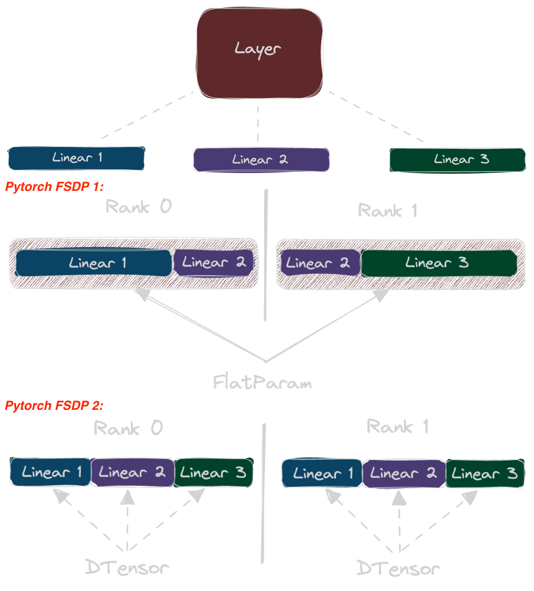
       - Pytorch FSDP1：将每个通信单元中所有层的参数拼接为一个或少数几个（按照兼容性，dtype、requires_grad等）一维扁平的参数对象，即FlatParameter（将参数拼接为FlatParameter，其梯度和逐元素优化器状态也采用与该FlatParameter对齐的扁平布局），每个FlatParameter在GPU之间均匀分片，权重聚合、梯度规约也以FlatParameter为一次通信的对象；对于数据并行，张量语义在权重聚合之后才需要考虑，优化器状态更新也不需要考虑模型视角的张量语义，因此“直接拼接、不考虑张量语义的划分”这种方式正确且简单，但是会导致同一参数张量在GPU之间分片不均，导致分布式存储状态下比较难以进行需要张量语义的操作（例如转换某层参数的精度）.
       - Pytorch FSDP2：使用DTensor（Distributed Tensor，分布式张量），每个DTensor参数张量在GPU之间均匀分片，权重聚合、梯度规约以一个或多个DTensor参数张量为一次通信的对象；每次聚合后的完整权重中每个张量的物理排列可能不是连续的（需重排，取决于具体实现），但是分布式存储状态下比较容易进行需要张量语义的操作.
   - 相比ZeRO-2进一步压缩了单GPU上参数所需的显存，真正实现了可训练的模型规模随GPU数量线性扩展；**不再需要在参数更新后立即聚合全部参数**，而是在前向和反向传播时沿计算图多次聚合局部参数，通信数据量只多出`# Params`，此外通过重叠通信和计算可以掩盖大部分多次权重聚合、梯度规约通信带来的等待延迟.
     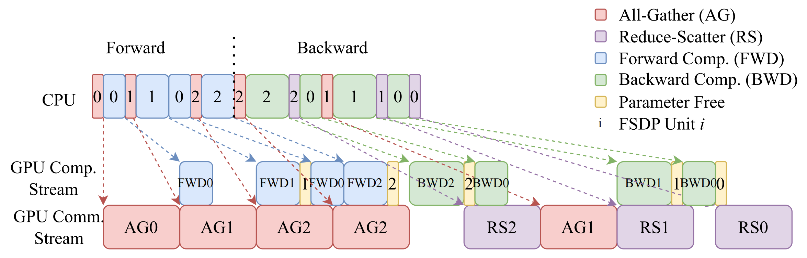
     ⬆️ Pytorch Distributed FSDP

> 补充：Pytorch Distributed FSDP中的CPU offload
> 
> 在已将模型封装为一个个FSDP instance的基础上，Pytorch FSDP支持以这些instance为调度单元的CPU offload，当某个instance当前没有参与计算时，将其权重和梯度卸载到CPU中，以进一步提高显存利用效率.

#### Model parallel

> FSDP已经实现计算和显存的线性扩展了，为什么需要其他并行方式？
> - 数据并行的计算扩展存在上限：
>   - Preliminary：当Batch size小于某个与噪声尺度相关的临界值时，增大Batch size可以带来近似线性的训练速度提升；但当Batch size大于该临界值后，继续增大Batch size的收益会快速递减（Critical batch size）.
>   - 因此对于每个训练任务都存在一个最优的Batch size，而数据并行需要消耗Batch size，因此数据并行的计算扩展存在上限.
>   - 此外Local batch size越小，通信开销也会越来越难以被计算掩盖.
> - 实现了参数显存的线性扩展，但是没有减少每个GPU中的激活值显存（采用固定Local batch size的比较口径）.
> 
> 数据并行的核心是切分数据，模型并行的核心是切分模型（不同于FSDP的参数分片；模型并行使得模型参数按照特定方式被切分放到不同的GPU上，且每个GPU上的计算只需要用到本地的参数，**因此激活值也被切分**；FSDP也进行参数分片，但只是将完整的模型参数分布式存储在每个GPU的显存中，在计算时每个GPU需要通过通信获得完整的参数），一种并行模式对应一种切分方式：
> - Pipeline parallel：沿层切分参数和计算（沿深度切）.
> - Tensor/Sequence parallel：沿层内张量维度切分参数和计算（沿宽度切），如果使用Sequence parallel，则进一步沿激活值的序列维度切分可独立处理的激活及其计算.
> - Expert parallel：沿专家维度切分参数和计算.
> - Context parallel：将Flash Attention式的分块Attention扩展到跨GPU场景，沿上下文序列维度切分激活和计算.
> 
> 模型并行通常可以和数据并行组成正交的设备网格，首先通过PP、TP等方式将一个模型副本的参数与计算切分到多个Rank，再将整个模型并行组复制DP份，使不同副本处理不同的Batch分片，以消耗全局Batch size预算为代价提高训练吞吐量；参数的分布式存储首先来自模型并行对参数的切分，若使用FSDP，还可以在对应的数据并行组内对各副本原本重复持有的同一模型分片进行分片存储.

##### Pipeline parallel

1. PP将模型的所有层切分为若干Stage，每个GPU只存有其中一个Stage的参数，只进行对应Stage的前向传播、反向传播、优化器状态更新，持有相邻Stage的GPU通过点对点通信在前向传播时传输边界激活值、在反向传播时传输激活值梯度.
   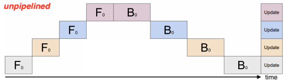
   在上图中，显存有效扩展，但计算过程和单GPU没有区别.
2. 为了提高计算吞吐量，通常把Batch切分成若干份并流水化每个Micro batch的前向传播和反向传播计算过程（若同时使用PP和DP，则在每个PP group内进一步把DP分配的Local batch切分为若干Micro batch），对每个GPU而言，处理完上一个Micro batch、传输激活值或激活值梯度（异步）、处理下一个Micro batch，反向传播时动态累加每个Micro batch得到的参数梯度.
   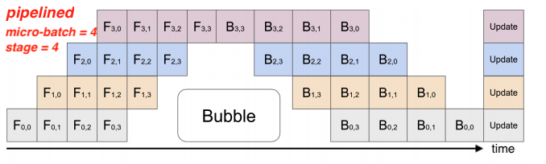
   上图是**GPipe**的实现，通过流水线明显改善了吞吐状况（且几乎免费，仅增加通信次数），但还是存在两个问题：
   - 流水线气泡：前向传播预热和排空、反向传播预热和排空所引入的气泡影响GPU利用率、整体吞吐和执行时间，理论气泡率为$\frac{n_{stages}-1}{n_{micro-batches}+n_{stages}-1}$（可以通过增加Micro batch的数量来降低气泡率，但前面提过Batch size存在一个权衡的上限）.
   - 激活值显存：每个GPU需要一直保存每个Micro batch的激活值直至其在反向传播中被消费，由于反向传播要等所有Micro batch完成前向后才开始，每个GPU的峰值显存包括所有Micro batch在该Stage的中间激活值.
3. 上述问题对应PP的两个主要优化方向，即在合理通信开销的前提下，如何减少流水线气泡和利用Batch切分拿到进一步降低峰值显存的利好：
   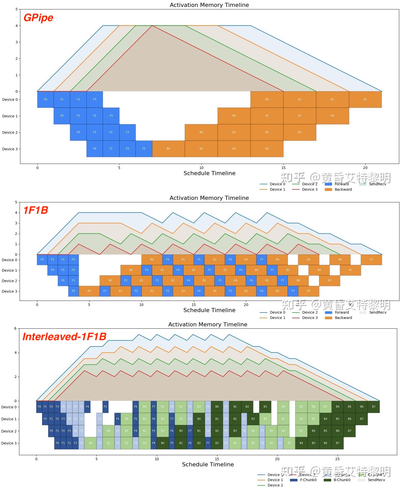
   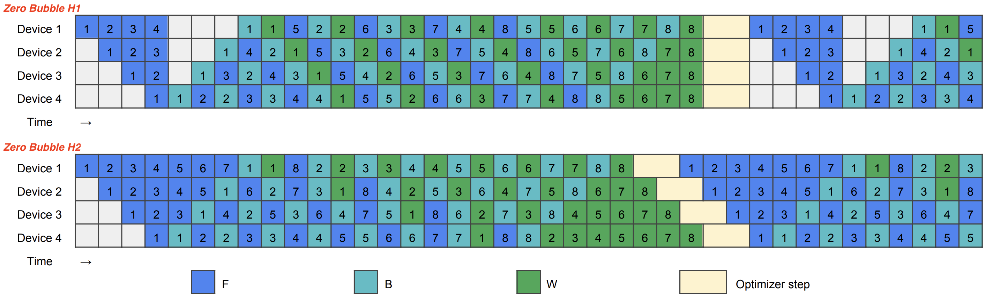
   - **1F1B**：
     - 每个Micro batch在前向传播完成后立即进行反向传播，尽早释放激活值以降低峰值显存，分为Warm-up、1F1B、Cool-down三个阶段.
     - 并没有减少GPipe的流水线气泡，每个GPU的峰值显存规模与Stage有关.
   - **Interleaved-1F1B（aka VPP）**：
     - 在1F1B基础上的改进，每个GPU被分配多个Stage，所有Stage循环映射到每个GPU.
     - 与1F1B相比，气泡数量不变，但是每个气泡时间缩短，GPU利用率提升，每个GPU的峰值显存规模仍与Stage有关且略多于1F1B，通信量显著上升.
   - **Zero Bubble PP**：
     - 在1F1B基础上的改进，由于反向传播包含激活值梯度计算和参数梯度计算两个部分，而下一个Micro batch的反向传播计算只需要用到上一个Micro batch的激活值梯度，因此可以通过解绑这两部分计算获得更高的流水线调整自由度，激活值梯度计算完成后立即传输到下一个GPU，参数梯度计算延后进行.
     - 与1F1B相比，H1版本的流水线气泡减少了2/3，每个GPU的峰值显存规模都与1F1B显存峰值最大的GPU相等；H2版本真正实现了零气泡，但是以每个GPU的峰值显存规模增大1倍为代价.

##### Tensor parallel & Sequence parallel

1. 矩阵乘法的两种分解方式
   - 权重列切：
     $$X=X, W=\begin{bmatrix}W_1&W_2\end{bmatrix}$$
     $$Y=\mathrm{GeLU}(XW)=\begin{bmatrix}\mathrm{GeLU}(XW_1)&\mathrm{GeLU}(XW_2)\end{bmatrix}$$
     输出等价于XW的切分.
   - 权重行切、输入列切（沿隐向量维度）：
     $$X=\begin{bmatrix}X_1&X_2\end{bmatrix}, W=\begin{bmatrix}W_1\\W_2\end{bmatrix}$$
     $$Y=\mathrm{GeLU}(XW)=\mathrm{GeLU}(X_1W_1+X_2W_2)$$
     类似Tiling.
2. Tensor parallel
   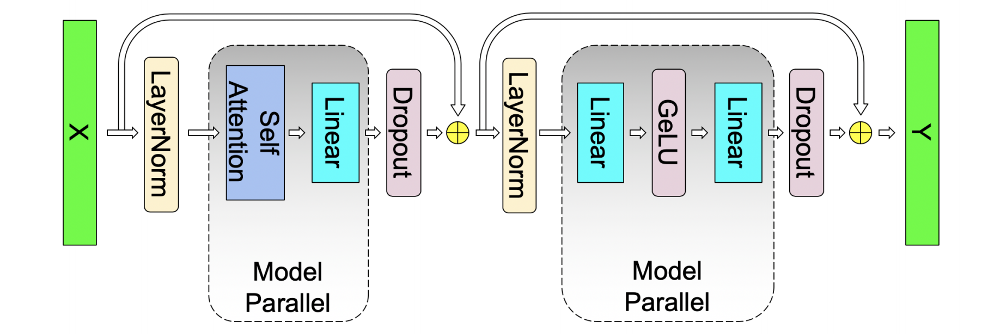
   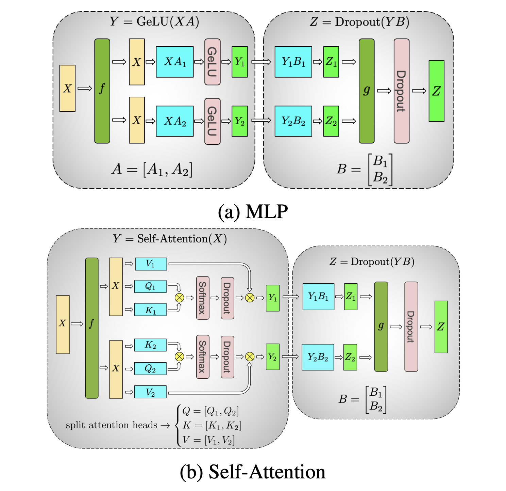
   - TP通常应用在**Attention**和**MLP**层以及**Embedding**和**LM head**，对于模型骨架上的其他操作（包括归一化、Dropout、残差加法、MoE router）整个TP group持有相同的参数副本、执行相同的计算、存有相同的激活：
     - Attention层：包含QKV projection、Attention、Output projection操作，**通常要求Query头数能被并行度整除**；**前向传播时**，QKV projection权重列切（每个GPU持有相同数量的一个或多个头），Output projection权重行切，每个GPU上相同的激活值分别投影到对应头的QKV，独立进行Attention，最后对所有GPU上的Output projection结果求和，因此$f$为Identity、$g$为All-reduce通信；**反向传播时**，相当于Output projection权重的转置列切，QKV projection权重的转置行切，图中右侧每个GPU上相同的激活值梯度按本地权重被映射回本地的Attention输出梯度，独立进行每个头的反向传播，最后分别累加所有GPU上的局部输入梯度，因此$g$为Identity、$f$为All-reduce通信.
     - MLP层：包含Up-projection、Non-linear、Down-projection操作，MLP层的TP不像Attention层那样包含注意力头的语义，只是单纯地通过矩乘的两种分解方式实现并行；**前向传播时**，Up-projection权重列切，Down-projection权重行切，因此$f$为Identity、$g$为All-reduce通信；**反向传播时**，Down-projection权重的转置列切，Up-projection权重的转置行切，因此$g$为Identity、$f$为All-reduce通信.
     - Embedding：每个GPU持有词表的一部分，且每个GPU拿到相同的Token id序列，对于属于本地词表范围的Token输出Embedding，本地词表中没有的Token输出零向量，通过All-reduce每个GPU拿到相同的全序列的Embedding；**反向传播时**，每个GPU都拿到相同的Embedding梯度，只需要将其中属于本地词表范围的Token对应的Embedding梯度累加起来.
     - LM head：权重列切（即沿词表维度切分），每个GPU只会拿到最终完整Logits的一部分，然后进行分布式Softmax（先本地规约再All-reduce）和损失计算；**反向传播时**通过All-reduce对每个GPU上的LM head输入梯度求和得到完整的输入梯度.
   - 对于MQA或GQA，若KV头数小于并行度，需要在所有GPU之间或共享同一KV头的GPU之间复制KV projection参数，且在反向传播时需要对相同KV projection参数副本的梯度进行All-reduce.
   - 对于Gated MLP，Up-projection包含Gate和Value两组投影，它们都按列切，和Attention层类似，反向传播时先在每个GPU上从这两路累加输入梯度，再在GPU之间对局部输入梯度进行All-reduce.
   - 分析：
     - 和PP相比，TP没有气泡问题，不需要消耗Batch size，适配新模型所需的Infra工程量更少.
     - 但是TP通信频繁、通信数据量大，且通信通常位于计算的关键路径上，难以被掩盖，因此TP对通信延迟和带宽要求很高，TP group通常限制在单个节点内，TP并行度通常最多设为单节点GPU数量（一般为8）.
       > 由于TPU的环面网格结构，通常在TPU上能够进行更大规模的TP.
       
       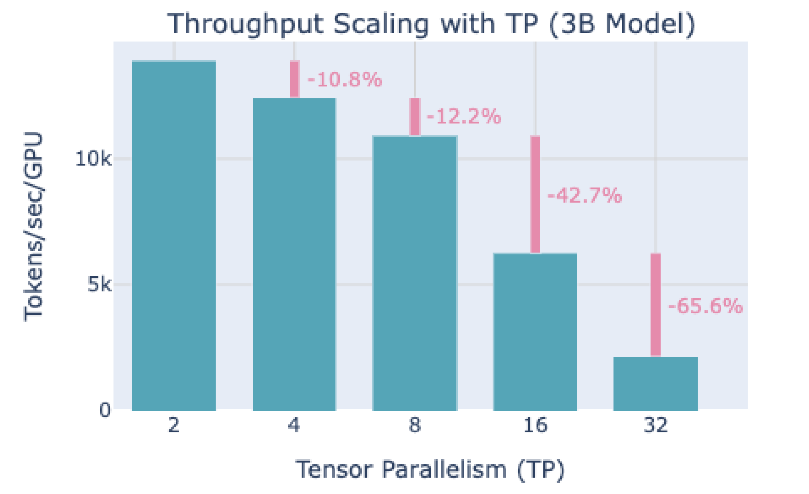
       - PP每个Stage通信一次（每个Micro batch进行一次点对点通信），每个Stage在一次前向或反向传播中的通信数据量为$bSH$.
       - TP每个Transformer block通信两次（Attention层和MLP层分别进行一次All-reduce通信），每个Transformer block在一次前向或反向传播中的通信数据量为$4BSH\frac{n_{devices}-1}{n_{devices}}$.
     - 在有高速互联GPU的情况下，总是优先使用TP！
3. Sequence parallel - making memory truly linear scaling
   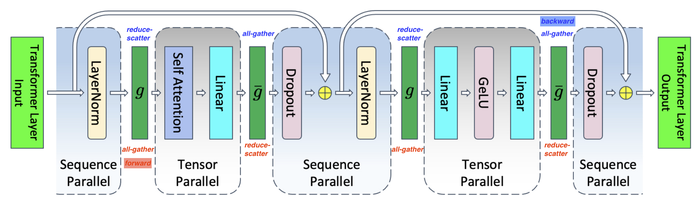
   - 动机：TP切分层内参数、计算和**部分临时激活**，但模型骨架上的输入、输出激活通常在GPU间复制，而训练时激活值的显存占用是一笔不小的开销.
     > 补充：训练时各类数据的显存占用
     > 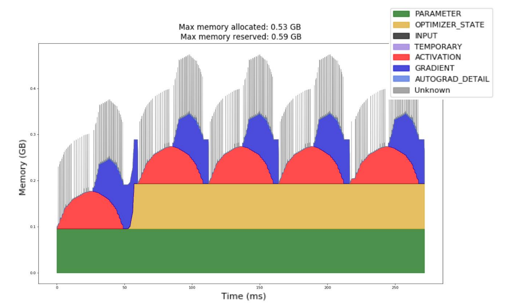
   - 从无并行，到TP，再到TP+SP：
     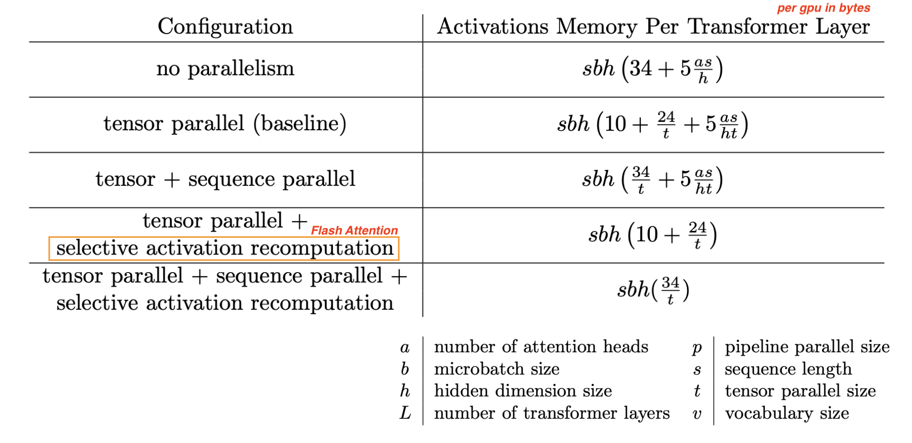
     > | 模块 | 激活值项 | 激活值显存（bytes） | 模块合计 | 使用TP后可并行化 | 使用TP+SP后可并行化 |
     > |---|---|---:|---:|---|---|
     > | **Attention** | QKV projection输入 | $2bsh$ | | | ✓ |
     > | | *Q、K、V* | $6bsh$ | | ✓ | ✓ |
     > | | *Softmax输出（用于计算Logits的梯度，进而计算Q和K的梯度，Softmax的雅可比矩阵取决于前向输出）* | $2abs^2$ | | ✓ | ✓ |
     > | | *Softmax输出的Dropout mask* | $abs^2$ | | ✓ | ✓ |
     > | | *Softmax Dropout输出（用于计算V的梯度）* | $2abs^2$ | 使用Flash Attention后通过激活值重计算可以去掉$5abs^2$的显存占用 | ✓ | ✓ |
     > | | Output projection输入 | $2bsh$ | | ✓ | ✓ |
     > | | Attention输出的Dropout mask | $bsh$ | $\boxed{11bsh+5abs^2}$ | | ✓ |
     > | **MLP** | Up-projection输入 | $2bsh$ | | | ✓ |
     > | | GeLU输入（形状为$b\times s\times4h$） | $8bsh$ | | ✓ | ✓ |
     > | | Down-projection输入（形状为$b\times s\times4h$） | $8bsh$ | | ✓ | ✓ |
     > | | MLP输出的Dropout mask | $bsh$ | $\boxed{19bsh}$ | | ✓ |
     > | **LayerNorm** | Attention前LayerNorm输入 | $2bsh$ | | | ✓ |
     > | | MLP前LayerNorm输入 | $2bsh$ | $\boxed{4bsh}$ | | ✓ |
     > | **总计** |  |  | $\boxed{bsh\left(34+5\frac{as}{h}\right)}$ | | |
   - 使用TP后仍然无法并行化的那些激活来自可以对序列中各Token独立计算的操作，因此可以沿序列维度“切分”（分布式计算和存储）这些激活；前向传播时，在Attention层、MLP层、LM head之前All-gather，在Embedding、Attention层、MLP层之后Reduce-scatter，反向传播与之相反；因此SP和TP是耦合的，且引入SP几乎不会给TP带来额外的通信成本.

##### Expert parallel

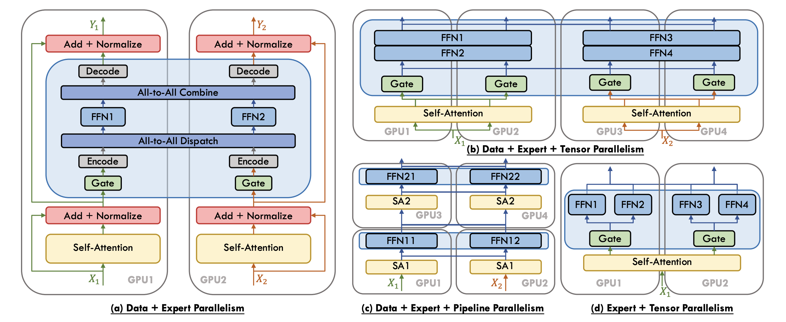

1. 在MoE模型中，一个很自然的想法是将MoE层中的专家分开放置在不同GPU中，即专家并行；**通常情况下EP和DP耦合**（上图a, b, c），要求EP并行度能够整除DP并行度：
   - 对于Attention等非MoE层，DP group内各GPU仍按普通DP处理各自的Batch分片.
   - 进入MoE层后，DP group被划分为一个或多个EP group：
     - 每个EP group内，不同GPU持有不同的一个或多个专家；前向传播时，通过All-to-all dispatch将各GPU原本独立处理的Token按路由结果发送给相应专家执行MLP，专家计算完成后，再通过All-to-all combine将结果送回Token原来的GPU；反向传播时，激活值梯度沿前向选中的专家MLP分支反向流动，同样通过两次All-to-all完成专家输出梯度的分发和专家输入梯度的返回.
     - 不同EP group中持有相同专家分片的对应GPU则构成专家数据并行（EDP），各自处理不同数据，并同步相同专家副本的参数梯度.
   - 5D并行（加上后面的CP）：
     $$\begin{aligned} \mathrm{world\ size}&=\mathrm{DP}*\mathrm{PP}*\mathrm{TP}*\mathrm{CP}&\mathrm{非MoE层} \\ &=(\mathrm{EDP}*\mathrm{EP})*\mathrm{PP}*\mathrm{TP}*\mathrm{CP}&\mathrm{MoE层} \\ \mathrm{DP}&=\mathrm{EDP}*\mathrm{EP} \end{aligned}$$
   > EP还能和TP耦合（上图d），在MoE层分化为EP和ETP.
2. 由于All-to-all通信在专家计算的关键路径上，因此EP和TP一样都对通信延迟和带宽有很高要求，尽量保证EP*TP最多为单节点GPU数量（一般为8）；此外对于MoE模型尽量使用EP而不是TP，主要原因是虽然EP和TP都能切分MLP的计算，但MoE模型的MLP参数本身就是按专家分开的，TP会使得参与矩乘的参数矩阵越来越小，导致GPU利用率下降（More: [here](https://docs.nvidia.com/megatron-core/developer-guide/latest/user-guide/features/moe.html#step-2-select-optimal-parallelism-strategy)）.
3. EP的复杂性：
   - [MoE Parallel Folding](https://arxiv.org/pdf/2504.14960)：使用EP意味着对MLP进行沿模型宽度的并行化，而Attention无法获得这类并行，除非同时使用TP，但是引入TP又会影响到MLP（前面提到应尽量使用EP而不是TP），因此这里陷入了Dilemma，没有一种同时适合Attention和MoE MLP的并行方案；因此Megatron团队提出MoE Parallel Folding，解耦Attention和MoE MLP的并行方案，Attention层支持TPxCPxDPxPP，MoE层支持ETPxEPxEDPxPP，实现更灵活的并行扩展.
   - [DeepEP](https://github.com/deepseek-ai/DeepEP)：DeepSeek开源的高性能EP通信库.

##### Context parallel

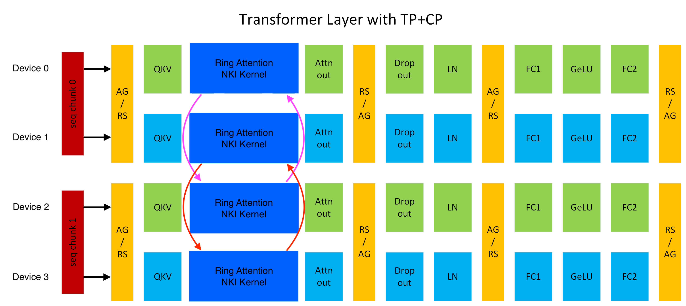

1. 可以概括几种并行方式如下：
   - DP：**切Batch，复制模型**.
   - PP：**沿层切模型**.
   - TP：**沿层内张量维度切模型**.
   - EP：**MoE模型中的专家放置**.
   当前的几种并行方式都可以在各自作用的维度扩展激活显存，但是面对长序列，它们都无法通过切分序列扩展显存，只能不断细化各自的维度（TP+SP的并行方式在TP区域沿隐藏维度切分激活、在SP区域沿序列维度切分激活，激活显存线性扩展，但是TP区域内部的激活值包含完整的序列长度，且在TP区域边界仍然需要临时恢复完整激活，因此当序列越来越长，TP+SP仍然无法在GPU之间有效切分激活），因此提出CP，其核心是“**切序列，复制模型**”.
2. 基于以下观察：
   - SP部分提到过，归一化、Dropout、残差加法、MoE router这些操作都可以对序列中各Token独立计算.
   - MLP层也可以对序列中各Token独立计算.
   - 问题出在Attention层，对每个Token的计算需要访问其他Token.
   因此对于Attention层的CP，使用**Ring Attention**算法，算法原理和Flash Attention相同，每个GPU持有其上序列的QKV，而KV在GPU之间循环流转，每个GPU通过在线Softmax得到其上序列的Query的Attention输出（More: [here](https://ki-seki-ultrascale-playbook-zh-cn.static.hf.space/index.html#%E4%B8%8A%E4%B8%8B%E6%96%87%E5%B9%B6%E8%A1%8C%EF%BC%88context_parallelism%EF%BC%89)）.
     > 可以想象TPU非常适合进行Ring Attention.

> **To sum up**
> 
> 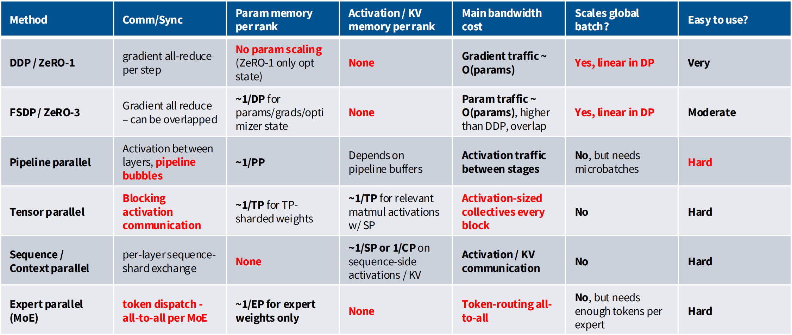

### Parallel in the wild

#### Common practice and benchmarking

1. Common practice：先用节点内TP/EP、节点间PP或FSDP分摊模型，使训练能够装入显存；模型装下后，尽量保持模型并行度不再增加，把剩余GPU用于DP以扩大吞吐.
2. Guidelines from Megatron：
   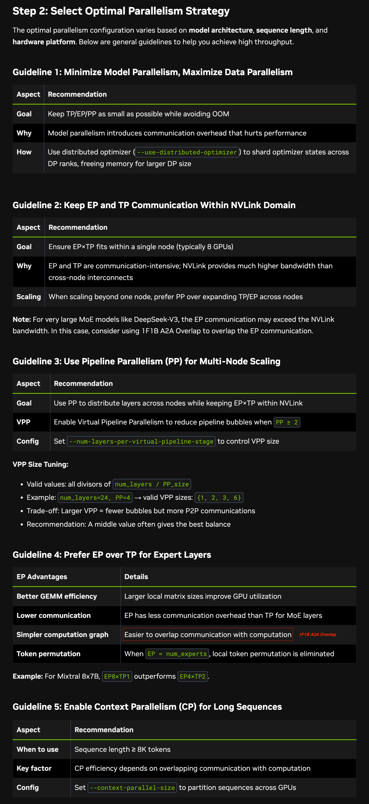
3. Benchmarking of different strategies：
   - 【Source: [here](https://skindhu.github.io/How-To-Scale-Your-Model-CN/article-trans/training.html)】通过解析或测量不同并行策略下每层所需的计算和通信时间，可以绘制图表直观看到不同并行策略的计算-通信时间比值如何随批量大小Scale up；若计算-通信时间比值大于1，则说明理论上通信时间可以被掩盖，表现为Computation bound，否则表现为Communication bound；如果Batch size足够大，仅使用FSDP就能达到Computation bound，但随着Batch size变小，需要通过加入更复杂的模型并行策略以保持Computation bound.
     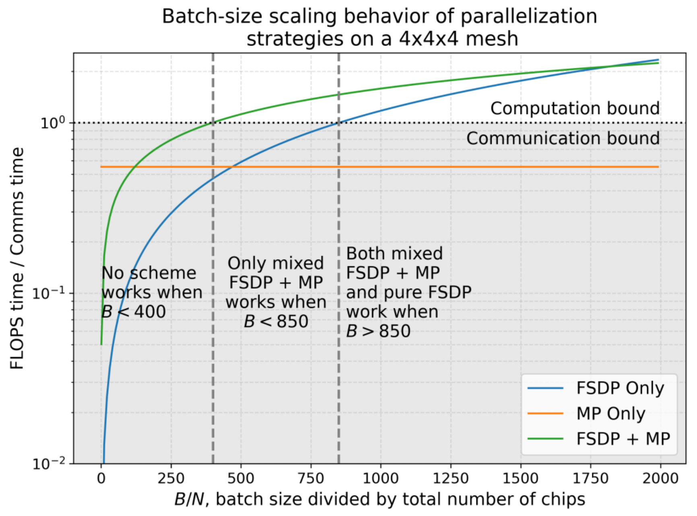
   - 【Source: [here](https://arxiv.org/pdf/2104.04473)】在扩展至3072张GPU的过程中，实现了超线性扩展，这是因为随着模型规模增大（矩阵乘法规模更大），GPU利用率得到提升，而通信时间相对于计算时间并没有显著增加；不同规模的模型都遵循了Common practice的并行策略，即：
     - Tensor parallel first up to 8, then caps out at 8.
     - Pipeline parallel goes up to make the model fit.
     - Data parallel gradually decreases with scale, with the largest model having DP=6.
     
     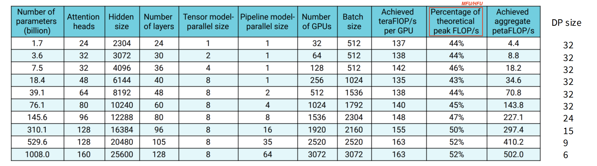

     > 补充：衡量训练Infra系统效率的两个指标MFU和HFU
     > 
     > $$\begin{aligned} \text{Model FLOPs Utilization}&=\frac{\text{模型有效 FLOP/s}}{\text{硬件理论峰值 FLOP/s}} \\ &=\frac{\text{模型必要 FLOPs}}{\text{运行时间}\times\text{GPU 数量}\times\text{单卡理论峰值 FLOP/s}} \\ \text{Hardware FLOPs Utilization}&=\frac{\text{硬件实际执行 FLOP/s}}{\text{硬件理论峰值 FLOP/s}} \\ &=\frac{\text{模型必要 FLOPs}+\text{重计算 FLOPs}}{\text{运行时间}\times\text{GPU 数量}\times\text{单卡理论峰值 FLOP/s}} \end{aligned}$$
   - 【Source: [here](https://arxiv.org/pdf/2104.04473)】这篇论文还有大量实验和图表，例如：
     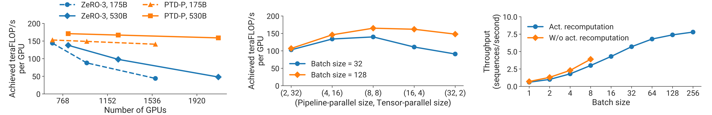
     - 左：合理使用3D并行在扩展时可以保持较好的单卡利用率（线性扩展）；Batch size越大利用率越高.
     - 中：对于PP和TP之间的分配，TP=8一般是最优的；PP流水线需要切分Batch，因此更大的Batch size总是能获得更高的利用率，随着PP并行度增大更大Batch size的优势也越来越大.
     - 右：激活值重计算意味着引入非必要计算，但是能够空出显存，而节省出的显存可以扩大Batch size，获得更高的利用率.

#### What do recent LMs do

| LMs | Strategy | Source |
|---|---|---|
| OLMo-7B | FSDP (probably fits intra-node) | [here](https://arxiv.org/pdf/2402.00838) |
| DeepSeek LLM (dense) | ZeRO-1 & PP & TP+SP | [here](https://arxiv.org/pdf/2401.02954) |
| DeepSeek-V3 (MoE) | ZeRO-1 & PP(16) & EP(64, 8 nodes combine to an EP group, use 1F1B A2A Overlap) | [here](https://arxiv.org/pdf/2412.19437) |
| Yi (dense) | ZeRO-1 & PP & TP | [here](https://arxiv.org/pdf/2403.04652) |
| Yi-Lightning (MoE) | ZeRO-1 & PP & EP | [here](https://arxiv.org/pdf/2412.01253) |
| Llama3 | DP(128) & PP(16) & TP(8) --long context extension-> DP(8) & PP(16) & TP(8) & CP(16) | [here](https://arxiv.org/pdf/2407.21783) |
| Gemma2 (on TPU) | FSDP & TP+SP | [here](https://arxiv.org/pdf/2408.00118) |