> [Stanford CS336, Spring 2026](https://cs336.stanford.edu/): Outline & Key points

## 10_Inference analysis, Basic tricks

### Inference analysis - understanding the inference workload

1. Landscape
   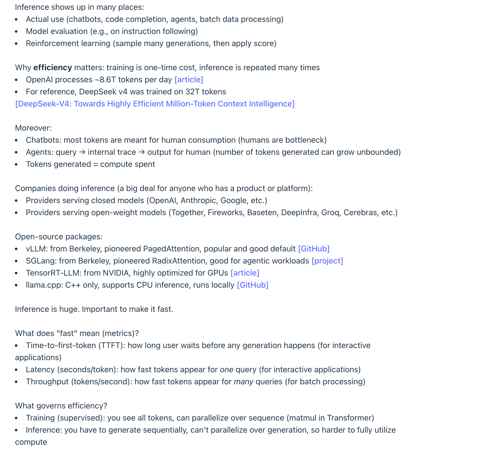
2. Notation
   .png)
   ⬆️ Source: [here](https://jax-ml.github.io/scaling-book/transformers/)
   
   一些默认配置：
   - 不使用GLU：F = 4D；使用GLU：F ≈ 8D/3.
   - D = NH.
   - N = KG.
3. Arithmetic intensity
   - 以`Y = X (B x D) @ W (D x F)`为例，假设使用BF16，并采用理想的分块复用，只统计HBM与SRAM之间的最低数据搬运量：
     - FLOPs：2BDF（BDF次乘，BDF次加）.
     - Bytes：
       - 读X：2BD（2字节）.
       - 读W：2DF.
       - 写Y：2BF.
     - AI = BDF / (BD + DF + BF).
     - With D, F >> B, AI ≈ B.
   - 以H100为例，FLOP/s为989e12，带宽为3.35e12，计算得到Roofline的Ridge point为295.
   - 对于Decode阶段的MLP负载，需要并发处理的请求大于295，才能达到Compute bound.
4. Inference analysis
   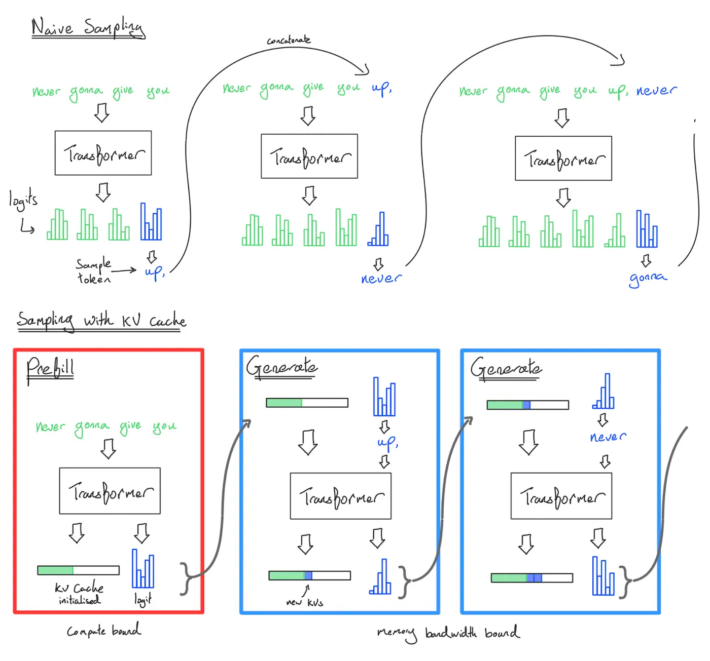
   ⬆️ Source: [here](https://jax-ml.github.io/scaling-book/inference/)
   - KV cache已经是Inference的标准操作，通过在Prefill以及每步Decode时缓存Prompt中或已生成的Token的所有Attention层、每个KV头的K和V向量，避免了每步Decode对前缀的重复计算，总的FLOPs从$O(T^3)$变为$O(T^2)$（这里考虑的是$QK^T$和$PV$，引入KV cache以后Query数量变为1，每步FLOPs从$O(T^2)$变为$O(T)$）.
   - 因此Inference分为两个不同的阶段：
     || 做： | 有： |
     |---|---|---|
     | **Prefill** | 对Prompt中的Token过所有Transformer block，写KV cache，并生成First token | 首轮：T = S；后续：T = S - P（P表示已存在的前缀长度） |
     | **Decode** | 自回归地生成新的Token，并在每一步将当前Token的各层K和V追加到KV cache | T = 1 |
   - Prefill阶段表现为Compute bound，**Decode阶段表现为Memory bound**：
     - **MLP层的算术强度**（假设采用理想的分块复用，只统计HBM与SRAM之间的最低数据搬运量）：
       - 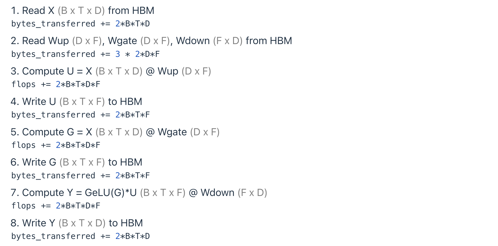
       - AI = 6BTDF / (4BTD + 4BTF + 6DF).
       - With D, F >> BT, AI ≈ BT.
       - ---
       - 😃 Prefill阶段MLP层的计算强度为BT，只要并发请求数和序列长度足够大就能避免Memory bound.
       - 😐 Decode阶段MLP层的计算强度为B，需要足够大的并发请求数以避免Memory bound（至少有机会能避免）.
     - **Attention操作的算术强度**（只考虑Attention操作，QKV projection和Output projection同MLP；假设使用标准MHA；假设采用理想的分块复用，只统计HBM与SRAM之间的最低数据搬运量）：
       - 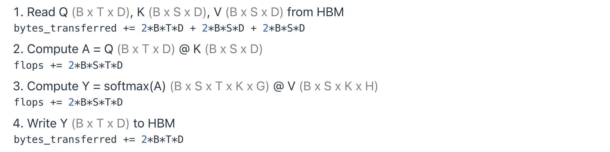
       - AI = 4BSTD / (4BSD + 4BTD) = ST / (S + T).
       - ---
       - 😃 Prefill阶段Attention操作的计算强度为S / 2，只要序列长度足够大就能避免Memory bound.
       - ☹️ Decode阶段Attention操作的计算强度为S / (S + 1) ≈ 1，导致Memory bound.
       - 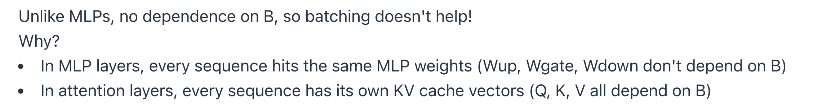
   - Decode阶段的指标是延迟和吞吐；由于Decode阶段表现为Memory bound，假设计算和访存可以重叠，那么每步自回归生成的延迟就等于访存耗时，在固定带宽下正比于访存数据量，而系统吞吐与访存数据量成负相关：
     - 访存数据量：
       $$\begin{aligned} \mathrm{Parameter\ bytes}&=2\times [\overbrace{D\times V\times 2}^{Embedding\&LM\ head}+\overbrace{D\times F\times 3\times L}^{MLP\ layers}+\overbrace{(D\times N\times H\times 2+D\times K\times H\times 2)\times L}^{Attention\ layers}] \\
       \mathrm{KV\ cache\ bytes\ (per\ sequence)}&=2\times S\times K\times H\times 2\times L \\
       \mathrm{Other\ part\ (per\ sequence)}&=2\times T\times D\times c \\
       \mathrm{Memory}&=B\times (\mathrm{KV\ cache\ bytes}+\mathrm{Other\ part})+\mathrm{Parameter\ bytes} \\
       &\approx B\times \mathrm{KV\ cache\ bytes}+\mathrm{Parameter\ bytes} \end{aligned}$$
     - **延迟**：
       $$\mathrm{Latency}=\mathrm{Memory}/\mathrm{Bandwith}$$
     - **吞吐**：
       $$\mathrm{Throughput}=B/\mathrm{Latency}$$
     - 以在H100上推理Llama2-13B为例，相关参数如下：
       $$\boxed{\begin{aligned} L&=40 \\ S&=1024 \\ V&=32000 \\ D&=5120 \\ F&=13824 \\ H&=128 \\ N&=40 \\ K&=40 \\ \mathrm{HBM\ bandwith}&=3.35\times 10^{12} \\ \mathrm{HBM\ capacity}&=80\times 10^{9} \end{aligned}}$$
       计算得到：
       | $B$ | $\mathrm{Memory}=8.39\times 10^{8}B+2.60\times 10^{10}$ | $\mathrm{Latency}=2.50\times 10^{-4}B+7.77\times 10^{-3}$ | $\mathrm{Throughput}=1.28\times 10^{5}B/(32B+993)$ |
       |---:|---:|---:|---:|
       | 1 | 26,869,760,000 | 0.0080 | 124.6755 |
       | 64 | 79,717,990,400 | 0.0238 | 2689.4807 |
       | 256 | 240,779,264,000（OOM） | 0.0719 | 3561.7685 |
       
       批量越大（即并发请求数越多），延迟越差，吞吐越好（但存在上限）；这符合预期，批量增大导致了更大的KV cache，但同时也分摊了模型参数的加载；因此推理时并发请求数的选取存在延迟和吞吐的权衡.
   - Prefill阶段的指标是TTFT；批量越小，TTFT越好（即越快生成首Token）.

> 补充：多卡并行推理
> - 最简单的多卡并行推理其实是一个服务器常识：同时部署M个模型副本，延迟不变，吞吐变为M倍.
> - 更复杂的多卡并行推理针对的是单卡显存不足、推理加速的问题，需要对模型或KV cache进行分片.
> 
> More (worth to read): [Distributing Inference Over Multiple Accelerators](https://jax-ml.github.io/scaling-book/inference/#distributing-inference-over-multiple-accelerators)

### Tricks to speed up inference

> 可以对推理加速的主要方法进行以下分类：
> - 系统层面：多卡并行推理.
> - 模型层面：模型压缩（量化/剪枝/蒸馏）、KV cache优化.
> - Use shortcuts but double check (lossless): Speculative decoding.

<u>**Take shortcuts (lossy)**</u>：

由于Decode阶段表现为Memory bound，因此可以通过减少访存数据量优化推理延迟和吞吐；而模型和KV cache是访存数据量的主要部分，因此优化围绕这两个部分展开：在模型架构层面主动优化KV表示以期在推理时减小KV cache的访存负担，或是通过训练后量化/剪枝/蒸馏减少模型的访存负担（btw推理加速语境下，剪枝和蒸馏强调的是基于原模型训练和适应一个对应的小模型，但它们本身就是一种训练方法了），评价特定方法时既要看推理加速的效果又要看和Baseline相比是否至少具有相当的性能.

1. KV compression
   - GQA（Grouped-query attention）：通过让同组的多个Query head共享一个Key head和Value head，将KV cache的访存数据量减少为原来的K/N，相比MHA可以同时优化延迟和吞吐，此外降低了推理部署的显存需求，且仍然保持了较好的模型表现.
   - MLA（Multi-head latent attention）：
     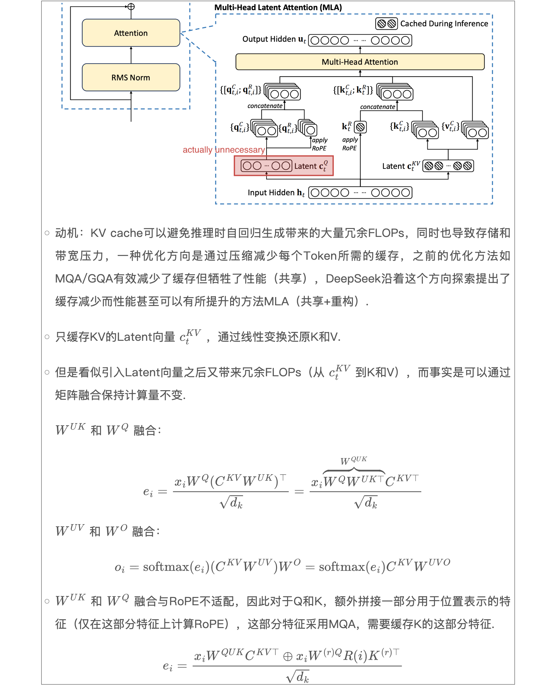
   - CLA（Cross-layer attention）：通过跨层共享KV向量，提升了Validation perplexity和KV cache bytes per token的帕累托前沿.
     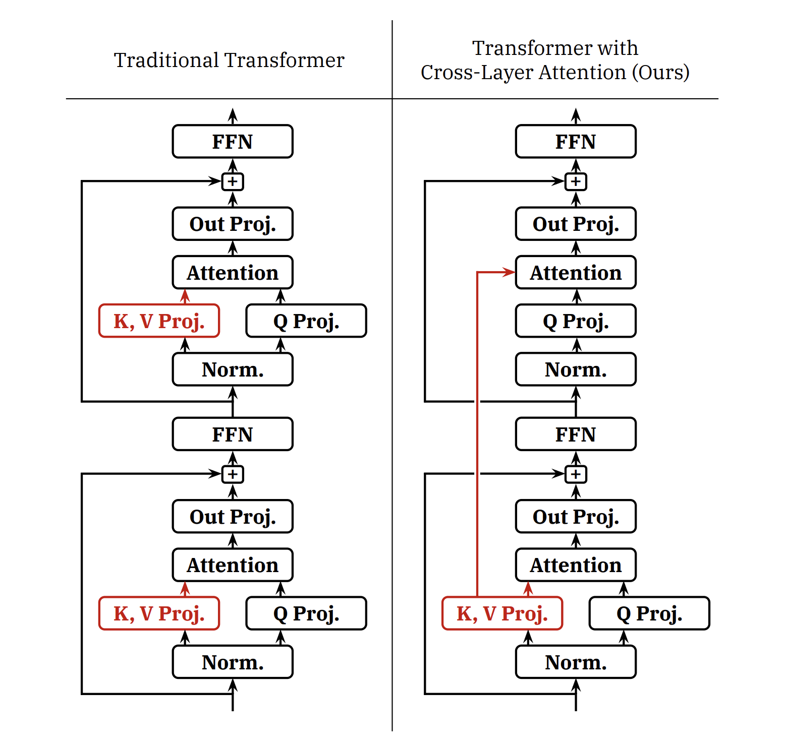

> 补充：训练和推理时的Attention操作（省略了Scale）
> 
> - Parallel training：
>   $$O=\mathrm{Softmax}\left(QK^T+M\right)V\in\mathbb{R}^{L\times d}$$
> - Iterative inference：
>   $$o_t=\sum_{j=1}^{t}\frac{\exp\left(q_t^Tk_j\right)}{\sum_{l=1}^{t}\exp\left(q_t^Tk_l\right)}v_j\in\mathbb{R}^{d}$$

2. Sparse attention：Query不再attend前面的所有KV向量，而是仅attend到预设或通过计算选择的部分KV向量（KV向量可以是Token粒度，也可以是由多个Token压缩得到的块的KV entry），降低Attention操作的计算量和访存量.
   - 静态稀疏注意力：由预先定义的位置规则决定每个Query可以访问哪些KV，例如：
     - SWA（Sliding window attention）：每个Query只attend最近的局部上下文，是一种归纳偏置；单层Sliding window的直接感受野只有窗口范围，但多层堆叠后，有效感受野可以超过一个窗口.
       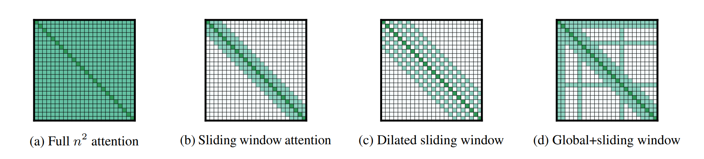
   - 动态稀疏注意力：根据当前Query与历史内容动态选择（先有鸡还是先有蛋问题，想避免attend到全序列，但要想准确知道哪些KV最重要，似乎又要先attend全序列，因此动态稀疏注意力的核心是**如何以远低于完整Attention的成本近似找出Top-k**），例如：
     - 【Paper: [here](https://arxiv.org/pdf/2502.13189)】MoBA（Mixture of Block Attention）：将KV分块，**以块内Key的平均值作为低成本索引**，近似选出Top-k块，再对其中的原始KV执行Attention；Query所在块固定参与计算.
     - 【Paper: [here](https://arxiv.org/pdf/2502.11089)】NSA（Native Sparse Attention）：将KV分块，**以可学习压缩器产生的压缩Key作为低成本索引**，近似选出Top-k块，再对其中的原始KV执行Attention；此外，Compression分支和Sliding分支也分别执行Attention，三条分支的输出通过可学习门控融合.
       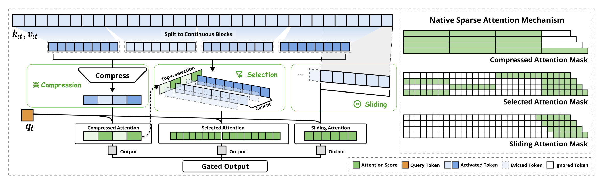
     - 【Paper: [here](https://arxiv.org/pdf/2512.02556)】DSA（DeepSeek Sparse Attention）：**使用独立训练、低维低精度的Lightning Indexer低成本扫描全序列并选择Top-k token**，再由主MLA读取被选中的Latent KV.
       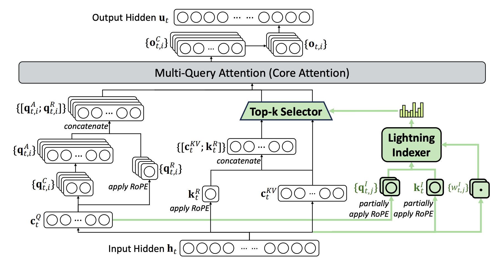
     - 【Paper: [here](https://arxiv.org/pdf/2606.19348)】CSA（Compressed Sparse Attention）&HCA（Heavily Compressed Attention）：DeepSeek-V4混合使用这两种策略；先将多个Token压缩成一个KV entry；CSA再**使用Lightning Indexer选择Top-k entry**，HCA则进行更激进的压缩并对全部压缩entry执行Dense attention；两者都通过Sliding window保留局部细节.
       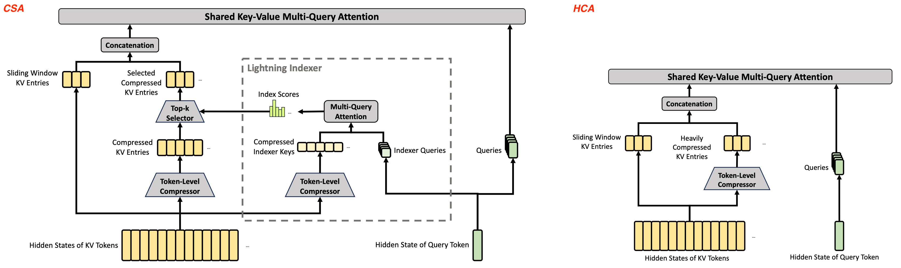
3. Linear attention：不再逐Token保存完整KV，而是把历史表示成固定大小的状态，再让Query从这个状态读取.
   > More: [[FAI] MIT 杨松琳 | 可扩展线性RNN的进展：DeltaNet及其变体](https://www.bilibili.com/video/BV1Pg5JzEEad), [22580: From GPT2 to Kimi3, Explained](https://x.com/waterloo_intern/status/2081762065392541951)
4. Quantization
   > 量化相关的研究可分为两个层次：
   > - 采用什么量化方案能够尽可能保持模型质量：
   >   - 量化时机：PTQ/QAT，静态量化/运行时动态量化.
   >   - 量化对象：权重，激活，KV cache，梯度.
   >   - 范围与粒度：哪些层保留高精度，per-tensor/per-channel/per-group/per-block.
   >   - 误差处理：异常值保护，通道缩放，二阶误差补偿.
   > - 数值映射与执行：
   >   - 数值格式：INT8/FP8/INT4/NF4.
   >   - 映射规则：对称/非对称，均匀/非均匀，舍入与截断策略.
   >   - 映射参数：`scale`，`zero_point`.
   >   - Kernel：如何存储和打包，如何融合反量化，使用何种乘加与累加精度.
   > 
   > More: [5种核心大语言模型量化技术详解](https://apxml.com/zh/posts/llm-quantization-techniques-explained)
   - PTQ（Post-training quantization）：训练->量化->Serve；如果需要同时量化权重和激活，可以分为静态量化和运行时动态量化，静态量化要求使用一个小型数据集确定每层激活值的映射参数.
   - QAT（Quantization-aware training）：训练->量化感知微调->量化->Serve；通过在训练时模拟量化影响，通常能带来更好的量化后表现，但是训练过程引入了额外的复杂性和开销；具体是在前向传播时进行伪量化，在反向传播时梯度直通.
   - 反量化通常与消费量化数据的算子融合：若硬件不能直接计算该格式，Kernel会在片上从HBM读取并解包tile、反量化、计算；若硬件原生支持该低精度格式，则直接低精度计算.
   - 量化必然引入误差，有大量工作研究如何尽量减少量化误差的影响：
     - RTN（Round-to-nearest，作为Baseline）：
       $$\begin{aligned} \text{Quantize:\ \ \ \ }&\boxed{q=\mathrm{clip}\left(\mathrm{round}\left(\frac{x}{s}\right)+z,q_{\min},q_{\max}\right)} \\
       \text{Dequantize:\ \ \ \ }&\boxed{\hat{x}=s(q-z)} \\
       \text{If\ symmetric (}q_{\min}=-q_{\max}\text{):\ \ \ \ }&s=\frac{\max_i|x_i|}{q_{\max}},z=0 \\
       \text{Else:\ \ \ \ }&s=\frac{x_{\max}-x_{\min}}{q_{\max}-q_{\min}},z=\mathrm{clip}\left(\mathrm{round}\left(q_{\min}-\frac{x_{\min}}{s}\right),q_{\min},q_{\max}\right) \end{aligned}$$
       s表示`scale`，z表示`zero_point`.
     - 【Paper: [here](https://arxiv.org/pdf/2210.17323)】GPTQ（Post-training quantization for GPTs）：当某一列权重被量化并产生误差时，利用输入激活的二阶统计量调整其他尚未量化的权重，使它们共同补偿该误差，从而让**量化前后的输出误差**尽可能小.
     - 【Paper: [here](https://arxiv.org/pdf/2306.00978)】AWQ（Activation-aware weight quantization）：
       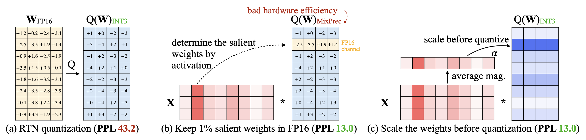
       - 输入激活幅值较大的通道（少数几个隐藏特征维度，0.1-1%）所对应的权重对**量化前后输出误差**的影响通常更大，因此可以通过统计输入激活各通道的幅值来识别并保护重要权重，以减少量化误差.
       - 使用混合精度表示权重（如图中b，重要权重保持高精度，量化其他权重）将导致较低的硬件效率.
       - AWQ通过一个沿输入通道的对角缩放矩阵S，放大重要通道对应的权重，降低它们的相对量化误差（如图中c）：
         $$Y=XW=(XS^{-1})(SW)$$
     - 【Paper: [here](https://arxiv.org/pdf/2306.03078)】SpQR：将大部分权重压缩到极低比特，同时识别少量对量化特别敏感的异常权重，以高精度稀疏形式单独保存.
5. Model pruning
   
   【Involved paper: [here](https://arxiv.org/pdf/2407.14679)】
   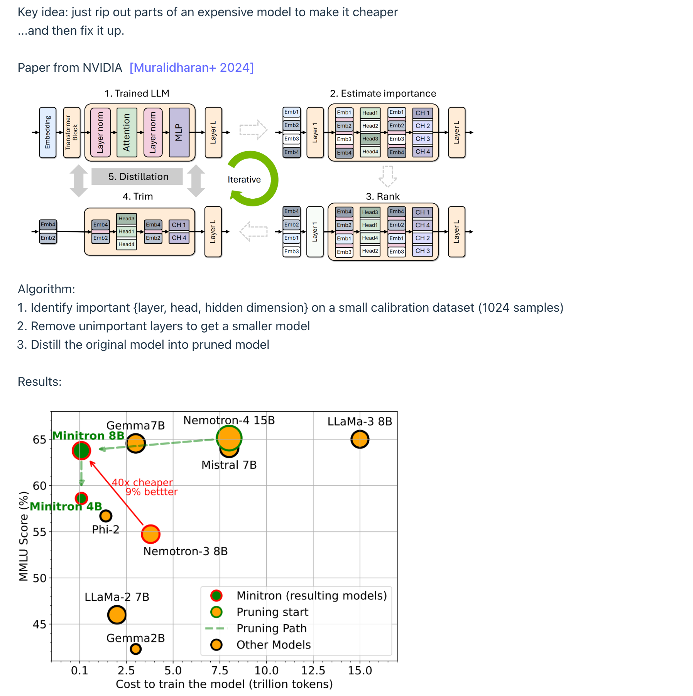
6. Distillation

<u>**Use shortcuts but double check (lossless)**</u>：

【Paper: [1](https://arxiv.org/pdf/2211.17192), [2](https://arxiv.org/pdf/2302.01318)】Speculative decoding
- 分别部署一个主模型和一个轻量的草稿模型，实际推理时每次先由小模型进行若干步的自回归生成，然后主模型并行地对小模型的几步采样进行验证，决定接受或拒绝每步采样，丢弃首个被拒绝采样及其之后采样的结果并重新采样，伪代码如下：
  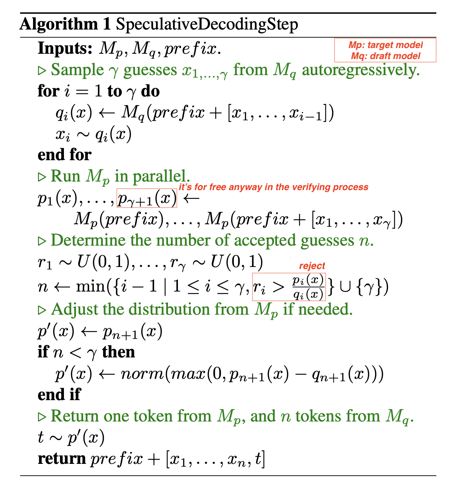
- 证明：
  - 借助一个分布（草稿模型）的采样结果等效采样目标分布（主模型）有多种方法，比如：
    - 重要性采样：使用从q中采样的采样结果来估计p下的期望，**不直接生成服从p的样本**（无偏，但是为降低方差q分布应尽量接近p分布）.
      $$\mathbb{E}_{x\sim p}\left[f(x)\right]=\mathbb{E}_{x\sim q}\left[\frac{p(x)}{q(x)}f(x)\right]$$
    - 拒绝采样：从q中采样并按$\frac{p(x)}{Mq(x)}$的概率（M为足够大常数）接受，只观察被接受的样本，这些样本是严格服从p的样本.
      $$\begin{aligned} P(X=x)&=q(x) \\
      \underline{\text{Construct:}}\ \ P(\mathrm{accept}\mid X=x)&=\frac{p(x)}{Mq(x)} \\
      P(X=x,\mathrm{accept})&=P(X=x)P(\mathrm{accept}\mid X=x) \\
      &=\frac{p(x)}{M} \\
      P(\mathrm{accept})&=\sum_{y}P(X=y)P(\mathrm{accept}\mid X=y) \\
      &=\sum_{y}\frac{p(y)}{M}=\frac{1}{M} \\
      \boxed{P(X=x\mid\mathrm{accept})}&=\frac{P(X=x,\mathrm{accept})}{P(\mathrm{accept})} \\
      &=\boxed{p(x)} \end{aligned}$$
    - Speculative decoding对应的投机采样（继承了拒绝采样的思想，同时**避免寻找常数M**）：将接受概率改为$\min\left(1,\frac{p(x)}{q(x)}\right)$，此外拒绝后再进行一步重采样.
      $$\begin{aligned} P(X=x)&=q(x) \\
      \underline{\text{Construct:}}\ \ P(\mathrm{accept}\mid X=x)&=\min\left(1,\frac{p(x)}{q(x)}\right) \\
      P(X=x,\mathrm{accept})&=P(X=x)P(\mathrm{accept}\mid X=x) \\
      &=\min\left(q(x),p(x)\right) \\
      P(\mathrm{accept})&=\sum_{y}P(X=y)P(\mathrm{accept}\mid X=y) \\
      &=\sum_{y}\min\left(q(y),p(y)\right) \\
      P(\mathrm{reject})&=1-P(\mathrm{accept}) \\
      &=\sum_{y}\left(p(y)-\min(q(y),p(y))\right) \\
      &=\sum_{y}\left[p(y)-q(y)\right]_{+}\text{\ \ (\ }[z]_{+}=\max(0,z),\ \min(a,b)+\max(0,a-b)=a\text{\ )} \\
      \underline{\text{Construct:}}\ \ P(Y=x\mid\mathrm{reject})&=\frac{\left[p(x)-q(x)\right]_{+}}{\sum_{y}\left[p(y)-q(y)\right]_{+}} \\
      P(Y=x,\mathrm{reject})&=P(\mathrm{reject})P(Y=x\mid\mathrm{reject}) \\
      &=\left[p(x)-q(x)\right]_{+} \\
      P(Y=x)&=P(Y=x,\mathrm{accept})+P(Y=x,\mathrm{reject}) \\
      &=\boxed{P(X=x,\mathrm{accept})+P(Y=x,\mathrm{reject})} \\
      &=\min\left(q(x),p(x)\right)+\left[p(x)-q(x)\right]_{+} \\
      &=\boxed{p(x)} \end{aligned}$$
  - Speculative decoding使用投机解码（如伪代码所示），**从草稿模型中采样并被接受**、**从草稿模型中采样并被拒绝然后重采样**两条路径所产生的样本等效于从主模型中采样的采样结果；实际操作时，丢弃首个被拒绝采样及其之后采样的结果，**拒绝位置的Token重采样**（注意不能从主模型中采样，会产生偏差），**拒绝位置之后的Token在下一轮中重新采样**（因为前缀变了，从重采样分布中采样到原先Token的概率为0）.
- 分析：
  - 上面推导过$P(\mathrm{accept})=\sum_{y}\min\left(q(y),p(y)\right)$，将接受概率记为$\alpha$（为简化分析，假设各位置接受事件独立且具有相同接受率），假设每轮草稿长度为$\gamma$，可以推导出每轮产出有效Token数的期望为（过程略，使用尾和公式）：
    $$\mathbb{E}[\mathrm{tokens\ per\ round}]=\frac{1-\alpha^{\gamma+1}}{1-\alpha}$$
  - 假设主模型单次前向传播时间为$T$、草稿模型单次前向传播时间为$t$，可以推导出使用Speculative decoding的加速比为：
    $$\mathrm{speedup}=\frac{\mathbb{E}[\mathrm{tokens\ per\ round}]\times T}{\gamma\times t+T}=\frac{\frac{1-\alpha^{\gamma+1}}{1-\alpha}\times T}{\gamma\times t+T}$$
    理想情况下$\gamma t\ll T$、$\gamma\to\infty$，有：
    $$\mathrm{speedup}=\frac{1}{1-\alpha}$$
  - | $\alpha$ | 理论加速比上限 | 实际典型加速比 |
    |:---:|:---:|:---:|
    | 0.5 | 2.0x | 1.5x |
    | 0.7 | 3.3x | 2.0x |
    | 0.8 | 5.0x | 2.5x |
    | 0.9 | 10.0x | 4.0x |
    
    可以证明$\alpha$等于草稿模型分布和主模型分布的重叠面积，因此应尽可能使用接近主模型分布的草稿模型.
  - Ablation of `number of draft tokens`：
    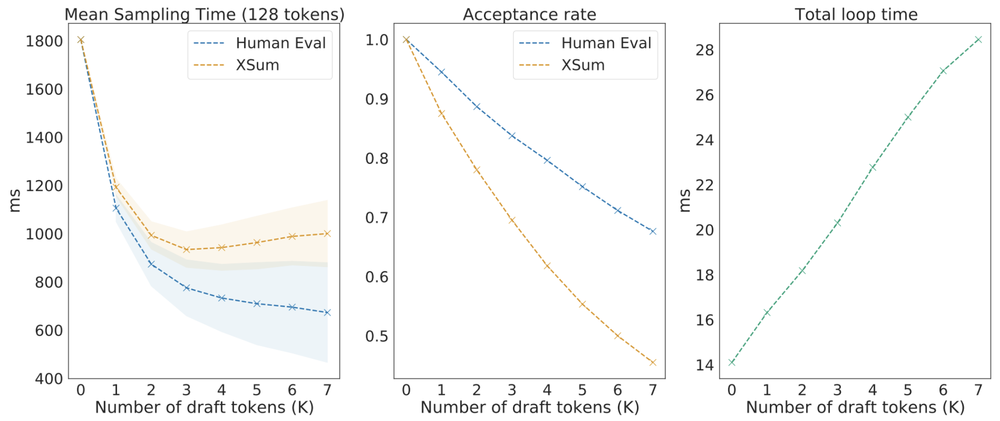
- 草稿模型额外占用了一定的GPU资源，现在有很多工作聚焦于**推理加速表现和草稿模型精简之间的平衡**，主要分为独立模型Proposer、利用目标Hidden states的轻量Proposer（例如EAGLE）、附加模块Proposer（例如MTP、Medusa）、无模型Proposer.
  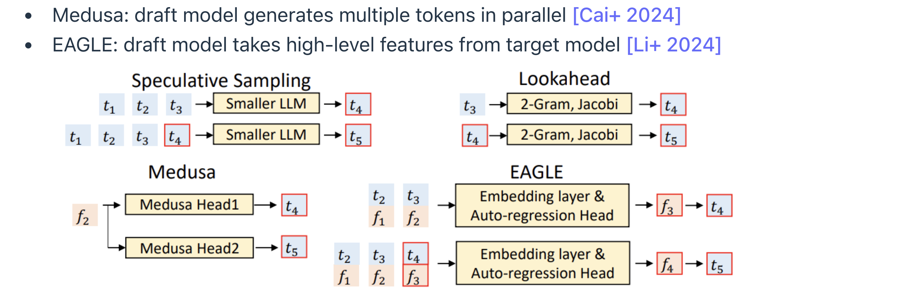

### Engineering tricks to improve utilization & throughput

1. 【Paper: [here](https://arxiv.org/pdf/2309.06180) (vLLM)】Paged attention
   - 动机：如果按照最长序列长度为每个请求分配KV cache显存，将造成显存浪费（预分配，但不会用到；预分配，但尚未用到；显存碎片），降低显存利用率从而影响吞吐.
     
   - 想法：
     - 借鉴操作系统中的虚拟内存，将显存中用于存储KV cache的部分划分为大量等长的细小块，每个请求分别维护对实际存储其KV cache的块的引用及相关元信息（即图中的“箭头”）；每个块的长度远小于最长序列长度，因此避免了显存浪费.
       
     - 每个**物理块**维护一个引用计数元信息，一个物理块可以被多个逻辑块同时引用，不同的逻辑块引用同一个物理块意味着**它们对应的序列中该块及之前所有块内容相同**，引用计数大于1的物理块只读（若请求引用了某个引用数大于1的未填满的物理块并需要在其中追加KV，需采用Copy-on-write，同时对应物理块的引用计数递减），由此可以实现vLLM中的一些有用特性：
       - APC（Automatic Prefix Caching，自动前缀缓存，通过设置`enable_prefix_caching=True`以开启）：对每个已填满的逻辑块，系统根据其所包含的Token ids、前一个逻辑块的哈希值及其他附加信息计算当前逻辑块的哈希值，从而使用哈希表维护从块的含义（块哈希）到块的存储地址（物理块id）的映射；开启APC后，对每个请求的Prompt，可以通过查询哈希表找到已缓存的前缀并复用KV块.
       - 相同前缀采样：对于同一Prompt同时采样多个回答的场景（例如：Beam search解码、Parallel sampling、RL rollout），也可以对共享前缀复用KV块.
         
       - 请求结束后引用计数递减，无引用的块可保留供后续请求复用，显存不足时再淘汰.
   - Paged attention用工程复杂度换取了一种能够更有效利用显存的KV cache管理方案，相比基线其所节省的显存能够支持更多并发请求，从而提升了系统吞吐.
     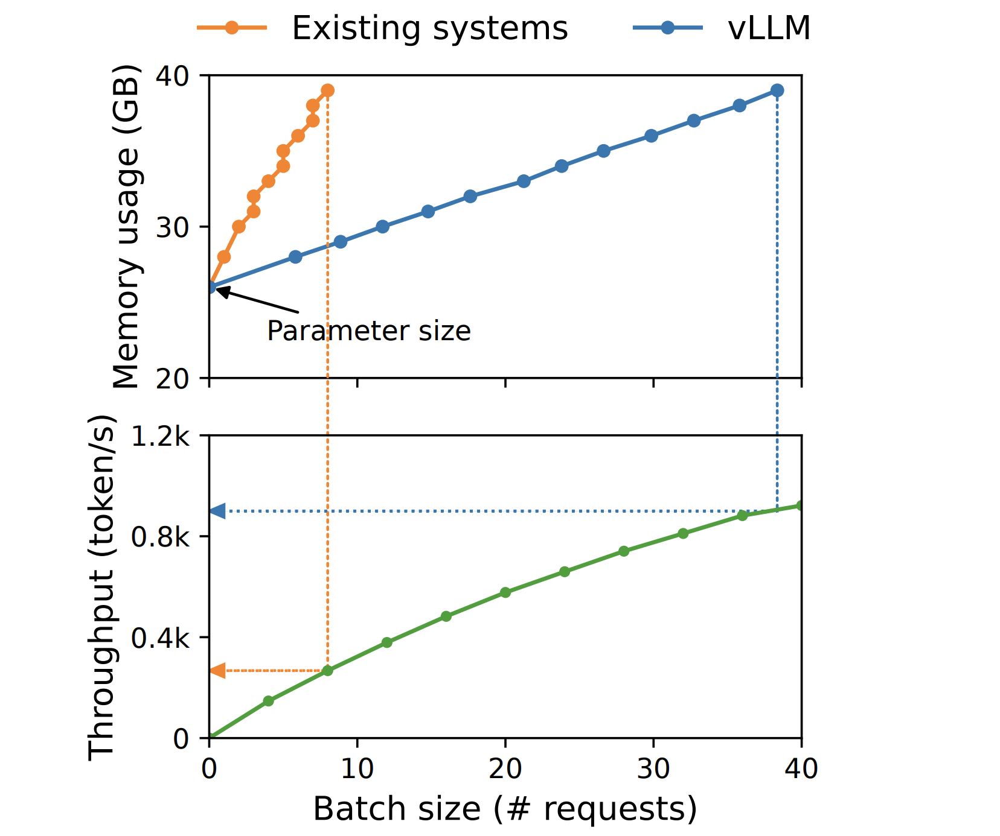
   > 补充：vLLM的其他特性
   > 
   > 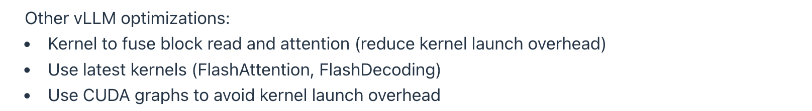
2. 【Paper: [here](https://www.usenix.org/system/files/osdi22-yu.pdf)】Continuous batching & Selective batching
   - 动机：以往推理系统采用Request-level scheduling，即Scheduler每次调度若干请求组成一个推理Batch推入Execution engine，Batch中的所有请求都完成完整推理之后将结果从Execution engine送回Scheduler；这会导致短请求推理完成以后在Execution engine中空转GPU，降低GPU利用率从而影响吞吐，同时增加短请求的端到端延迟.
     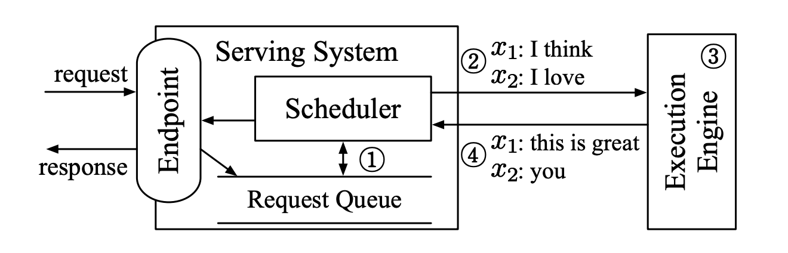
   - 想法：
     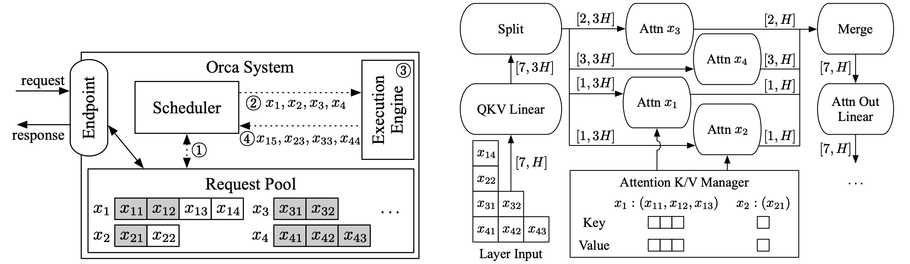
     - 采用Iteration-level scheduling（aka **Continuous batching**），将调度单位由完整序列的生成变为一次前向传播（上图左）；Scheduler每次调度若干请求组成一个推理Batch推入Execution engine，其中可以包含Prefill或Decode负载（**这里其实有很大改进空间**，见“3. Chunked prefill & PD分离”），在Execution engine中对Batch只执行一次前向传播、生成下一个Token.
     - 原论文还提出**Selective batching**的单轮推理过程（上图右）：观察到每个Batch中包含T（Query的序列长度）和S（KV的序列长度）都各异的负载，最简单的想法是Padding到最长序列长度进行批处理，但这非常低效；该方法对于非Attention操作，将B和T拉平到一个维度批量处理，对于Attention操作，对Batch中的每个请求负载启动并行Kernel，更充分地利用计算资源.
   > 补充：原论文给出的调度算法（结合了Pipeline parallel）
   > 
   > 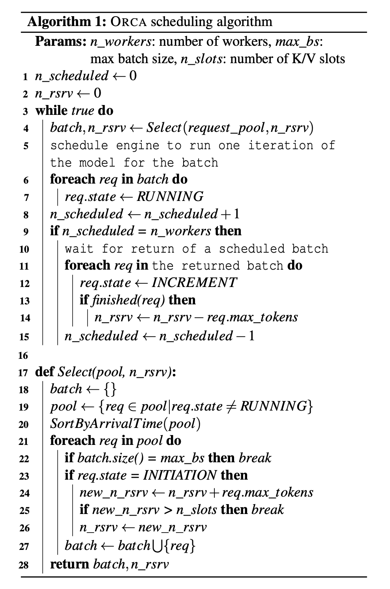
3. Chunked prefill & PD分离：基于Prefill和Decode负载性能瓶颈不同、Prefill优先或Decode优先的各自问题、并行策略的选择逻辑不同、混合导致的流水线气泡等问题，有这两种主要路线.
   > More: [[LLM服务] Chunked Prefills 与 Prefill-Decoding 分离的内在逻辑](https://www.bilibili.com/video/BV1hy94YKEun)